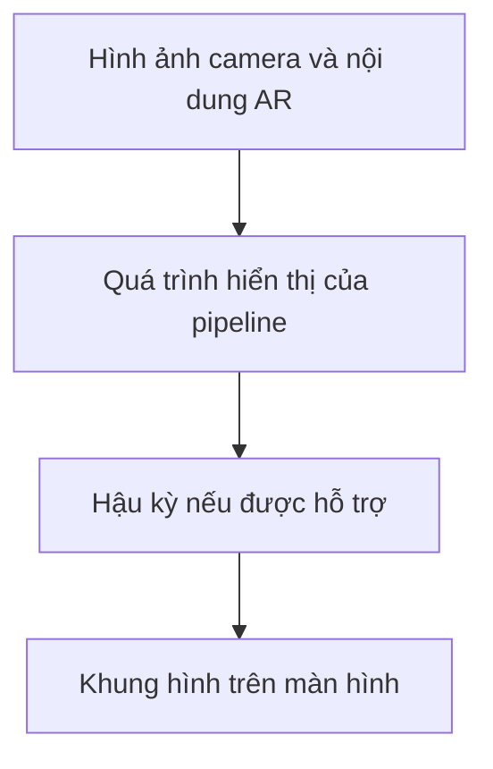

# Bài 06 — Thêm hậu kỳ hình ảnh (Add post-processing to your filter)

> **Lộ trình:** Mobile AR Development · **Chủ đề:** Create a basic face filter · **Môi trường tham chiếu:** Unity 2022.3  
> **Hình thức:** Bài học thực hành về hoàn thiện hình ảnh AR.

## 1. Mục tiêu

Post-processing (hậu kỳ hình ảnh) là bước xử lý diện mạo khung hình sau một phần hoặc toàn bộ quá trình render, tùy pipeline. Trong bộ lọc khuôn mặt, hậu kỳ có thể giúp tạo phong cách màu nhất quán, nhưng cũng dễ gây ảnh hưởng đến màu da hoặc độ sáng của camera nếu dùng quá mạnh.

Bạn sẽ giải thích vị trí của hậu kỳ trong pipeline, thực hiện thử nghiệm bật/tắt một hiệu ứng tương thích với dự án, so sánh trước/sau và đánh giá độ mượt trên thiết bị thật.

## 2. Vị trí của hậu kỳ

Hậu kỳ **không thay thế face tracking**. Nó điều chỉnh hình ảnh được hiển thị chứ không làm hệ thống nhận diện mặt tốt hơn. Cách camera nền được kết hợp với nội dung ảo và phạm vi chịu tác động của hiệu ứng phụ thuộc cấu hình render pipeline.

| Khái niệm | Vai trò cần phân biệt |
| --- | --- |
| Face tracking | Theo dõi vị trí/hướng khuôn mặt |
| Material/Shader | Quy định cách một bề mặt hoặc đối tượng được hiển thị |
| Particle System | Tạo những phần tử hiệu ứng theo thời gian |
| Post-processing | Điều chỉnh diện mạo khung hình qua bước hậu kỳ |

## 3. Chuẩn bị an toàn cho thử nghiệm

1. Sao lưu scene hoặc lưu một bản cấu hình trước khi thay đổi.
2. Xác định dự án dùng pipeline nào và phiên bản package nào; phương thức bật hậu kỳ có thể khác nhau. Ví dụ, một số dự án URP dùng cấu hình volume, nhưng không nên áp nguyên một thao tác URP cho pipeline khác.
3. Tạo hai trường hợp có thể so sánh: **không hậu kỳ** và **có hậu kỳ**.
4. Chọn một hiệu ứng dễ quan sát, mức độ nhẹ và tương thích với dự án (ví dụ một điều chỉnh màu phù hợp nếu có).

## 4. Thực hành từng bước

### 4.1. Thiết lập điểm chuẩn

Chạy bộ lọc đang có texture, phụ kiện hoặc hiệu ứng hạt. Chụp khung hình tham chiếu ở điều kiện ánh sáng ổn định và ghi nhận cảm nhận độ sáng, màu sắc, tốc độ khung hình. Đây là bản A.

### 4.2. Thử hậu kỳ

Kích hoạt hệ thống hậu kỳ **theo render pipeline của dự án**, dùng một hiệu ứng đơn giản và mức vừa phải. Không đoán rằng tất cả các camera AR đều mặc định hỗ trợ mọi lựa chọn hậu kỳ. Kiểm tra camera của scene và cấu hình render thực tế.

### 4.3. So sánh có kiểm soát

Giữ cùng thiết bị, cùng scene và điều kiện ánh sáng gần giống. Chạy bản B; quan sát: phụ kiện có còn rõ không? Màu ảnh camera có bị thay đổi quá mức? Có dấu hiệu tụt FPS? Việc ghi nhận ngay cả khi hiệu ứng không hoạt động cũng có giá trị, vì giúp phát hiện vấn đề tương thích.

### 4.4. Điều chỉnh và kiểm thử lại

Giảm cường độ hiệu ứng nếu ảnh quá gắt; tắt những pass không cần thiết và đo lại. Kiểm tra trên thiết bị thật, vì Game view không phản ánh chính xác mọi con đường render/camera của nền tảng AR.

## 5. Bảng so sánh trước/sau

| Tiêu chí | A: Chưa hậu kỳ | B: Đã hậu kỳ | Nhận xét |
| --- | --- | --- | --- |
| Màu sắc/độ tương phản | Ghi khi test | Ghi khi test | Có phù hợp phong cách? |
| Khả năng đọc chi tiết mặt | Ghi khi test | Ghi khi test | Có mất chi tiết? |
| Phụ kiện/texture | Ghi khi test | Ghi khi test | Có bị đổi màu bất thường? |
| Độ mượt/FPS | Ghi khi test | Ghi khi test | Có chi phí bổ sung? |
| Tương thích camera AR | Ghi khi test | Ghi khi test | Hiệu ứng tác động tới phần nào? |

## 6. Khắc phục sự cố

- **Bật mà không thấy khác biệt:** kiểm tra pipeline, volume/layer/camera nếu dự án dùng những thành phần này và trạng thái kích hoạt hiệu ứng.
- **Hình ảnh camera/đối tượng không đồng nhất:** kiểm tra cách ghép camera feed và nội dung ảo trong pipeline.
- **Tông màu quá gắt:** giảm cường độ và so sánh ở nhiều điều kiện ánh sáng.
- **Chạy chậm:** tắt từng hiệu ứng, đánh giá frame time rồi chỉ giữ phần cần thiết.
- **Editor đúng, điện thoại sai:** kiểm tra lại gói render, build target và khả năng hỗ trợ trên thiết bị.

## 7. Checklist

- [ ] Xác định được pipeline đang sử dụng.
- [ ] Có ảnh/video điểm chuẩn không hậu kỳ.
- [ ] Thử một thay đổi hậu kỳ có thể bật/tắt.
- [ ] So sánh chất lượng hình ảnh trên thiết bị thật.
- [ ] Ghi nhận tác động tới hiệu năng và tương thích AR.

## 8. Câu hỏi ôn tập

**Câu 1.** Mục đích chính của hậu kỳ trong face filter là gì?  
A. Thay thế hệ thống nhận diện khuôn mặt.  
B. Gắn kính vào face trackable.  
C. Quản lý AR Session.  
D. Tinh chỉnh diện mạo hình ảnh sau/quanh giai đoạn render.  
**Đáp án: D.** Hậu kỳ tác động đến hình ảnh, không trực tiếp đảm nhận tracking.

**Câu 2.** Vì sao cần xác định render pipeline trước khi cấu hình hậu kỳ?  
A. Cơ chế và khả năng hỗ trợ hậu kỳ có thể khác nhau.  
B. Mọi pipeline tự động bật cùng shader.  
C. Pipeline quyết định tên người dùng.  
D. Hậu kỳ chỉ chạy trên web.  
**Đáp án: A.** Tùy pipeline, các thành phần cấu hình và hỗ trợ có thể khác.

**Câu 3.** Cách kiểm thử nào cho kết luận đáng tin cậy nhất?  
A. So hai ảnh chụp ở hai điều kiện hoàn toàn khác.  
B. Thêm nhiều hiệu ứng cùng lúc.  
C. So sánh bật/tắt trong điều kiện gần như giống nhau, đo hiệu năng.  
D. Chỉ thử trong Project view.  
**Đáp án: C.** Kiểm thử có đối chứng giúp đánh giá tác động thật sự.

**Câu 4.** Hiệu ứng làm màu da quá gắt. Cách xử lý hợp lý nhất là gì?  
A. Xóa face tracking.  
B. Giảm cường độ hiệu ứng và so sánh lại.  
C. Tăng số particle.  
D. Đổi tên scene.  
**Đáp án: B.** Vấn đề liên quan đến xử lý hình ảnh, nên điều chỉnh hậu kỳ.

**Câu 5.** Tại sao phải kiểm tra trên điện thoại?  
A. Điện thoại luôn có GPU mạnh hơn máy tính.  
B. Vì không cần quyền camera.  
C. Vì mọi shader chỉ chạy được trên iOS.  
D. Con đường xử lý camera và hiệu năng AR có thể khác Editor.  
**Đáp án: D.** Thiết bị thật là môi trường kiểm chứng cuối cùng.

## 9. Tổng kết

Hậu kỳ chỉ có ích nếu **cải thiện trải nghiệm nhìn mà không che lấp khuôn mặt, phá tính nhất quán hoặc làm máy chạy chậm đáng kể**. Bắt đầu từ một hiệu ứng nhẹ, đo trước/sau và giữ lại khi nó thực sự đem lại giá trị.

---

*Bài học độc lập được biên soạn lại bằng tiếng Việt từ đề cương thực hành. Để đối chiếu lộ trình và tài nguyên chính thức, xem [Unity Learn — Create a basic face filter](https://learn.unity.com/pathway/mobile-ar-development/unit/create-a-basic-face-filter-tutorials?version=2022.3). Nội dung này không phải bản chép hay bản dịch chính thức của Unity.*
