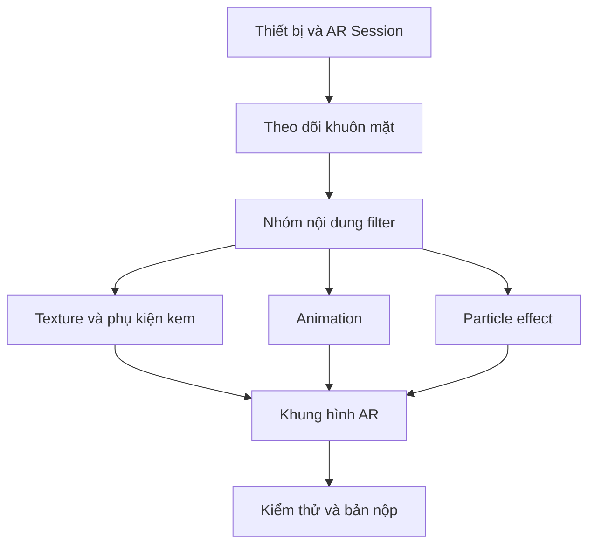

# Bài 07 — Bài nộp: Bộ lọc cho thương hiệu kem (Submission: Ice cream company filter)

> **Lộ trình:** Mobile AR Development · **Chủ đề:** Create a basic face filter · **Môi trường tham chiếu:** Unity 2022.3  
> **Loại:** Bài thực hành đánh giá. Đây là đề bài triển khai độc lập và tiêu chí tự đánh giá; không phải mô tả nguyên văn tiêu chí nộp của Unity.

## 1. Bài toán và mục tiêu sản phẩm

Một thương hiệu kem muốn có bộ lọc AR để người dùng chụp ảnh/video vui nhộn. Sản phẩm phải nhận diện được khuôn mặt và thể hiện một phong cách liên quan đến kem; đồng thời cần chạy đủ ổn định trên thiết bị hỗ trợ face tracking.

**Nhiệm vụ:** xây dựng một filter nhỏ mang chủ đề kem, tận dụng các kỹ năng: thiết lập tracking, texture, phụ kiện, animation, particle effect và hậu kỳ (nếu tương thích). Filter cần có **ít nhất một thao tác hoặc sự kiện tương tác** dẫn đến **một phản hồi quan sát được**. Không bắt buộc sử dụng tất cả hiệu ứng nếu chúng làm sản phẩm kém ổn định.

## 2. Yêu cầu chức năng và phi chức năng

| Nhóm | Yêu cầu cần chứng minh |
| --- | --- |
| Tracking | Nội dung chính bám theo khuôn mặt ở nhiều góc nhìn |
| Thẩm mỹ | Màu sắc/phụ kiện làm người xem nhận ra chủ đề kem |
| Tương tác | Có một hành động hoặc sự kiện gây ra thay đổi nhìn thấy được |
| Trạng thái | Xử lý hợp lý khi mặt xuất hiện, biến mất hoặc tracking kém |
| Kiểm thử | Có bằng chứng chạy trên thiết bị thực tế tương thích |
| Hiệu năng | Có quan sát về FPS/độ mượt và một quyết định tối ưu nếu cần |

**Gợi ý thiết kế không bắt buộc:** một chiếc mũ hình cây kem và hiệu ứng rắc cốm xuất hiện trong một sự kiện. Hãy tự chọn cách kích hoạt phù hợp khả năng của dự án, không giả định hệ thống AR tự hỗ trợ mọi cử chỉ khuôn mặt.

## 3. Phác thảo cấu trúc sản phẩm

Hậu kỳ, nếu dùng, thuộc bước hoàn thiện hình ảnh sau cùng và phải được kiểm tra cùng camera AR.

## 4. Các giai đoạn triển khai

### 4.1. Giai đoạn 1 — Chốt ý tưởng và khả năng thiết bị

Viết một đoạn ngắn mô tả đối tượng sử dụng, hình ảnh chủ đạo và phản hồi tương tác. Kiểm tra thiết bị hỗ trợ face tracking, quyền camera và môi trường build. Tạo scene sạch để dễ debug.

**Điểm kiểm tra:** có một mô tả sản phẩm ngắn và thiết bị đích được xác nhận.

### 4.2. Giai đoạn 2 — Bản tối thiểu có tracking

Tạo một vật thể đại diện nằm đúng trên/đi theo khuôn mặt. Chạy trên điện thoại. **Chưa thêm hiệu ứng phức tạp nếu tracking còn lỗi.**

**Điểm kiểm tra:** vật thể theo khuôn mặt khi nhìn thẳng, quay trái/phải và khi nghiêng đầu.

### 4.3. Giai đoạn 3 — Nhận diện thương hiệu và sự kiện

Thêm texture hoặc phụ kiện chủ đề kem. Bổ sung một phản hồi có thể quan sát được, chẳng hạn animation của một chi tiết hoặc burst hạt sau sự kiện bạn đã chọn. Mỗi phần thêm mới cần được test riêng để xác định nguyên nhân nếu xảy ra lỗi.

**Điểm kiểm tra:** có bằng chứng rõ ràng về trạng thái trước và sau tương tác/sự kiện.

### 4.4. Giai đoạn 4 — Tinh chỉnh và tối ưu

Kiểm tra vật liệu, căn chỉnh phụ kiện, animation, particle, hậu kỳ nếu có. Giảm những yếu tố làm giảm độ ổn định. Thử ở các điều kiện ánh sáng, khoảng cách và góc mặt khác nhau.

**Điểm kiểm tra:** người kiểm thử độc lập có thể tái hiện trải nghiệm và nhận thấy kết quả tương tác.

## 5. Kịch bản kiểm thử bắt buộc

| Mã | Hành động | Kết quả mong đợi |
| --- | --- | --- |
| T01 | Khởi động với quyền camera hợp lệ | Phiên AR vào trạng thái sử dụng được nếu thiết bị hỗ trợ |
| T02 | Đưa một khuôn mặt vào khung hình | Filter xuất hiện và bám đúng mặt |
| T03 | Quay/cúi/ngẩng đầu | Phụ kiện vẫn ở vị trí tương đối phù hợp |
| T04 | Kích hoạt sự kiện tương tác đã chọn | Có phản hồi hình ảnh quan sát được |
| T05 | Rời khuôn mặt khỏi khung hình | Không còn hiện tượng vật thể trôi nổi không chủ đích |
| T06 | Thử trong ánh sáng khác nhau | Ghi nhận độ ổn định và lỗi gặp phải |
| T07 | Chạy đủ lâu để quan sát độ mượt | Ghi nhận FPS/frame time nếu có công cụ đo |

Không cần tự đưa ra một mức FPS tối thiểu tùy ý nếu đề bài không quy định; cần mô tả kết quả đo và quyết định của mình.

## 6. Sản phẩm cần nộp

- [ ] Project/scene Unity hoặc bản build có thể tái hiện trải nghiệm.
- [ ] Ảnh hoặc video cho trường hợp thành công, có thể thấy filter theo mặt.
- [ ] Video/ảnh thể hiện tương tác hoặc sự kiện và phản hồi.
- [ ] Mô tả hướng dẫn chạy: thiết bị, phần mềm, thao tác kích hoạt.
- [ ] Báo cáo tối thiểu một trường hợp lỗi, cách tái hiện và cách xử lý.
- [ ] Nêu ít nhất một cải tiến sau lần thử đầu tiên.

## 7. Thang tự đánh giá gợi ý

| Hạng mục | Trọng số gợi ý |
| --- | ---: |
| Tracking và vị trí phụ kiện | 30% |
| Chủ đề/thiết kế trực quan | 20% |
| Tương tác hoặc phản hồi rõ ràng | 20% |
| Kiểm thử, giải thích lỗi | 20% |
| Hồ sơ/bằng chứng nộp | 10% |

Các trọng số là **đề xuất để tự kiểm tra tiến độ**, không phải rubric chính thức của khóa Unity Learn.

## 8. Câu hỏi tự đánh giá

1. **Tại sao filter phải được kiểm tra khi quay đầu?** Vì căn chỉnh đúng khi nhìn thẳng chưa chứng minh transform theo mặt hoạt động tốt ở nhiều hướng.
2. **Vì sao cần có trạng thái mất tracking?** Vì khuôn mặt có thể rời camera hoặc không được hệ thống theo dõi ổn định.
3. **Thế nào là một tương tác có thể kiểm chứng?** Có điều kiện kích hoạt xác định, hành động thực hiện được và phản hồi quan sát được.
4. **Khi thêm particle làm ứng dụng chậm, cần làm gì?** Giảm tải hạt/material và đo lại trên thiết bị.
5. **Minh chứng tốt khác với ảnh đẹp đơn thuần ở đâu?** Nó cho thấy chức năng, điều kiện test và kết quả thực tế có thể tái hiện.

## 9. Tiêu chí hoàn thành

Sản phẩm được xem là hoàn thành trong phạm vi bài thực hành này khi: **(1)** chạy trên thiết bị mục tiêu có hỗ trợ; **(2)** hiệu ứng bám theo mặt; **(3)** có một phản hồi tương tác/sự kiện; **(4)** có bằng chứng chạy và báo cáo ít nhất một lỗi/cải tiến. Nên ưu tiên bản nhỏ, kiểm chứng được trước khi mở rộng thiết kế.

---

*Bài học độc lập được biên soạn lại bằng tiếng Việt từ đề cương thực hành. Để đối chiếu lộ trình và tài nguyên chính thức, xem [Unity Learn — Create a basic face filter](https://learn.unity.com/pathway/mobile-ar-development/unit/create-a-basic-face-filter-tutorials?version=2022.3). Nội dung này không phải bản chép hay bản dịch chính thức của Unity.*
