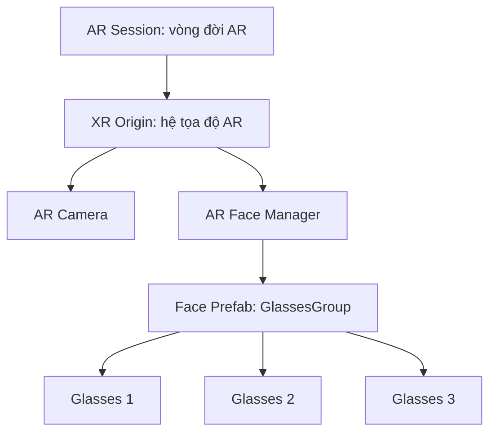

# Bài 01 — Dựng scene AR với ba mẫu kính

> **Khóa:** Mobile AR Development · **Chủ đề:** Create an interactive face filter · **Unity:** 2022.3
> **Tham khảo:** [Unity Learn — Create an interactive face filter](https://learn.unity.com/course/create-with-ar-face-filters/unit/interactive-face-filter?version=2022.3). Bài viết là học liệu tiếng Việt tự biên soạn để thực hành, không thay thế hướng dẫn chính thức.

## 1. Tổng quan

Một bộ lọc kính AR (Augmented Reality) phải đặt mô hình 3D lên khuôn mặt, đồng thời cập nhật vị trí khi người dùng quay hoặc nghiêng đầu. Bài thực hành xây dựng một scene mới, nhập mô hình kính và cấu hình `AR Face Manager` để mỗi khuôn mặt được theo dõi có một nhóm kính gắn kèm. Ở giai đoạn đầu, chỉ cần kiểm chứng kính bám đúng khuôn mặt; logic chọn kính sẽ được cấu hình riêng.

**Đầu ra:** scene `InteractiveFaceFilter` có `AR Session`, `XR Origin`, camera AR và prefab `GlassesGroup` chứa ba mẫu kính.

## 2. Mục tiêu học tập

- Giải thích vai trò của `AR Session`, `XR Origin`, `AR Face Manager` và `Face Prefab`.
- Tạo và tổ chức `GlassesGroup` để có thể thay thế các kiểu kính độc lập.
- Build ứng dụng lên một thiết bị hỗ trợ face tracking, xác minh kính chuyển động theo khuôn mặt.

## 3. Chuẩn bị

Sử dụng Unity 2022.3 với môi trường AR Foundation đã cấu hình; cài provider tương ứng (ARCore XR Plugin trên Android hoặc ARKit XR Plugin trên iOS), quyền camera và cấu hình build hợp lệ. Nếu dùng gói học liệu của khóa, nhập các tài nguyên tương tác cho face filter; tên và vị trí asset có thể khác nếu bạn tự tạo dự án. Face tracking phải được xác minh trên **thiết bị thật**: chỉ chạy Play mode trong Editor không chứng minh được chức năng nhận diện khuôn mặt.

## 4. Cấu trúc scene và nguyên lý

`AR Face Manager` nhận pose của khuôn mặt từ ARCore/ARKit, sau đó tạo đối tượng dựa trên `Face Prefab`. Ba mẫu kính nên là các con riêng biệt để sau này bật/tắt `Mesh Renderer` cho từng mẫu. Khi làm việc trong Editor, có thể để một bản `GlassesGroup` ở scene để căn chỉnh; bản thực sự được dùng khi tracking cần xuất phát từ prefab được gán cho manager.

## 5. Thực hành

1. Lưu scene mới với tên dễ nhận biết, ví dụ `InteractiveFaceFilter`. Giữ các đối tượng AR nền tảng từ scene mẫu đã chạy được.
2. Mở cấu hình **Build Settings**: chọn nền tảng mục tiêu, thêm scene đang mở vào danh sách scene build và kiểm tra XR Plug-in Management.
3. Nhập bộ asset kính 3D. Trong `Project`, kiểm tra từng prefab/model có `Mesh Renderer`, material và kích thước phù hợp.
4. Tạo `GlassesGroup` làm GameObject cha; đưa ba mẫu kính vào dưới nó và đặt tên rõ ràng. Căn vị trí, hướng và tỉ lệ tương đối với tâm mặt. Không giả định `position = (0,0,0)` là vị trí sống mũi; pose tracking thường đặt ở tâm đầu.
5. Thêm `AR Face Manager` ở đối tượng quản lý AR phù hợp. Kéo prefab đã lưu của `GlassesGroup` vào trường `Face Prefab` (tên trường có thể khác theo phiên bản component).
6. Cài camera AR theo chế độ phù hợp cho face tracking, đảm bảo quyền camera. Tắt các AR manager xung đột nếu provider không hỗ trợ đồng thời.
7. Build và chạy trên thiết bị; nhìn thẳng, quay đầu trái/phải, cúi/ngẩng và quan sát kính bám mặt.

**Checkpoint:** có đủ ba model trong `GlassesGroup`; nhìn trong Inspector thấy tham chiếu `Face Prefab`; ứng dụng bắt được một khuôn mặt trên thiết bị tương thích.

## 6. Kiểm thử và xử lý lỗi

| Hiện tượng | Kiểm tra |
|---|---|
| Camera chỉ hiện nền đen | Quyền camera, AR Session, XR plugin và tính tương thích thiết bị |
| Có camera nhưng không hiện kính | `AR Face Manager`, prefab và trạng thái `Mesh Renderer` |
| Kính quá to, quay lệch hoặc xuyên mặt | Local Position/Rotation/Scale của model dưới `GlassesGroup` |
| Editor hiện kính nhưng điện thoại không có | Có thể bạn mới chỉnh bản mẫu trong scene, chưa cập nhật prefab/Face Prefab |

Không chỉnh đồng thời nhiều tham số: sửa một thay đổi, build lại và ghi nhận hiệu quả.

## 7. Bài tập củng cố

Dùng ba kiểu kính khác nhau và lập bảng kiểm thử trên thiết bị với các tư thế: nhìn thẳng, quay 30 độ, nghiêng đầu và mất tracking. Lưu ít nhất một ảnh minh chứng khi kính nằm đúng trên mặt.

## 8. Checklist

- [ ] Scene có AR Session, XR Origin và camera hoạt động.
- [ ] `GlassesGroup` chứa ba mẫu kính có tên phân biệt.
- [ ] Face prefab đã được gán cho `AR Face Manager`.
- [ ] Build trên điện thoại có tracking khuôn mặt.
- [ ] Đã lưu scene và prefab sau khi căn chỉnh.

## 9. Câu hỏi trắc nghiệm ôn tập

### Câu 1

Thành phần nào tạo và cập nhật đối tượng theo khuôn mặt nhận diện?

A. AR Face Manager  
B. Canvas  
C. Canvas Scaler  
D. PlayerPrefs

**Đáp án: A.** AR Face Manager quản lý các đối tượng khuôn mặt được theo dõi.

### Câu 2

Vì sao cần dùng thiết bị thật để nghiệm thu face tracking?

A. Editor luôn có camera AR thật  
B. Face tracking phụ thuộc provider và phần cứng thiết bị  
C. Mọi prefab chỉ chạy trên iOS  
D. UI không chạy trong Editor

**Đáp án: B.** Thiết bị thật mới xác minh chuỗi camera, provider và tracking.

### Câu 3

Ba mẫu kính nên được tổ chức thế nào?

A. Ba scene độc lập  
B. Một texture duy nhất  
C. Ba GameObject con của GlassesGroup  
D. Ba Canvas riêng

**Đáp án: C.** Các đối tượng con có thể được bật/tắt độc lập.

### Câu 4

Khi kính lệch khỏi sống mũi, nên kiểm tra gì đầu tiên?

A. Số lượng nút UI  
B. Âm thanh  
C. Tên scene  
D. Local Transform của kính

**Đáp án: D.** Vị trí, hướng và tỉ lệ tương đối với pose khuôn mặt chi phối độ khớp.

### Câu 5

Có kính trong Editor nhưng không có trên điện thoại: cách kiểm tra hợp lý?

A. Kiểm tra Face Prefab và provider AR  
B. Xóa toàn bộ material  
C. Tăng âm lượng thiết bị  
D. Chỉ đổi màu Canvas

**Đáp án: A.** Thiết lập prefab và hỗ trợ AR là điểm kiểm tra trực tiếp nhất.

---

**Đọc thêm:** [Unity Learn — Create with AR: Face Filters](https://learn.unity.com/course/create-with-ar-face-filters/unit/interactive-face-filter?version=2022.3).
