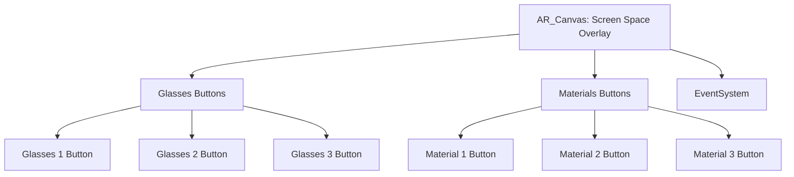

# Bài 02 — Thiết kế giao diện chọn kính và màu sắc

> **Khóa:** Mobile AR Development · **Chủ đề:** Create an interactive face filter · **Unity:** 2022.3
> **Tham khảo:** [Unity Learn — Create an interactive face filter](https://learn.unity.com/course/create-with-ar-face-filters/unit/interactive-face-filter?version=2022.3). Bài viết là học liệu tiếng Việt tự biên soạn để thực hành, không thay thế hướng dẫn chính thức.

## 1. Bài toán giao diện

Bộ lọc tương tác có **hai hàng nút**: một hàng chọn một trong ba kiểu kính, một hàng chọn màu/material cho kính đang hiện. Giao diện phải hiển thị trên hình camera mà không che phần quan trọng của khuôn mặt. Trong Unity 2022.3, ví dụ này dùng hệ **Unity UI (uGUI)** với `Canvas`, `Button`, `Image`, `Rect Transform` và `EventSystem`.

## 2. Mục tiêu

- Phân biệt giao diện `Screen Space - Overlay` với đối tượng 3D trong scene.
- Gán icon cho ba nút chọn kính và màu cho ba nút chọn material.
- Kiểm tra nút vẫn nhìn thấy và bấm được ở nhiều tỉ lệ màn hình.

## 3. Kiến thức cốt lõi

| Thành phần | Công dụng |
|---|---|
| `AR_Canvas` | Prefab chứa giao diện lớp phủ của bộ lọc |
| `Glasses Buttons` | Nhóm ba nút chọn kiểu kính |
| `Materials Buttons` | Nhóm ba nút chọn màu |
| `EventSystem` | Điều phối sự kiện nhấp/chạm của UI |
| `Image > Source Image` | Hình biểu tượng của từng nút |
| `Rect Transform` | Neo và bố cục UI theo màn hình |
| `Canvas Scaler` | Quy đổi kích thước UI giữa nhiều độ phân giải |

Dữ liệu icon và màu chỉ biểu diễn lựa chọn; **chưa tự thay đổi mô hình** cho đến khi chúng ta nối các nút với Visual Scripting.

## 4. Thực hành từng bước

1. Trong `Assets/_InteractiveFaceFilter/Prefabs`, kéo `AR_Canvas` vào Hierarchy. Nếu không dùng asset mẫu, tự tạo Canvas ở chế độ `Screen Space - Overlay`, kèm hai nhóm nút và `EventSystem`.
2. Mở `Game` view; bật tạm `GlassesGroup` của scene để xem kính nằm ở vị trí nào. Ghi nhớ phải tắt đối tượng xem trước nếu thiết kế dùng AR manager sinh prefab khi chạy.
3. Mở rộng `AR_Canvas > Glasses Buttons`. Chọn `Glasses 1 Button` và tìm `Image > Source Image` trong Inspector.
4. Trong thư mục Sprites, mở sprite sheet `UI_Icon_Glasses`, chọn biểu tượng tương ứng mẫu thứ nhất; gán vào `Source Image`. Lặp lại cho nút 2 và 3.
5. Mở `AR_Canvas > Materials Buttons`. Chọn `Material 1 Button` và đặt `Image > Color` thành màu mong muốn; lặp lại với hai nút còn lại.
6. Kiểm tra các `Rect Transform`: hai hàng nút dễ phân biệt, khoảng chạm đủ lớn, không nằm ngoài mép thiết bị. Chỉnh anchors và `Canvas Scaler` khi cần.
7. Lưu scene; kiểm thử bằng chuột trong `Game` view và chạm trên điện thoại.

**Lưu ý:** Icon từ sprite sheet có thể cần được import kiểu `Sprite (2D and UI)` và slice sẵn. Nếu sử dụng icon tự tạo, không làm xê dịch bố cục atlas đã được thiết lập để cắt sprite.

## 5. Tình huống thực tế

Một giao diện thử kính nên có ba icon kiểu kính ở đáy màn hình và ba nút màu ở hàng phía trên. Người dùng nhìn camera để thấy gương mặt; nhấp nút để thay lựa chọn. Nếu các nút đè lên mắt, di chuyển cả nhóm bằng `Rect Transform` thay vì chỉnh từng nút một cách rời rạc.

## 6. Lỗi thường gặp

| Vấn đề | Nguyên nhân thường gặp | Cách sửa |
|---|---|---|
| Nhấn nút không nhận | Thiếu `EventSystem` hoặc Button không `Interactable` | Kiểm tra EventSystem và Button |
| Không thấy icon | `Source Image` chưa gán/sprite nhập sai | Chọn sprite đúng |
| Nút lệch khi đổi độ phân giải | Anchor hoặc Canvas Scaler không phù hợp | Kiểm tra trên Game view nhiều tỷ lệ |
| Thấy giao diện nhưng chưa đổi kính | UI chưa được nối logic | Thực hiện đồ thị Visual Scripting |

## 7. Bài tập

Tạo hai bố cục UI (hàng nút dưới và trên). So sánh khả năng nhìn rõ kính và khả năng chạm bằng ngón tay. Lưu ảnh hai bố cục và chọn bản dễ sử dụng nhất.

## 8. Checklist

- [ ] Có đủ ba nút kính và ba nút material.
- [ ] Ba icon đúng với ba mẫu kính.
- [ ] Màu của mỗi nút dễ nhận biết.
- [ ] EventSystem hoạt động; Canvas không che tâm khuôn mặt.

## 9. Câu hỏi trắc nghiệm ôn tập

### Câu 1

Hệ UI nào được dùng trong bài này?

A. UI Toolkit  
B. Unity UI (uGUI)  
C. IMGUI  
D. Không dùng UI

**Đáp án: B.** Canvas và Button thuộc uGUI.

### Câu 2

Để đổi icon kính, cần chỉnh thuộc tính nào?

A. Image > Source Image  
B. Transform > Scale  
C. Camera > Field of View  
D. Audio Listener

**Đáp án: A.** Source Image là sprite mà Image vẽ.

### Câu 3

Đối tượng nào tiếp nhận nhấp/chạm UI?

A. AR Session  
B. AR Face  
C. EventSystem  
D. Mesh Filter

**Đáp án: C.** EventSystem xử lý hệ thống input cho UI.

### Câu 4

Giao diện đúng nhưng chưa thay kính: nguyên nhân hợp lý?

A. Màu nút quá tối  
B. Model thiếu texture  
C. Camera quá sáng  
D. Chưa nối sự kiện với logic

**Đáp án: D.** UI chỉ trình bày nút; cần graph để phản ứng.

### Câu 5

Khi giao diện tràn màn hình điện thoại, ưu tiên điều chỉnh gì?

A. Rect Transform anchors và Canvas Scaler  
B. Mesh normals  
C. AR face mesh  
D. PlayerPrefs

**Đáp án: A.** Anchor và scaler kiểm soát cách bố cục theo màn hình.

---

**Đọc thêm:** [Unity Learn — Create with AR: Face Filters](https://learn.unity.com/course/create-with-ar-face-filters/unit/interactive-face-filter?version=2022.3).
