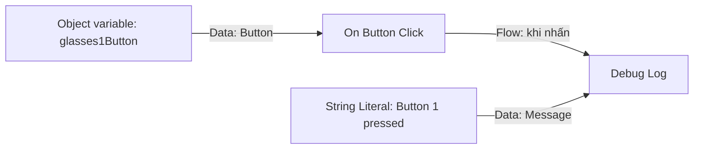

# Bài 03 — Dùng Visual Scripting phát hiện thao tác nhấn nút

> **Khóa:** Mobile AR Development · **Chủ đề:** Create an interactive face filter · **Unity:** 2022.3
> **Tham khảo:** [Unity Learn — Create an interactive face filter](https://learn.unity.com/course/create-with-ar-face-filters/unit/interactive-face-filter?version=2022.3). Bài viết là học liệu tiếng Việt tự biên soạn để thực hành, không thay thế hướng dẫn chính thức.

## 1. Tổng quan

Visual Scripting biểu diễn logic bằng các **node** kết nối qua dây **Flow** và **Data**. Với bộ lọc kính AR, nút trên UI phát sự kiện khi người dùng chạm; một `Script Graph` xác định phải thực hiện thao tác nào. Bước đầu tiên là phát hiện `Glasses 1 Button` và ghi một thông báo thử nghiệm vào Console.

## 2. Mục tiêu

- Tạo `Script Machine` và `Script Graph` tên `MeshChanger`.
- Tạo Object variable `glasses1Button` kiểu `Button`.
- Kết nối `Get Variable` → `On Button Click` → `Debug Log` và kiểm chứng.

## 3. Cơ chế của graph

Dây **Data** cung cấp giá trị (ví dụ Button hoặc String). Dây **Flow** quyết định khi nào hành động xảy ra. Đừng nhầm tên biến `glasses1Button` với tên GameObject `Glasses 1 Button`: biến chỉ là chỗ giữ tham chiếu đến nút thực tế.

## 4. Các bước thực hiện

1. Trong `Hierarchy`, tạo GameObject trống và đặt tên `Visual Scripts`.
2. Trong Inspector, thêm component `Script Machine`; chọn `New` để tạo `Script Graph`, lưu tên `MeshChanger` vào một thư mục dễ tìm.
3. Chọn `Edit Graph` và làm quen với `Graph Editor`, `Graph Inspector`, `Blackboard` và menu tìm node (*fuzzy finder*).
4. Xóa hai node mặc định `On Start` và `On Update` nếu không dùng. Không cần kiểm tra nút liên tục theo frame.
5. Nhấp chuột phải trong Graph Editor, tìm `On Button Click` (có thể theo `Events > GUI`).
6. Trong `Blackboard > Object`, tạo biến `glasses1Button`, chọn kiểu `Button` và gán nút `Glasses 1 Button` từ scene làm giá trị.
7. Kéo biến từ Blackboard ra đồ thị để tạo `Get Variable`; nối đầu ra của biến vào đầu vào Target của `On Button Click`.
8. Thêm `Debug Log (Message)` và `String Literal` với nội dung `Button 1 pressed`. Nối đầu ra Flow của sự kiện đến `Debug Log`, nối String đến Message.
9. Vào Play mode, nhấn nút kính thứ nhất và kiểm tra Console. Kết thúc Play mode rồi lưu Graph/Scene.

**Checkpoint:** mỗi lần nhấn đúng nút sẽ ghi một thông báo; nhấn hai nút khác không làm phát sinh thông báo này.

## 5. Gỡ lỗi có hệ thống

| Hiện tượng | Kiểm tra |
|---|---|
| Event node không sáng | Biến `glasses1Button`, Target và `EventSystem` |
| Node sáng nhưng không có log | Dây Flow đến `Debug Log`, lọc Console |
| Có lỗi biến rỗng | Blackboard Object variable đã gán đúng Button chưa |
| Nút khác cũng kích hoạt | Có dùng chung sai Button reference không |

Thực hành thêm: chuyển `Debug Log` thành `Debug Log Warning`; sau đó thử nối tên GameObject với chuỗi bằng `String Concat`.

## 6. Checklist

- [ ] Có `Script Machine` và graph `MeshChanger`.
- [ ] Biến `glasses1Button` kiểu Button không rỗng.
- [ ] `On Button Click` nhận Target đúng.
- [ ] Có Console log khi nhấn nút đầu tiên.
- [ ] Không dùng `On Update` để dò nút mỗi frame.

## 7. Câu hỏi trắc nghiệm ôn tập

### Câu 1

Dây Flow trong Visual Scripting dùng để làm gì?

A. Cấp dữ liệu texture  
B. Quyết định thứ tự thực hiện node  
C. Lưu file  
D. Điều khiển vị trí kính trực tiếp

**Đáp án: B.** Flow kích hoạt thứ tự hành động.

### Câu 2

Loại biến nào phù hợp để tham chiếu UI Button trong ví dụ?

A. Float  
B. String  
C. Object variable kiểu Button  
D. Vector3

**Đáp án: C.** Biến cần lưu đúng tham chiếu Button.

### Câu 3

Node nào phát hiện lần nhấn nút?

A. On Button Click  
B. On Update  
C. Get Position  
D. Set Material

**Đáp án: A.** On Button Click là sự kiện dành cho tương tác Button.

### Câu 4

Vì sao On Button Click có thể không hoạt động khi Target để This?

A. Nó luôn yêu cầu Internet  
B. Nó chỉ hỗ trợ ARKit  
C. Thiếu âm thanh  
D. Script Machine nằm trên GameObject không chứa Button

**Đáp án: D.** This tham chiếu GameObject đang mang graph, không phải nút UI đích.

### Câu 5

Cách thử nghiệm đơn giản nhất là gì?

A. Ghi thông điệp bằng Debug Log  
B. Build 20 lần  
C. Thêm 3 camera  
D. Ẩn EventSystem

**Đáp án: A.** Log kiểm tra được chính xác lúc sự kiện xảy ra.

---

**Đọc thêm:** [Unity Learn — Create with AR: Face Filters](https://learn.unity.com/course/create-with-ar-face-filters/unit/interactive-face-filter?version=2022.3).
