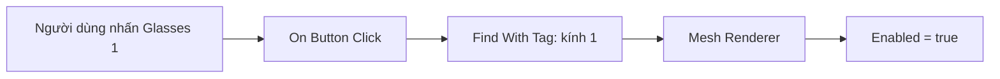

# Bài 04 — Bật mẫu kính bằng nút tương tác

> **Khóa:** Mobile AR Development · **Chủ đề:** Create an interactive face filter · **Unity:** 2022.3
> **Tham khảo:** [Unity Learn — Create an interactive face filter](https://learn.unity.com/course/create-with-ar-face-filters/unit/interactive-face-filter?version=2022.3). Bài viết là học liệu tiếng Việt tự biên soạn để thực hành, không thay thế hướng dẫn chính thức.

## 1. Mục tiêu thực hành

Một mẫu kính có thể chứa nhiều mesh. Để chọn kính qua UI, cần xác định đúng GameObject/renderer rồi thay trạng thái hiển thị. Bài thực hành này nâng cấp `MeshChanger` từ chỉ ghi log sang **bật hiển thị mẫu kính được chọn**. Trong hướng dẫn dùng graph, các mẫu kính có thể được truy tìm qua **Tag** và `Find With Tag`.

## 2. Thuật ngữ chính

- **Tag:** nhãn định danh gán cho GameObject; giúp tìm đối tượng theo vai trò thay vì tên nhìn thấy.
- **Mesh Renderer:** component vẽ mesh; bật/tắt component này khác với bật/tắt cả GameObject.
- **Get Variable:** lấy tham chiếu Button trong graph.
- **On Button Click:** nhận nhấn/chạm.
- **Find With Tag:** tìm GameObject mang tag được chỉ định.
- **Set Enabled:** thay thuộc tính `enabled` của renderer mục tiêu.

## 3. Luồng xử lý

`Find With Tag` thường tìm một đối tượng đầu tiên có tag phù hợp. Nếu một kiểu kính gồm nhiều mesh ở các GameObject con, hãy bảo đảm tag được gắn lên đúng đối tượng có renderer cần điều khiển, hoặc bổ sung xử lý cho từng renderer. Không giả định một tag trên GameObject cha sẽ tự bật các renderer ở mọi con.

## 4. Các bước thực hiện

1. Trong prefab `GlassesGroup`, kiểm tra những `Mesh Renderer` cần điều khiển. Đặt trạng thái ban đầu không hiện cho cả ba kiểu kính để tránh tất cả chồng lên nhau.
2. Tạo ba tag phân biệt cho ba kiểu kính (ví dụ `Glasses1`, `Glasses2`, `Glasses3`) qua Tag Manager; gán tag phù hợp cho đối tượng được tìm trong graph.
3. Mở `MeshChanger` graph, giữ phần `glasses1Button` → `On Button Click` đã được kiểm chứng.
4. Thêm node `Find With Tag` và chỉ định tag `Glasses1`. Kéo tham chiếu đối tượng tìm được đến component `Mesh Renderer` thích hợp rồi đặt thuộc tính `Enabled` thành `true` khi có sự kiện.
5. Vào Play mode, nhấn nút đầu tiên: chỉ kính thứ nhất xuất hiện; chụp ảnh kiểm chứng.
6. Nhân bản nhánh sự kiện cho hai nút còn lại. Tạo hai biến kiểu Button là `glasses2Button`, `glasses3Button`, gán đúng GameObject UI.
7. Với từng nhánh, thay Target và Tag tương ứng; kiểm tra từng nút độc lập. Lưu graph, scene và prefab.

**Quan trọng:** Ở mốc này, ba nút có thể *chỉ bật* kính tương ứng; muốn một kiểu xuất hiện thì hai kiểu kia phải biến mất, cần hoàn thiện logic chuyển đổi ở bài riêng.

## 5. Kiểm thử và debug

| Thử nghiệm | Kỳ vọng |
|---|---|
| Bấm nút kính 1 | Renderer của kính 1 được bật |
| Bấm nút kính 2 | Renderer của kính 2 được bật |
| Bấm nút kính 3 | Renderer của kính 3 được bật |
| Xóa tag hoặc nhập sai tag | Node tìm không được mục tiêu; cần xử lý lỗi reference |

Nếu graph chạy nhưng không hiện mesh, kiểm tra `Mesh Renderer` có nằm trên đối tượng được `Find With Tag` trả về không và `GameObject.activeInHierarchy` có đang hoạt động không.

## 6. Checklist

- [ ] Ba nút tham chiếu ba Button khác nhau.
- [ ] Tag nhất quán giữa Hierarchy và graph.
- [ ] Mỗi nhánh bật đúng renderer tương ứng.
- [ ] Đã kiểm tra trên prefab thực sự được AR tạo ra.

## 7. Câu hỏi trắc nghiệm ôn tập

### Câu 1

Mục đích của Tag trong ví dụ là gì?

A. Điều khiển UI scale  
B. Tìm đối tượng kính cần điều khiển  
C. Ghi âm thanh  
D. Lưu dữ liệu lên cloud

**Đáp án: B.** Tag giúp graph truy tìm GameObject theo vai trò.

### Câu 2

Component nào trực tiếp chịu trách nhiệm hiển thị mesh?

A. Mesh Renderer  
B. AR Session  
C. EventSystem  
D. Canvas Scaler

**Đáp án: A.** Mesh Renderer vẽ hình học 3D của kính.

### Câu 3

Chỉ bật renderer kính 2 mà không tắt kính 1 có thể gây gì?

A. Mất camera  
B. Tắt EventSystem  
C. Hai kính chồng lên nhau  
D. Tự lưu PlayerPrefs

**Đáp án: C.** Các mẫu có thể cùng tồn tại nếu không bị tắt.

### Câu 4

Nếu Find With Tag không tìm thấy gì, nên kiểm tra?

A. Màu nút  
B. FPS  
C. Âm thanh  
D. Tên và việc gán Tag

**Đáp án: D.** Tag không khớp khiến tìm kiếm trả về mục tiêu rỗng.

### Câu 5

Một tag trên cha luôn bật tất cả con hay không?

A. Không; cần xét renderer của từng GameObject  
B. Có ở mọi phiên bản  
C. Chỉ trên iOS  
D. Chỉ khi dùng TextMeshPro

**Đáp án: A.** Tag không tự động thay đổi Enabled của các component con.

---

**Đọc thêm:** [Unity Learn — Create with AR: Face Filters](https://learn.unity.com/course/create-with-ar-face-filters/unit/interactive-face-filter?version=2022.3).
