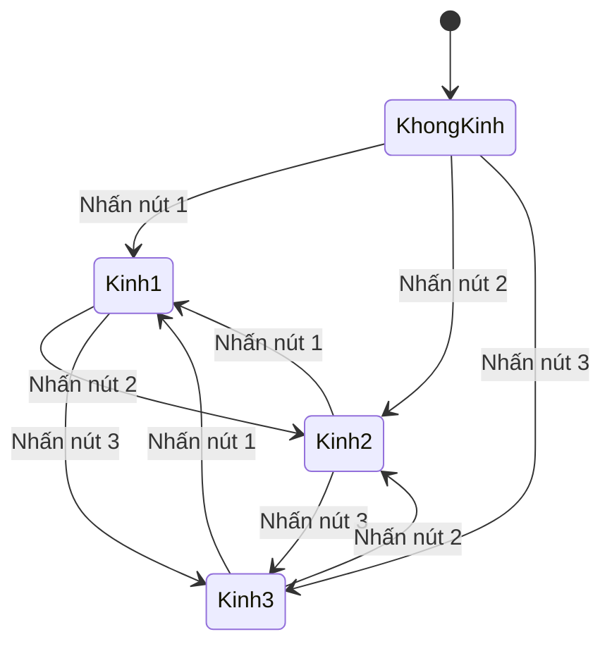

# Bài 05 — Hoàn thiện đồ thị chuyển đổi giữa ba mẫu kính

> **Khóa:** Mobile AR Development · **Chủ đề:** Create an interactive face filter · **Unity:** 2022.3
> **Tham khảo:** [Unity Learn — Create an interactive face filter](https://learn.unity.com/course/create-with-ar-face-filters/unit/interactive-face-filter?version=2022.3). Bài viết là học liệu tiếng Việt tự biên soạn để thực hành, không thay thế hướng dẫn chính thức.

## 1. Vấn đề cần giải quyết

Khi người dùng chọn mẫu kính B, mẫu A phải biến mất. Nếu graph chỉ bật mẫu vừa chọn, các kính sẽ chồng lên nhau và bộ lọc hoạt động sai. Giải pháp là bảo đảm **tối đa một kiểu kính đang hiển thị** sau mỗi sự kiện nhấn nút.

## 2. Mục tiêu

- Phân biệt trạng thái *bật kính được chọn* và *chuyển đổi kính*.
- Cấu hình graph tắt các renderer không được chọn.
- Tạo bài kiểm thử chuyển liên tiếp 1 → 2 → 3 → 1 để phát hiện lỗi tích lũy.

## 3. Quy tắc trạng thái

Cho ba trạng thái hiển thị `g1`, `g2`, `g3`, trong đó `true` có nghĩa renderer tương ứng đang bật. Khi chọn mẫu thứ `i`:

```text
Chọn 1 → (g1, g2, g3) = (true, false, false)
Chọn 2 → (g1, g2, g3) = (false, true, false)
Chọn 3 → (g1, g2, g3) = (false, false, true)
```



State diagram giúp thấy rằng mỗi lần nhấn là một lần gán **trạng thái hoàn chỉnh**, không chỉ bật thêm một mesh.

## 4. Quy trình triển khai bằng Visual Scripting

1. Mở graph `MeshChanger`, xác định ba nhánh `On Button Click` và ba mục tiêu kính (qua biến hoặc `Find With Tag`).
2. Bổ sung các node tắt renderer của ba mẫu ở đầu mỗi nhánh hoặc dùng một đoạn logic chung để tắt tất cả.
3. Sau khi tắt, bật `Mesh Renderer.enabled = true` cho mẫu kính vừa chọn.
4. Đảm bảo thứ tự Flow: **tắt các kính khác → bật kính được chọn**. Không dùng ba điều kiện độc lập có thể cùng trả `true` cho một lần chọn.
5. Play mode, bấm 1 → 2 → 3 → 1. Kiểm tra Hierarchy và Game view sau từng bước. Lưu graph.
6. Build lên điện thoại để kiểm tra nút chạm và tracking trong điều kiện thực tế.

Một cách tổ chức dễ bảo trì là đóng gói phần *Set visibility* thành một **Custom Event** nhận chỉ số kính đang chọn. Tuy nhiên, nếu mới học Visual Scripting, ba nhánh rõ ràng và kiểm thử được vẫn phù hợp.

## 5. Các lỗi dễ mắc

- **Chỉ thấy một kính lúc bắt đầu nhưng dần xuất hiện ba kính:** graph đang cộng dồn trạng thái, không tắt các renderer cũ.
- **Không kính nào hiện:** node tắt được chạy cuối cùng, hoặc tag/biến của nhánh bật sai.
- **Nhấn một lần phải chờ lâu:** kiểm tra xử lý thừa trong graph, đừng dò UI liên tục trong `On Update`.
- **Trong Scene view đúng nhưng trên khuôn mặt sai:** kiểm tra prefab instance thực tế được `AR Face Manager` quản lý.

## 6. Tiêu chí nghiệm thu

- [ ] Sau mọi lần chọn chỉ có một mẫu kính đang hiện.
- [ ] Chuyển đổi 1 → 2 → 3 → 1 không sinh kính trùng.
- [ ] Mỗi Button gọi đúng nhánh; không để tham chiếu null.
- [ ] Graph được lưu và đã kiểm tra trên thiết bị.

## 7. Câu hỏi trắc nghiệm ôn tập

### Câu 1

Điểm khác biệt chính giữa bật kính và chuyển kính là gì?

A. Chuyển kính phải tắt mẫu cũ  
B. Chuyển kính luôn cần Internet  
C. Chuyển kính xóa Camera  
D. Không có khác biệt

**Đáp án: A.** Chuyển trạng thái phải giữ quy tắc không chồng nhiều mẫu.

### Câu 2

Khi chọn kính 2, trạng thái mong đợi là?

A. true,true,false  
B. false,true,false  
C. false,false,false  
D. true,false,true

**Đáp án: B.** Chỉ renderer của kính 2 được bật.

### Câu 3

Thứ tự Flow nào hợp lý?

A. Bật tất cả rồi dừng  
B. Lưu PlayerPrefs trước  
C. Tắt kính khác rồi bật kính chọn  
D. Ẩn Canvas rồi không bật lại

**Đáp án: C.** Thứ tự này tạo trạng thái xác định.

### Câu 4

Vì sao nên kiểm thử chuỗi 1→2→3→1?

A. Để đo GPS  
B. Để kiểm tra hình nền  
C. Để nhận diện ảnh  
D. Để phát hiện trạng thái tích lũy/chồng kính

**Đáp án: D.** Thử liên tiếp phát hiện bug do trạng thái cũ không được xóa.

### Câu 5

Một phương án giúp graph dễ bảo trì hơn là?

A. Dùng Custom Event chung để cập nhật hiển thị  
B. Sao chép hàng trăm scene  
C. Xóa EventSystem  
D. Tăng độ phân giải vô hạn

**Đáp án: A.** Đoạn logic chung tránh trùng lặp các thao tác tắt/bật.

---

**Đọc thêm:** [Unity Learn — Create with AR: Face Filters](https://learn.unity.com/course/create-with-ar-face-filters/unit/interactive-face-filter?version=2022.3).
