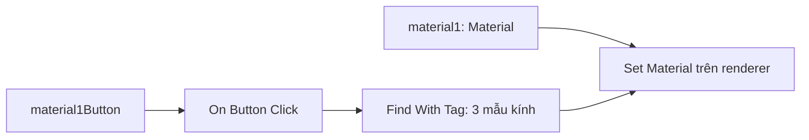

# Bài 06 — Thiết lập nút màu đầu tiên và material cho kính

> **Khóa:** Mobile AR Development · **Chủ đề:** Create an interactive face filter · **Unity:** 2022.3
> **Tham khảo:** [Unity Learn — Create an interactive face filter](https://learn.unity.com/course/create-with-ar-face-filters/unit/interactive-face-filter?version=2022.3). Bài viết là học liệu tiếng Việt tự biên soạn để thực hành, không thay thế hướng dẫn chính thức.

## 1. Tổng quan

Kiểu kính là cấu trúc 3D, còn màu sắc chủ yếu do `Material` quyết định. Bài thực hành thiết lập một nút màu và kiểm tra khi nhấn, material của kính được thay đổi mà không đổi mẫu kính đang chọn. Đây là bước tách logic *chọn hình dáng* khỏi *chọn diện mạo*.

## 2. Mục tiêu

- Tạo hoặc kiểm tra ba material dùng cho các màu kính.
- Lưu tham chiếu `material1Button` và `material1` trong graph riêng `MaterialChanger`.
- Cấu hình luồng nhấn nút để đặt material lên renderer mục tiêu.

## 3. Cơ chế

`Mesh Renderer` quyết định đối tượng được vẽ, còn `Material` xác định bề mặt được vẽ thế nào. Việc thay material phải tác động đúng renderer của kính đang được hiển thị. Nếu các mẫu kính khác nhau đều có renderer, có thể thay material của **cả ba** để bất kỳ kiểu kính nào được chọn sau đó cũng nhận màu đã chọn.

Đây là sơ đồ logic, không phải danh sách node chính xác bắt buộc cho mọi phiên bản package.

## 4. Thực hành

1. Trong `Project`, tạo ba Material có màu dễ phân biệt hoặc chọn ba material có sẵn. Kiểm tra shader tương thích render pipeline đang dùng; đặt tên rõ ràng như `Material_1`, `Material_2`, `Material_3`.
2. Chọn nút đầu tiên trong `AR_Canvas > Materials Buttons` và so màu biểu tượng với `Material_1` để người dùng hiểu kết quả.
3. Tạo GameObject riêng quản lý visual script (hoặc dùng `Visual Scripts` đã có) và thêm `Script Machine` với `Script Graph` mới tên `MaterialChanger`.
4. Trong Blackboard, tạo biến Object `material1Button` kiểu `Button`, trỏ tới `Material 1 Button`; tạo biến material `material1` kiểu `Material`, trỏ tới asset màu thứ nhất.
5. Thêm `On Button Click`, lấy nút từ `Get Variable material1Button` làm Target.
6. Dùng node tìm/nhận `Mesh Renderer` của từng mẫu kính, rồi nối tới thao tác `Set Material` với giá trị từ `Get Variable material1`. Lặp cho ba mục tiêu nếu cần đổi đồng bộ.
7. Play mode, chọn một mẫu kính đang hiện rồi nhấn nút màu 1. Quan sát kết quả và các giá trị trên renderer; lưu graph khi kiểm thử đạt.

**Lưu ý khi dùng nhiều material slots:** nếu mesh có nhiều vị trí material, phải xác định đúng slot/index muốn thay. Đừng để logic đổi màu vô tình ghi lên material của mặt kính trong khi chỉ muốn đổi màu gọng.

## 5. Kiểm thử

| Trường hợp | Kỳ vọng |
|---|---|
| Nhấn Material 1 khi kính 1 đang hiện | Kính 1 nhận màu 1 |
| Đổi sang kính 2 sau đó | Kính 2 cũng nhận màu nhất quán nếu triển khai đổi đồng bộ |
| Nhấn nút màu khi chưa có mặt | Không phát sinh lỗi NullReference khó hiểu |
| Chọn sai material slot | Màu đổi ở thành phần không mong đợi; cần kiểm tra slot |

## 6. Checklist

- [ ] Material tương ứng với màu nút.
- [ ] `MaterialChanger` có Button/Material variable được gán đầy đủ.
- [ ] Sự kiện nhấn màu 1 kích hoạt `Set Material` đúng mục tiêu.
- [ ] Đã kiểm thử khi thay mẫu kính.

## 7. Câu hỏi trắc nghiệm ôn tập

### Câu 1

Thành phần nào quy định diện mạo bề mặt kính?

A. Material  
B. EventSystem  
C. Anchor  
D. PlayerPrefs

**Đáp án: A.** Material điều khiển shader và thông số bề mặt.

### Câu 2

Biến material1Button cần kiểu nào?

A. Vector3  
B. Button  
C. Camera  
D. AudioSource

**Đáp án: B.** Đầu vào của sự kiện nút cần tham chiếu Button.

### Câu 3

Vì sao có thể cần áp material cho cả ba mẫu kính?

A. Để tăng polygon  
B. Để tắt AR Session  
C. Để màu được giữ khi chuyển kiểu kính  
D. Để làm UI biến mất

**Đáp án: C.** Các mẫu thay phiên hiển thị đều cần diện mạo thống nhất.

### Câu 4

Nếu màu đổi nhầm sang tròng kính, cần kiểm tra?

A. Tiêu đề scene  
B. Ngôn ngữ dự án  
C. EventSystem  
D. Renderer và material slot/index

**Đáp án: D.** Có thể đang đặt vật liệu ở sai slot.

### Câu 5

Chọn màu 1 nhưng không đổi gì: kiểm tra đầu tiên?

A. Tham chiếu Button, Material và dây graph  
B. Vị trí GPS  
C. Quyền microphone  
D. Scale của Canvas duy nhất

**Đáp án: A.** Lỗi liên kết giá trị và Flow là nguyên nhân trực tiếp.

---

**Đọc thêm:** [Unity Learn — Create with AR: Face Filters](https://learn.unity.com/course/create-with-ar-face-filters/unit/interactive-face-filter?version=2022.3).
