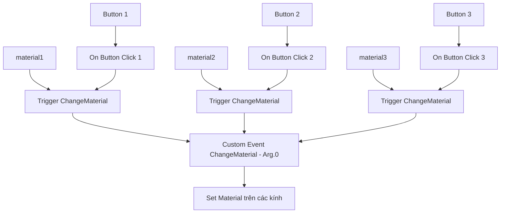

# Bài 07 — Hoàn thiện chuyển đổi ba màu bằng Custom Event

> **Khóa:** Mobile AR Development · **Chủ đề:** Create an interactive face filter · **Unity:** 2022.3
> **Tham khảo:** [Unity Learn — Create an interactive face filter](https://learn.unity.com/course/create-with-ar-face-filters/unit/interactive-face-filter?version=2022.3). Bài viết là học liệu tiếng Việt tự biên soạn để thực hành, không thay thế hướng dẫn chính thức.

## 1. Bài toán

Nếu mỗi màu cần tìm ba kính và đặt material cho cả ba, lặp nguyên một chuỗi node ba lần sẽ khiến graph rối và dễ sửa sót. `Custom Event` cho phép tách thao tác chung `ChangeMaterial` khỏi sự kiện của từng nút. Nút nào được nhấn sẽ truyền đúng `Material` làm tham số.

## 2. Mục tiêu

- Tạo `Custom Event` tên `ChangeMaterial` nhận một material qua `Arg. 0`.
- Phân biệt node tiếp nhận `Custom Event` với `Custom Event Trigger` dùng để gọi sự kiện.
- Mở rộng cấu hình cho `material1Button`, `material2Button`, `material3Button`.

## 3. Sơ đồ dữ liệu và điều khiển

Mỗi nút có Input riêng nhưng cùng đi qua một logic cập nhật. Đây là một dạng **tái sử dụng hành vi**, tương tự hàm nhận tham số trong lập trình truyền thống.

## 4. Thực hành chi tiết

1. Mở Script Graph `MaterialChanger` đã có nhánh cho Material 1.
2. Ngắt kết nối Flow giữa `On Button Click` với chuỗi `Find With Tag`/`Set Material` và ngắt dây dữ liệu `material1` đang nối trực tiếp tới các node đặt material.
3. Dời chuỗi Find/Set sang một vùng riêng; thêm node `Custom Event` đặt tên **`ChangeMaterial`**, nhận một đối số `Arg. 0` kiểu material phù hợp với node Set Material.
4. Nối Flow của `Custom Event` vào chuỗi Find/Set; nối `Arg. 0` đến đầu vào material của các thao tác đặt vật liệu.
5. Bên cạnh `On Button Click` đầu tiên, thêm `Custom Event Trigger` cùng tên `ChangeMaterial`; nối Flow từ sự kiện nút và nối `material1` từ Blackboard đến `Arg. 0` của trigger.
6. Test trong Editor: nhấn nút màu 1, cả ba mẫu kính được gán material tương ứng. Thoát Play mode.
7. Nhân bản nhóm gồm `Get Variable` của Button, `On Button Click`, `Get Variable` của Material và `Custom Event Trigger` thêm hai lần.
8. Ở nhóm thứ hai thay cặp biến thành `material2Button` và `material2`; nhóm thứ ba thành `material3Button` và `material3`.
9. Chạy lại thử ba nút với ba mẫu kính; tắt đối tượng `GlassesGroup` chỉ dùng để xem trước trong scene nếu prefab sinh từ AR là nguồn hiển thị thực tế. Lưu scene và build trên điện thoại.

## 5. Gỡ lỗi

| Lỗi | Cách xác minh |
|---|---|
| Nút nào cũng đổi màu 1 | Kiểm tra tên biến Material ở các nhánh nhân bản |
| Trigger chạy nhưng không cập nhật | Tên Custom Event ở Trigger và Event phải trùng; kiểm tra `Arg. 0` |
| Chỉ một mẫu kính đổi màu | Xem chuỗi `Find With Tag`/`Set Material` đã xử lý đủ renderer chưa |
| Màu mới mất sau đổi kiểu | Đảm bảo mọi mẫu kính được cập nhật hoặc trạng thái material được áp khi chọn mẫu |

## 6. Checklist

- [ ] Có Custom Event `ChangeMaterial` và Trigger cùng tên.
- [ ] `Arg. 0` mang material được nút chọn.
- [ ] Ba nhóm nút có biến đúng và khác nhau.
- [ ] Ba màu hoạt động trên mọi mẫu kính mà không sinh node cập nhật trùng lặp.

## 7. Câu hỏi trắc nghiệm ôn tập

### Câu 1

Vai trò của Custom Event ChangeMaterial là gì?

A. Tái sử dụng logic đổi material  
B. Đổi camera  
C. Lưu file  
D. Tạo UI Canvas

**Đáp án: A.** Một hành vi chung được nhiều nút gọi lại.

### Câu 2

Arg. 0 truyền thông tin gì trong ví dụ?

A. Vị trí GPS  
B. Material cần áp dụng  
C. Độ phân giải  
D. Số lượng camera

**Đáp án: B.** Đối số cho biết màu/material mà người dùng lựa chọn.

### Câu 3

Lý do cả ba nút đều sử dụng Custom Event Trigger?

A. Để cả ba chỉ đổi màu 1  
B. Để vô hiệu hóa AR  
C. Để gọi cùng hành vi với tham số khác nhau  
D. Để tắt giao diện

**Đáp án: C.** Các Trigger dùng chung event, mỗi cái truyền material của nút tương ứng.

### Câu 4

Nhấn nút màu 2 mà màu 1 hiện: cần kiểm tra?

A. Trình duyệt  
B. Anchor  
C. Tốc độ mạng  
D. Biến material2/material1 ở nhánh được nhân bản

**Đáp án: D.** Nhánh mới có thể vẫn tham chiếu biến cũ.

### Câu 5

Custom Event và Trigger phải giống nhau ở đâu?

A. Tên sự kiện và cách truyền tham số  
B. Màu nền UI  
C. Vị trí Camera  
D. Tên Scene bắt buộc

**Đáp án: A.** Tên và dữ liệu thống nhất cho phép trigger gọi đúng listener.

---

**Đọc thêm:** [Unity Learn — Create with AR: Face Filters](https://learn.unity.com/course/create-with-ar-face-filters/unit/interactive-face-filter?version=2022.3).
