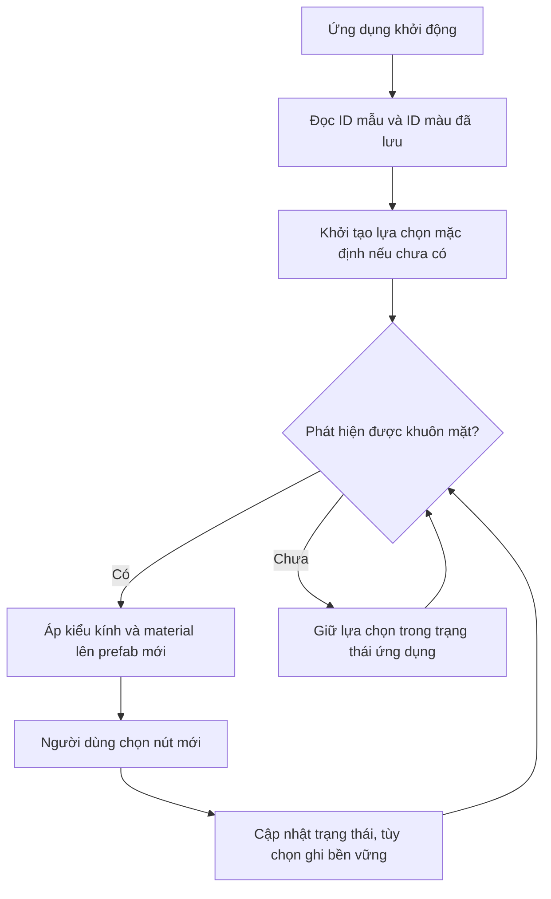

# Bài 08 — Kiểm thử, lưu và khôi phục lựa chọn kính

> **Khóa:** Mobile AR Development · **Chủ đề:** Create an interactive face filter · **Unity:** 2022.3
> **Tham khảo:** [Unity Learn — Create an interactive face filter](https://learn.unity.com/course/create-with-ar-face-filters/unit/interactive-face-filter?version=2022.3). Bài viết là học liệu tiếng Việt tự biên soạn để thực hành, không thay thế hướng dẫn chính thức.

## 1. Mục tiêu

Một bộ lọc đã cho đổi mẫu và đổi màu cần được kiểm tra ở các tình huống chuyển lựa chọn, mất mặt và chạy lại ứng dụng. Cần phân biệt **lưu scene/prefab trong Unity** với **lưu lựa chọn của người dùng khi ứng dụng tắt**. Việc lưu lựa chọn qua các lần mở ứng dụng là phần mở rộng có thể triển khai bằng `PlayerPrefs`; không phải mọi project mẫu đều sẵn cơ chế này.

## 2. Hai cấp độ dữ liệu

| Dữ liệu | Ví dụ | Cách duy trì |
|---|---|---|
| Tài nguyên thiết kế | GlassesGroup, Material, Graph, scene | Lưu asset và scene trong Editor |
| Trạng thái phiên chạy | Kính 2, màu xanh | Biến runtime trong graph hoặc controller |
| Tùy chọn giữa các lần chạy | Mẫu kính yêu thích | `PlayerPrefs`/storage theo thiết kế ứng dụng |

`PlayerPrefs` lưu tùy chọn đơn giản theo khóa; không dành cho dữ liệu bí mật. Để khôi phục chính xác, lưu **mã lựa chọn** (số thứ tự hoặc tên định danh ổn định), không lưu trực tiếp instance renderer của khuôn mặt vì instance sẽ thay đổi khi tracking tạo lại prefab.

## 3. Sơ đồ khôi phục lựa chọn (mở rộng)



Khi tracking mất rồi xuất hiện trở lại, manager có thể tạo instance mới; **trạng thái lựa chọn cần được áp dụng lại** chứ không chỉ thay đổi một instance đã biến mất.

## 4. Thực hành kiểm thử trước khi lưu

1. Mở scene, kiểm tra `GlassesGroup` được AR manager sinh và không bị lặp bởi một đối tượng xem trước còn bật trong scene.
2. Chọn lần lượt ba mẫu kính; sau mỗi lần chọn, xác nhận chỉ một mẫu hiện.
3. Với từng mẫu, bấm cả ba nút màu; xác nhận đúng material và không bị mất khi chuyển mẫu.
4. Che mặt khỏi camera rồi đưa mặt trở lại; kiểm tra vật thể mới sinh có nhận đúng lựa chọn hiện hành không.
5. Lưu scene, prefab và Script Graph bằng các thao tác lưu tương ứng; đóng mở lại Unity Editor để xác minh tài nguyên được bảo toàn.
6. Tạo build mới, thoát ứng dụng và mở lại. Nếu chưa triển khai lưu tùy chọn runtime, ứng dụng sẽ về mặc định; đây **không** phải lỗi của thao tác lưu scene.

## 5. Mở rộng: lưu kiểu kính và màu bằng C#

Đoạn mã sau minh họa **cơ chế lưu mã lựa chọn**, có thể dùng để tham chiếu khi triển khai node Visual Scripting tương ứng:

```csharp
using UnityEngine;

public static class GlassesPreferences
{
    private const string StyleKey = "facefilter_style";
    private const string ColorKey = "facefilter_color";

    public static void Save(int styleIndex, int colorIndex)
    {
        PlayerPrefs.SetInt(StyleKey, Mathf.Clamp(styleIndex, 0, 2));
        PlayerPrefs.SetInt(ColorKey, Mathf.Clamp(colorIndex, 0, 2));
        PlayerPrefs.Save();
    }

    public static (int style, int color) Load()
    {
        return (PlayerPrefs.GetInt(StyleKey, 0),
                PlayerPrefs.GetInt(ColorKey, 0));
    }
}
```

Sau khi `Load()`, phải dùng các chỉ số trả về để cập nhật renderer/material trong scene; **đọc dữ liệu không tự làm UI đổi kính**. Đoạn minh họa có thể được triển khai lại bằng node PlayerPrefs trong graph nếu package có các node tương ứng.

## 6. Bảng kiểm thử hồi quy

| Kịch bản | Kết quả cần có |
|---|---|
| 1 → 2 → 3 → 1 | Không có kính chồng |
| Màu 1 → 3 → 2 | Material đúng sau mỗi lần |
| Đổi màu rồi đổi kính | Màu được áp dụng đúng theo thiết kế |
| Mất tracking rồi quay lại | Không lỗi, kính mới hiện đúng |
| Thoát/mở ứng dụng | Mặc định hoặc khôi phục lựa chọn đúng tính năng đã triển khai |

## 7. Checklist

- [ ] Scene, prefab và graph đã lưu.
- [ ] Đã kiểm thử đổi kính, đổi màu và mất tracking.
- [ ] Phân biệt rõ dữ liệu Editor và dữ liệu runtime.
- [ ] Nếu dùng `PlayerPrefs`, đã kiểm tra lựa chọn sau khi mở lại ứng dụng.

## 8. Câu hỏi trắc nghiệm ôn tập

### Câu 1

Lưu scene trong Editor có tự lưu lựa chọn người dùng qua lần mở app?

A. Có luôn  
B. Không, đó là hai loại dữ liệu khác nhau  
C. Chỉ Android  
D. Chỉ ARKit

**Đáp án: B.** Asset lưu cấu hình thiết kế, không phải trạng thái tùy chọn runtime.

### Câu 2

PlayerPrefs phù hợp nhất với dữ liệu nào?

A. Video hàng GB  
B. Mật khẩu  
C. Chỉ số kiểu kính và màu ưu thích  
D. Mesh vertices mỗi frame

**Đáp án: C.** Đây là vài tùy chọn nhỏ, không nhạy cảm.

### Câu 3

Tại sao không lưu trực tiếp reference renderer của AR face làm tùy chọn bền vững?

A. Vì không thể thay màu  
B. Vì chỉ có 2 kính  
C. Vì luôn là null  
D. Vì AR tracking có thể tạo instance mới

**Đáp án: D.** Reference instance không bền qua các phiên tracking và khởi động.

### Câu 4

Load chỉ số lựa chọn xong cần làm gì?

A. Áp lại kiểu kính và material vào đối tượng hiện có  
B. Xóa AR Session  
C. Bật mọi kính  
D. Đổi độ phân giải

**Đáp án: A.** Giá trị đọc về cần được sử dụng để cập nhật trạng thái hiển thị.

### Câu 5

Khi mất và tìm lại mặt, điều gì quan trọng?

A. Bỏ EventSystem  
B. Áp lại trạng thái cho instance face prefab mới  
C. Tắt toàn bộ material  
D. Chỉ tăng FPS

**Đáp án: B.** Instance mới phải nhận lại các lựa chọn hiện hành.

---

**Đọc thêm:** [Unity Learn — Create with AR: Face Filters](https://learn.unity.com/course/create-with-ar-face-filters/unit/interactive-face-filter?version=2022.3).
