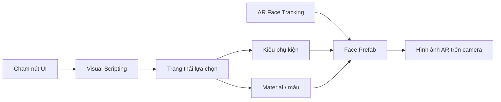

# Bài 09 — Bài tập dự án: bộ lọc khuôn mặt chủ đề đại dương

> **Khóa:** Mobile AR Development · **Chủ đề:** Create an interactive face filter · **Unity:** 2022.3
> **Tham khảo:** [Unity Learn — Create an interactive face filter](https://learn.unity.com/course/create-with-ar-face-filters/unit/interactive-face-filter?version=2022.3). Bài viết là học liệu tiếng Việt tự biên soạn để thực hành, không thay thế hướng dẫn chính thức.

## 1. Đề bài

Thiết kế một bộ lọc AR chủ đề **đại dương/lặn biển** cho trải nghiệm ở thủy cung. Người dùng nhìn camera để thấy phụ kiện lặn được gắn lên khuôn mặt, sau đó tương tác với các nút để thay ít nhất một yếu tố trực quan (chẳng hạn mẫu kính lặn hoặc màu trang bị). Đây là bài tập sản phẩm: cần tự xác định thiết kế, triển khai và minh chứng kết quả thay vì sao chép nguyên giao diện thử kính thời trang.

## 2. Sản phẩm mong đợi

- Một scene AR có face tracking hoạt động trên điện thoại phù hợp.
- Ít nhất **hai lựa chọn trực quan khác nhau**: hai kiểu phụ kiện hoặc hai màu; khuyến khích triển khai cả chọn kiểu và đổi màu.
- Giao diện nút dễ chạm, không che toàn bộ mắt và mũi.
- Tài nguyên 3D/2D thống nhất chủ đề (kính lặn, ống thở, họa tiết san hô/cá/bọt khí). Bảo đảm tài nguyên được sử dụng hợp lệ.
- Video hoặc ảnh minh chứng tương tác, kèm mô tả cách kiểm thử và một cải tiến sau lần thử đầu tiên.

## 3. Thiết kế giải pháp

Cần duy trì hai luồng tách biệt: dữ liệu **tracking** cập nhật tư thế khuôn mặt, còn dữ liệu **tương tác** quyết định phụ kiện và material. Sản phẩm phải hoạt động khi người dùng xoay đầu, nhấn nút nhanh và rời/đưa mặt trở lại camera.

## 4. Các mốc thực hiện

1. **Phác thảo:** vẽ mockup hai hàng nút, chọn bảng màu và ít nhất hai phụ kiện phù hợp chủ đề dưới nước.
2. **Làm scene:** tạo hoặc tái sử dụng scene AR đã có; gắn prefab phụ kiện vào khuôn mặt.
3. **Kết nối UI:** gán icon, material và tên nút dễ hiểu; kiểm tra trên nhiều màn hình.
4. **Lập trình tương tác:** dùng Visual Scripting để lựa chọn phụ kiện và màu; không cho hai mẫu loại trừ nhau chồng lên nhau.
5. **Kiểm thử:** trên thiết bị thật, kiểm tra quay đầu, thay phụ kiện, thay màu và trường hợp mất tracking.
6. **Hoàn thiện:** sửa ít nhất một lỗi/điểm khó dùng, chụp ảnh trước/sau khi cải tiến; xuất build hoặc video demo.

## 5. Tiêu chí đánh giá đề xuất

| Tiêu chí | Mô tả đạt yêu cầu |
|---|---|
| Tracking | Phụ kiện bám tương đối ổn định theo khuôn mặt |
| Tương tác | Bấm nút dẫn đến phản hồi rõ ràng và đúng lựa chọn |
| Chuyển trạng thái | Không chồng vật thể không mong muốn |
| Mỹ thuật | Có ngôn ngữ thiết kế liên quan đại dương |
| Minh chứng | Có ảnh/video, mô tả điều kiện và kết quả test |
| Khả năng tái hiện | Có scene/project hoặc build cùng hướng dẫn mở/chạy |

Đây là rubric tự đánh giá để hoàn thiện bài làm, không phải bảng điểm chính thức của Unity Learn.

## 6. Báo cáo nộp bài

Ghi rõ tên dự án, nền tảng/thiết bị, mô tả chức năng, cách thao tác, điểm đã tự thiết kế, một lỗi đã khắc phục và liên kết video/demo. Không gửi bản build chứa asset không có quyền sử dụng hoặc video quay người khác nếu chưa có sự đồng ý.

## 7. Checklist cuối

- [ ] Có dự án và build chạy được trên thiết bị tương thích.
- [ ] Có tối thiểu hai lựa chọn tương tác khác nhau.
- [ ] Có minh chứng khi camera theo dõi và khi bấm nút.
- [ ] Có bảng kiểm thử ít nhất ba trường hợp.
- [ ] Có ít nhất một cải tiến được giải thích.

## 8. Câu hỏi trắc nghiệm ôn tập

### Câu 1

Đầu ra quan trọng nhất của bài tập là gì?

A. Đề cương lý thuyết suông  
B. Sản phẩm AR tương tác kèm minh chứng chạy  
C. Một ảnh nền tĩnh  
D. Một bảng tính

**Đáp án: B.** Bài dự án phải có sản phẩm tương tác và minh chứng.

### Câu 2

Thành phần nào gắn phụ kiện theo chuyển động mặt?

A. Canvas Scaler  
B. PlayerPrefs  
C. AR Face Tracking và Face Prefab  
D. Debug Log

**Đáp án: C.** Tracking cung cấp pose để phụ kiện bám khuôn mặt.

### Câu 3

Nếu hai mặt nạ chồng nhau khi đổi kiểu, điều gì cần sửa?

A. Trạng thái ẩn/hiện các lựa chọn  
B. Màu UI duy nhất  
C. Tên thư mục Assets  
D. Icon ứng dụng

**Đáp án: A.** Mẫu không chọn cần được tắt.

### Câu 4

Cách thể hiện cải tiến có thể kiểm chứng?

A. Chỉ nhận xét đẹp hơn  
B. Xóa hết test  
C. Không quay màn hình  
D. Ảnh trước/sau cùng mô tả lỗi đã sửa

**Đáp án: D.** Minh chứng đối chiếu cho thấy tác động cải tiến.

### Câu 5

Khi dùng ảnh mặt người khác làm video demo, cần chú ý gì?

A. Cần sự đồng ý và quyền sử dụng hợp lệ  
B. Tự động công khai  
C. Không cần quan tâm  
D. Chỉ đổi định dạng

**Đáp án: A.** Quyền riêng tư và quyền sử dụng nội dung cần được tôn trọng.

---

**Đọc thêm:** [Unity Learn — Create with AR: Face Filters](https://learn.unity.com/course/create-with-ar-face-filters/unit/interactive-face-filter?version=2022.3).
