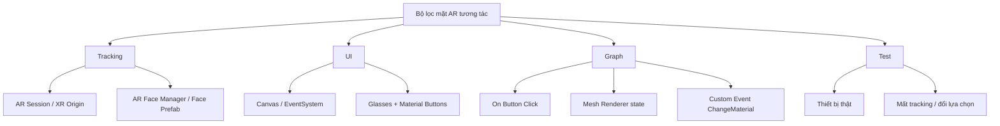

# Bài 10 — Bài kiểm tra tổng hợp: AR Face Filters

> **Khóa:** Mobile AR Development · **Chủ đề:** Create an interactive face filter · **Unity:** 2022.3
> **Tham khảo:** [Unity Learn — Create an interactive face filter](https://learn.unity.com/course/create-with-ar-face-filters/unit/interactive-face-filter?version=2022.3). Bài viết là học liệu tiếng Việt tự biên soạn để thực hành, không thay thế hướng dẫn chính thức.

## 1. Phạm vi kiểm tra

Bài đánh giá này hệ thống hóa các kỹ năng xây dựng bộ lọc khuôn mặt AR tương tác trong Unity 2022.3: scene AR, face tracking, Canvas/uGUI, Visual Scripting, điều khiển `Mesh Renderer`, lựa chọn material, vòng đời prefab và kiểm thử. Nội dung câu hỏi được biên soạn để tự học, **không phải bộ câu hỏi chính thức** của Unity Learn.

## 2. Bản đồ kiến thức

Người học đạt yêu cầu khi có thể giải thích quan hệ giữa thành phần và dự đoán hậu quả nếu thiếu một mắt xích, không chỉ ghi nhớ tên node.

## 3. Hướng dẫn làm bài

- Tự trả lời trước khi xem đáp án.
- Với mỗi câu, ghi thêm lý do lựa chọn của mình.
- Nếu trả lời sai, quay lại scene thực hành và tái hiện tình huống.
- Thang tự đánh giá gợi ý: trả lời đúng 80% trở lên và thực hiện thành công một bài kiểm thử ngắn.

## 4. Bài thực hành kết thúc

Tạo hoặc mở dự án bộ lọc kính. Chạy thử và ghi lại kết quả của năm thao tác: chọn kính 1, chọn kính 3, chọn màu 2, trở lại kính 1, đưa mặt ra khỏi camera rồi quay lại. Sau mỗi lần, ghi mẫu kính/màu đang hiện và trạng thái tracking. Bài làm chỉ đạt nếu tương tác rõ ràng, không có kính chồng và không xuất hiện lỗi tham chiếu nghiêm trọng.

## 5. Điểm dễ nhầm

| Dễ nhầm | Phân biệt đúng |
|---|---|
| `Mesh Renderer.enabled` và `GameObject.SetActive` | Một bên điều khiển hiển thị component; một bên tác động trạng thái hoạt động cả đối tượng |
| `On Button Click` và `On Update` | Một bên theo sự kiện người dùng; một bên chạy mỗi frame |
| Flow và Data | Flow quyết định thời điểm; Data truyền giá trị |
| `Custom Event` và `Custom Event Trigger` | Một bên tiếp nhận hành vi; một bên phát lệnh gọi |
| Lưu scene và lưu lựa chọn runtime | Hai cơ chế ở hai giai đoạn khác nhau |

## 6. Checklist kết thúc module

- [ ] Giải thích được đường đi từ nút UI đến việc thay mesh/material.
- [ ] Xác định được ít nhất ba lỗi phổ biến và cách tái hiện.
- [ ] Hoàn thành bài thực hành cuối.
- [ ] Có bản build chạy trên thiết bị và minh chứng kết quả.

## 7. Câu hỏi trắc nghiệm ôn tập

### Câu 1

Trong mô hình hệ thống, vai trò của AR Face Manager là gì?

A. Tạo và cập nhật khuôn mặt được theo dõi  
B. Lưu vật liệu  
C. Làm nút màu  
D. Viết dữ liệu ra Drive

**Đáp án: A.** AR Face Manager đảm nhận đối tượng khuôn mặt do subsystem cung cấp.

### Câu 2

Khi nhấn nút kính 3, thay đổi nào phải xảy ra?

A. Bật mọi kính  
B. Tắt các kính khác và bật kính 3  
C. Khởi động camera mới  
D. Xóa mọi material

**Đáp án: B.** Tại một thời điểm chỉ mẫu kính chọn được hiển thị.

### Câu 3

Dây Data từ material2 nên nối tới đâu?

A. RectTransform  
B. AR Session  
C. Đầu vào material của ChangeMaterial Trigger  
D. EventSystem

**Đáp án: C.** Dữ liệu material là tham số để event chung biết màu nào được chọn.

### Câu 4

Nếu không nhận nhấn nút trong Game view, nên kiểm tra?

A. Tên file ảnh  
B. FPS GPU trước tiên  
C. PlayerPrefs trước tiên  
D. Button reference, EventSystem và Input

**Đáp án: D.** Đây là những mắt xích trực tiếp của tương tác UI.

### Câu 5

Để chứng minh kính thật sự bám mặt cần gì?

A. Kiểm thử trên thiết bị hỗ trợ face tracking  
B. Chỉ chụp ảnh scene trong Editor  
C. Chỉ kiểm tra Canvas  
D. Chỉ đổi tên prefab

**Đáp án: A.** Tracking thật phụ thuộc thiết bị và provider AR.

---

**Đọc thêm:** [Unity Learn — Create with AR: Face Filters](https://learn.unity.com/course/create-with-ar-face-filters/unit/interactive-face-filter?version=2022.3).
