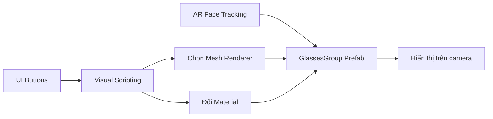

# Create an interactive face filter — Giáo trình thực hành tiếng Việt

**Pathway:** Mobile AR Development  
**Môi trường tham chiếu:** Unity 2022.3  
**Sản phẩm cuối:** bộ lọc AR cho phép chọn mẫu kính, đổi màu kính và thực hành sáng tạo bộ lọc chủ đề đại dương.

## Lộ trình học

| Bài | Tên bài |
|---:|---|
| 01 | [Dựng scene AR với ba mẫu kính](01-Tutorials/001-build-a-new-scene-with-glasses.md) |
| 02 | [Thiết kế giao diện chọn kính và màu sắc](01-Tutorials/002-set-up-the-ui.md) |
| 03 | [Dùng Visual Scripting phát hiện thao tác nhấn nút](01-Tutorials/003-create-a-visual-script-to-detect-a-button-press.md) |
| 04 | [Bật mẫu kính bằng nút tương tác](01-Tutorials/004-turn-on-the-glasses-with-buttons.md) |
| 05 | [Hoàn thiện đồ thị chuyển đổi giữa ba mẫu kính](01-Tutorials/005-update-your-graph-to-switch-between-glasses.md) |
| 06 | [Thiết lập nút màu đầu tiên và material cho kính](01-Tutorials/006-configure-one-color-button.md) |
| 07 | [Hoàn thiện chuyển đổi ba màu bằng Custom Event](01-Tutorials/007-complete-the-color-switching-functionality.md) |
| 08 | [Kiểm thử, lưu và khôi phục lựa chọn kính](01-Tutorials/008-save-and-load-the-glasses.md) |
| 09 | [Bài tập dự án: bộ lọc khuôn mặt chủ đề đại dương](02-Exercises/009-submission-ocean-themed-face-filter.md) |
| 10 | [Bài kiểm tra tổng hợp: AR Face Filters](03-Quizzes/010-create-with-ar-face-filters-quiz.md) |

## Luồng hệ thống

## Cách sử dụng

Học lần lượt các bài 1–8 để xây dựng ứng dụng, hoàn thành dự án ở bài 9, sau đó dùng bài 10 để kiểm tra kiến thức. Trong mỗi bài có mục tiêu, quy trình thực hành, xử lý lỗi và các câu trắc nghiệm kèm đáp án/giải thích.

**Lưu ý:** Các tệp là học liệu tiếng Việt biên soạn để học tập; giao diện và tên node có thể khác giữa các phiên bản Unity và gói Visual Scripting. Phải kiểm thử AR trên thiết bị thật có hỗ trợ face tracking.
