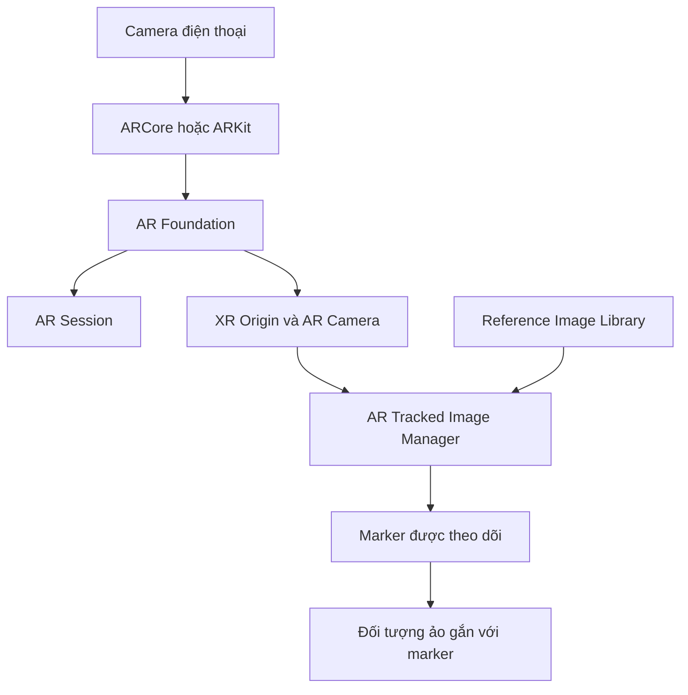

# Bài 01 — Khởi tạo dự án AR nhận diện hình ảnh (Marker-based AR)

> **Lộ trình:** Mobile AR Development · **Chủ đề:** Create a marker-based AR app · **Môi trường tham chiếu:** Unity 2022.3  
> **Mục tiêu sản phẩm:** Mở camera trên điện thoại, nhận diện hình ảnh đánh dấu (marker) và chuẩn bị vị trí để đặt nội dung ảo.

## 1. Tổng quan

Marker-based AR là cách xây dựng ứng dụng thực tế tăng cường dựa trên một **hình ảnh tham chiếu đã đăng ký trước**. Khi camera phát hiện hình ảnh này, hệ thống ước lượng vị trí và hướng của nó để đối tượng ảo có thể xuất hiện đúng nơi. Ví dụ, khi điện thoại hướng vào một bức tranh in, một mô hình 3D sẽ xuất hiện trên tranh.

Trong Unity, **AR Foundation** cung cấp giao diện chung cho các chức năng AR; **ARCore** (Android) và **ARKit** (iOS) cung cấp khả năng triển khai trên thiết bị tương ứng. Việc camera mở được **không đồng nghĩa** với chức năng theo dõi hình ảnh đã hoạt động.

## 2. Mục tiêu học tập

Sau bài này, người học có thể:

1. Phân biệt vai trò của `AR Session`, `XR Origin` và `AR Tracked Image Manager`.
2. Tạo một scene Unity có khả năng theo dõi hình ảnh tham chiếu.
3. Cấu hình quyền camera và chuẩn bị bản build cho thiết bị hỗ trợ AR.
4. Phát hiện các nguyên nhân cơ bản khiến ứng dụng không nhận diện được marker.

## 3. Cấu trúc hệ thống

`AR Session` quản lý vòng đời phiên AR. `XR Origin` liên kết hệ tọa độ của scene với dữ liệu tracking. `AR Tracked Image Manager` quản lý những hình ảnh được phát hiện từ `Reference Image Library` — danh sách ảnh đã được đăng ký để nhận diện.

| Thành phần | Vai trò | Điều cần kiểm tra |
| --- | --- | --- |
| `Scene` | Chứa GameObject và Component | Scene đã được lưu và thêm vào build |
| `AR Session` | Quản lý phiên AR | Không thiếu hoặc trùng session |
| `XR Origin` | Gốc tọa độ và camera AR | Camera/trackable manager đúng vị trí |
| `AR Tracked Image Manager` | Nhận diện ảnh tham chiếu | Đã gán thư viện ảnh |
| `XR Reference Image Library` | Danh sách marker | Ảnh có đặc trưng tốt, kích thước thực hợp lý |

## 4. Chuẩn bị

- Unity Editor phù hợp với dự án, lấy **Unity 2022.3** làm mốc tham chiếu.
- Các package tương thích: **AR Foundation**, **XR Plug-in Management** và trình cung cấp ARCore hoặc ARKit cho nền tảng đích.
- Điện thoại có hỗ trợ AR và cáp/kết nối để cài ứng dụng.
- Một ảnh marker có họa tiết, độ tương phản tốt; bản in hoặc hình ảnh được hiển thị rõ ràng.

> **Lưu ý:** Tên menu và giao diện Inspector khác nhau giữa các phiên bản Unity/AR Foundation. Chọn các package tương thích với phiên bản Editor thay vì tự gán số phiên bản package.

## 5. Quy trình thực hành

### 5.1. Tạo project và scene

1. Tạo project Unity 3D và đặt tên dễ nhận biết, ví dụ `MarkerBasedAR`.
2. Tạo scene, lưu thành `MarkerARScene`.
3. Mở **Package Manager** để cài các thành phần AR cần thiết; mở **XR Plug-in Management** và bật provider tương ứng với Android hoặc iOS.
4. Thiết lập nền tảng build, camera permission và các điều kiện cấu hình theo yêu cầu của provider.

### 5.2. Thiết lập đối tượng AR

1. Thêm `AR Session` và `XR Origin` được cấu hình cho AR Foundation.
2. Bảo đảm camera trong `XR Origin` có những thành phần AR camera cần thiết do package cung cấp.
3. Gắn `AR Tracked Image Manager` trên đối tượng thích hợp, thường là `XR Origin`.
4. Tạo asset **Reference Image Library**, thêm ảnh marker và thiết lập kích thước vật lý của ảnh nếu quy trình/provider yêu cầu.
5. Gán library vào thuộc tính `Reference Library` của manager.

### 5.3. Kiểm thử trên điện thoại

1. Build và cài ứng dụng trên thiết bị tương thích.
2. Cấp quyền camera khi hệ điều hành yêu cầu.
3. Hướng camera vào marker ở khoảng cách vừa phải, đủ sáng và hạn chế lóa.
4. Quan sát trạng thái tracking; ghi lại ảnh/video màn hình, thông báo lỗi và điều kiện thử nghiệm.

**Checkpoint:** Ứng dụng mở camera bình thường, `AR Session` hoạt động và ảnh tham chiếu có thể được phát hiện. Chưa cần mô hình 3D trong bài này.

## 6. Một số điểm kỹ thuật dễ nhầm

- **Marker khác QR code:** Marker ở đây là ảnh tham chiếu để theo dõi không gian, không bắt buộc mã hóa dữ liệu như QR.
- **Pose:** gồm vị trí (*position*) và hướng (*rotation*) của marker trong hệ tọa độ AR.
- **Image detection khác object spawning:** phát hiện marker là bước lấy thông tin tracking; việc tạo mô hình ảo là hành động riêng.
- **Play Mode không thay thế thiết bị thật:** Game View không tái hiện đầy đủ camera, ARCore/ARKit và điều kiện ánh sáng thực tế.

## 7. Gỡ lỗi và kiểm chứng

| Hiện tượng | Nguyên nhân cần kiểm tra | Hướng xử lý |
| --- | --- | --- |
| Không thấy hình camera | Quyền camera hoặc cấu hình AR | Kiểm tra quyền, provider và Console |
| Camera hoạt động nhưng không nhận ảnh | Chưa gán library, ảnh không phù hợp | Xác nhận thư viện và dùng marker có chi tiết rõ |
| Theo dõi chập chờn | Ánh sáng kém, phản chiếu, che khuất | Thử ánh sáng đều, tránh lóa và rung |
| Không chạy trên thiết bị | Thiết bị hoặc package chưa tương thích | Kiểm tra yêu cầu ARCore/ARKit và Player Settings |

Ghi kết quả theo mẫu: **Mong đợi → Thực tế → Minh chứng → Giả thuyết nguyên nhân → Thử lại**.

## 8. Bài tập thực hành

Tạo một scene chỉ gồm những thành phần AR cơ bản. Dùng hai ảnh tham chiếu khác nhau, lần lượt thử ở môi trường đủ sáng và ánh sáng yếu. So sánh thời điểm phát hiện và độ ổn định của tracking bằng quan sát, **không tự suy ra độ chính xác định lượng khi chưa đo**.

**Sản phẩm:** scene đã lưu, ảnh chụp cấu hình library và video ngắn minh chứng camera nhận ảnh.

## 9. Câu hỏi ôn tập

**Câu 1.** Thành phần nào chứa danh sách hình ảnh dùng để nhận diện?  
A. `Audio Listener` · B. `XR Reference Image Library` · C. `Canvas` · D. `Rigidbody`  
**Đáp án: B.** Thư viện ảnh là nguồn tham chiếu mà trình quản lý theo dõi hình ảnh sử dụng.

**Câu 2.** Để nội dung ảo bám vào hình ảnh khi camera di chuyển, dữ liệu nào đặc biệt quan trọng?  
A. Tên scene · B. Số nút UI · C. Vị trí và hướng của ảnh được theo dõi · D. Màu Background  
**Đáp án: C.** Pose cho biết hình ảnh đang ở đâu và quay theo hướng nào.

**Câu 3.** Camera đã mở nhưng không phát hiện marker. Kiểm tra nào phù hợp nhất trước tiên?  
A. Reference Library và khả năng hỗ trợ image tracking · B. Số lượng điểm trong game · C. Âm lượng hệ thống · D. Font chữ  
**Đáp án: A.** Camera hoạt động và tracking ảnh là hai chức năng khác nhau.

**Câu 4.** Vì sao cần chạy thử trên thiết bị thật?  
A. Để thay mọi mã C# · B. Vì Editor không lưu scene · C. Để dùng mouse input · D. Để kiểm tra camera, provider và tracking trong thực tế  
**Đáp án: D.** Chức năng AR phụ thuộc thiết bị và môi trường thật.

**Câu 5.** `AR Session` có vai trò chính nào?  
A. Quản lý vòng đời phiên AR · B. Vẽ TextMeshPro · C. Phát nhạc · D. Xoay mesh  
**Đáp án: A.** Session điều phối trạng thái khởi tạo và vận hành AR.

## 10. Tổng kết

Một dự án marker-based AR cần đúng **thiết bị, provider, session, XR Origin, image tracking manager và thư viện ảnh**. Khi tracking đã hoạt động, bước tiếp theo là tạo nội dung ảo và gắn nó vào ảnh được theo dõi.

**Tham khảo:** [Unity Learn — Create a marker-based AR app](https://learn.unity.com/pathway/mobile-ar-development/unit/create-a-marker-based-ar-app?version=2022.3). Đây là tài liệu học tập biên soạn độc lập, không phải bản chép nguyên văn hướng dẫn chính thức.
