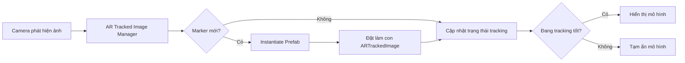

# Bài 02 — Tạo mô hình ảo xuất hiện trên AR Marker

> **Lộ trình:** Mobile AR Development · **Chủ đề:** Spawn an object on an AR Marker · **Môi trường tham chiếu:** Unity 2022.3

## 1. Mục tiêu

Tạo một **Prefab** chứa mô hình 3D và cho mô hình xuất hiện khi camera nhận diện ảnh đã đăng ký. Khi marker di chuyển, mô hình cần đi theo marker; khi tracking không ổn định, ứng dụng cần có cách xử lý rõ ràng.

Sau bài này, người học có thể giải thích khác biệt giữa `Prefab` và `Instantiate`, sử dụng pose/Transform của marker, điều khiển vòng đời đối tượng và phát hiện lỗi spawn lặp.

## 2. Prefab, Instantiate và hệ tọa độ

**Prefab** là mẫu GameObject có thể tái sử dụng, cùng các Component, cấu hình và cấu trúc con. `Instantiate()` tạo một instance tại runtime; `Destroy()` loại bỏ đối tượng khi cần. Ví dụ một mô hình tác phẩm nghệ thuật có thể được tạo thành Prefab để dùng cho nhiều marker.

Điểm quan trọng của AR là **cha–con của Transform**. Nếu instance trở thành con của `ARTrackedImage`, Transform cục bộ của nó được định nghĩa so với ảnh đang theo dõi. Khi pose ảnh thay đổi, mô hình sẽ di chuyển theo mà không cần cập nhật vị trí thế giới thủ công mỗi frame.



Sơ đồ tách ba công việc: tạo instance **một lần**, giữ instance đi theo marker qua quan hệ Transform và bật/tắt nội dung dựa trên trạng thái tracking.

## 3. Chuẩn bị Prefab

1. Trong scene, tạo một GameObject hình học đơn giản (Cube hoặc mô hình 3D được phép sử dụng).
2. Điều chỉnh kích thước để phù hợp với kích thước vật lý của ảnh; ví dụ mô hình quá lớn có thể che kín camera.
3. Kéo GameObject từ **Hierarchy** vào thư mục trong **Project** để tạo Prefab.
4. Thêm Collider nếu nội dung yêu cầu tương tác va chạm. Collider **không bắt buộc** chỉ để hiển thị mô hình.
5. Trong scene AR, bảo đảm đã có `AR Tracked Image Manager` và `Reference Image Library` hoạt động.

## 4. Mã C# theo dõi marker và sinh đối tượng

Ví dụ dưới đây sử dụng API của AR Foundation 5.x, phù hợp với nhánh tài liệu dùng Unity 2022.3. Khi chuyển sang phiên bản AR Foundation khác, cần đối chiếu chữ ký event với phiên bản package hiện có.

```csharp
using System.Collections.Generic;
using UnityEngine;
using UnityEngine.XR.ARFoundation;
using UnityEngine.XR.ARSubsystems;

public class MarkerContentSpawner : MonoBehaviour
{
    [SerializeField] private ARTrackedImageManager trackedImageManager;
    [SerializeField] private GameObject contentPrefab;

    private readonly Dictionary<TrackableId, GameObject> contents =
        new Dictionary<TrackableId, GameObject>();

    private void OnEnable()
    {
        if (trackedImageManager != null)
            trackedImageManager.trackedImagesChanged += OnImagesChanged;
    }

    private void OnDisable()
    {
        if (trackedImageManager != null)
            trackedImageManager.trackedImagesChanged -= OnImagesChanged;
    }

    private void OnImagesChanged(ARTrackedImagesChangedEventArgs args)
    {
        foreach (ARTrackedImage image in args.added)
        {
            if (contentPrefab == null) continue;

            GameObject instance = Instantiate(contentPrefab, image.transform);
            instance.transform.localPosition = Vector3.zero;
            instance.transform.localRotation = Quaternion.identity;
            contents[image.trackableId] = instance;
            instance.SetActive(image.trackingState == TrackingState.Tracking);
        }

        foreach (ARTrackedImage image in args.updated)
        {
            if (contents.TryGetValue(image.trackableId, out GameObject instance))
                instance.SetActive(image.trackingState == TrackingState.Tracking);
        }

        foreach (ARTrackedImage image in args.removed)
        {
            if (contents.TryGetValue(image.trackableId, out GameObject instance))
            {
                Destroy(instance);
                contents.Remove(image.trackableId);
            }
        }
    }
}
```

**Giải thích:**

- `trackedImagesChanged` báo tập ảnh vừa xuất hiện, được cập nhật hoặc bị gỡ bỏ.
- `Instantiate(contentPrefab, image.transform)` tạo mô hình làm **con** của ảnh đã theo dõi.
- `TrackableId` là khóa quản lý instance cho từng ảnh; không tạo thêm mô hình ở mỗi frame.
- `TrackingState.Tracking` giúp ẩn nội dung khi hệ thống không xác nhận pose đang được theo dõi ổn định.
- Khi image bị loại bỏ, instance được dọn; trong các thiết kế nhiều nội dung lặp nhanh có thể cân nhắc tái sử dụng thay vì tạo/hủy liên tục.

## 5. Gắn mã vào Unity

1. Tạo file `MarkerContentSpawner.cs` (trùng tên class).
2. Gắn script vào GameObject quản lý trong scene.
3. Kéo `AR Tracked Image Manager` vào trường `Tracked Image Manager` trong Inspector.
4. Kéo Prefab vào trường `Content Prefab`.
5. Build lên điện thoại; thử đưa marker vào khung hình, di chuyển marker và rời khỏi khung hình.

**Checkpoint:** Trong mỗi lần ảnh được theo dõi có **một** mô hình xuất hiện và bám đúng marker. Nếu dùng nhiều ảnh, từng ảnh có instance riêng.

## 6. Đối chiếu với ví dụ Instantiate cơ bản

Lệnh sau chỉ tạo một đối tượng cách vị trí hiện tại theo trục Z thế giới:

```csharp
Instantiate(prefab, transform.position + Vector3.forward * 2f,
            Quaternion.identity);
```

Đó là ví dụ tốt để học `Instantiate`, nhưng **không đủ** cho mục tiêu AR marker vì instance không tự bám theo pose của hình ảnh. Khi cần nội dung đi theo marker, hãy gắn instance với Transform của `ARTrackedImage`.

## 7. Lỗi thường gặp

| Vấn đề | Nguyên nhân | Cách kiểm tra |
| --- | --- | --- |
| Không hiện mô hình | Chưa gán Prefab hoặc manager | Kiểm tra Inspector và Console |
| Mô hình xuất hiện sai chỗ | Sai parent, local offset hoặc scale | Xác nhận parent là `ARTrackedImage` |
| Mỗi frame có thêm mô hình | Gọi `Instantiate` trong cập nhật lặp | Chỉ spawn khi ảnh được thêm mới |
| Mô hình nhấp nháy | Tracking chập chờn hoặc ánh sáng kém | Quan sát `trackingState`, thử marker rõ hơn |
| Ảnh biến mất nhưng nội dung còn | Chưa xử lý sự kiện removed | Kiểm tra dọn instance theo TrackableId |

## 8. Thực hành mở rộng

- Dùng hai hình marker có chi tiết khác nhau và quan sát số instance trong **Hierarchy**.
- Thêm một hiệu chỉnh `localPosition` nhỏ để mô hình nằm trên bề mặt ảnh, rồi giải thích vì sao dịch chuyển theo trục thế giới có thể không đúng.
- Ghi một video khi đưa marker vào/ra khung hình và nhận xét hành vi của instance.

## 9. Câu hỏi ôn tập

**Câu 1.** `Prefab` có ý nghĩa gì?  
A. File ghi âm · B. Hệ tọa độ thế giới · C. Mẫu GameObject tái sử dụng · D. Quyền camera  
**Đáp án: C.** Prefab lưu một cấu hình đối tượng để tạo instance nhiều lần.

**Câu 2.** Phương thức nào tạo bản sao ở runtime?  
A. `Instantiate()` · B. `Destroy()` · C. `SetActive()` · D. `Debug.Log()`  
**Đáp án: A.** `Instantiate` tạo instance mới.

**Câu 3.** Vì sao nên đặt mô hình thành con của `ARTrackedImage`?  
A. Để tắt camera · B. Để tăng kích thước project · C. Để loại bỏ scene · D. Để nội dung kế thừa chuyển động của marker  
**Đáp án: D.** Quan hệ parent–child giữ mô hình theo đúng pose ảnh.

**Câu 4.** Cách tránh tạo vô hạn mô hình là gì?  
A. Đổi tên prefab · B. Spawn khi marker mới được thêm và quản lý bằng TrackableId · C. Tăng FPS · D. Tắt Collider  
**Đáp án: B.** Tạo một lần cho mỗi image, cập nhật trạng thái ở các sự kiện sau.

**Câu 5.** Nếu marker tạm mất tracking, cách xử lý nào hợp lý?  
A. Luôn sinh thêm model · B. Xóa toàn bộ project · C. Tạm ẩn nội dung cho đến khi tracking ổn định · D. Chuyển sang canvas overlay  
**Đáp án: C.** Việc ẩn tạm giúp tránh hiện mô hình ở pose thiếu tin cậy.

## 10. Tổng kết

Mấu chốt của bài không chỉ là **spawn Prefab** mà là **spawn đúng thời điểm, đúng Transform và có vòng đời rõ ràng**. Đây là nền tảng để gắn các tương tác UI, âm thanh và hiệu ứng trong những ứng dụng AR thực tế.

**Tham khảo:** [Unity Learn — Create a marker-based AR app](https://learn.unity.com/pathway/mobile-ar-development/unit/create-a-marker-based-ar-app?version=2022.3) · [AR Foundation 5.1 — Image tracking](https://docs.unity.cn/Packages/com.unity.xr.arfoundation%405.1/manual/features/image-tracking.html). Nội dung và ví dụ thực hành được biên soạn độc lập.
