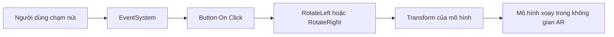

# Bài 03 — Thêm giao diện và nút xoay mô hình AR

> **Lộ trình:** Mobile AR Development · **Chủ đề:** Add a UI with rotation buttons · **Môi trường tham chiếu:** Unity 2022.3

## 1. Tổng quan và mục tiêu

Một mô hình ảo đã xuất hiện trên marker vẫn còn ít khả năng tương tác. Bài này xây dựng **hai nút trên màn hình** để xoay mô hình sang trái hoặc sang phải theo từng lần nhấn. Giao diện phải dễ nhìn trên điện thoại và tác động lên **mô hình**, không làm xoay cả camera hoặc marker.

Người học sẽ cấu hình `Canvas`, `RectTransform`, `Button`, `EventSystem`, tạo hàm xử lý sự kiện `On Click()` và kiểm tra UI ở nhiều tỉ lệ màn hình.

## 2. Thành phần UI trong Unity

| Thành phần | Ý nghĩa |
| --- | --- |
| `Canvas` | Bề mặt chứa giao diện |
| `RectTransform` | Vị trí, kích thước và bố cục UI |
| `Anchor` | Mốc căn chỉnh khi kích thước màn hình thay đổi |
| `Canvas Scaler` | Điều chỉnh khả năng hiển thị theo độ phân giải |
| `Button` | Phát tín hiệu `On Click()` |
| `EventSystem` | Điều phối sự kiện nhập liệu UI |
| `TextMeshPro` | Hiển thị văn bản trên nút hoặc thông báo |

Sử dụng Canvas kiểu **Screen Space** khi muốn nút điều khiển cố định theo màn hình điện thoại. Điều này khác với **World Space Canvas** trong bài về giao diện gắn với marker.

## 3. Luồng xử lý sự kiện



Không cần thay đổi góc xoay ở mọi frame khi người dùng chỉ muốn xoay theo từng lần chạm. Cập nhật Transform **ngay khi có sự kiện** sẽ đơn giản và dễ kiểm thử hơn.

## 4. Tạo các nút trong scene

1. Tạo `Canvas` dạng **Screen Space - Overlay** (hoặc cấu hình screen-space thích hợp với dự án).
2. Thêm hai `Button`, đặt tên `RotateLeftButton` và `RotateRightButton`.
3. Đổi nhãn thành `⟲ Trái` và `Phải ⟳` bằng TextMeshPro nếu có.
4. Đặt anchor nút về phía đáy màn hình; chỉnh lề để nút không sát mép và tránh vùng giao diện hệ điều hành.
5. Kiểm tra `EventSystem` hiện diện và chỉ có hệ thống input UI phù hợp được cấu hình.
6. Thử các tỉ lệ màn hình trong Game View, sau đó kiểm thử chạm trên điện thoại.

## 5. Script xoay mô hình

```csharp
using UnityEngine;

public class MarkerRotationController : MonoBehaviour
{
    [SerializeField] private float anglePerTap = 15f;
    private Transform target;

    public void SetTarget(Transform model)
    {
        target = model;
    }

    public void RotateLeft()
    {
        if (target != null)
            target.Rotate(Vector3.up, -anglePerTap, Space.Self);
    }

    public void RotateRight()
    {
        if (target != null)
            target.Rotate(Vector3.up, anglePerTap, Space.Self);
    }
}
```

`target` phải là Transform của **nội dung cần xoay** (thường là instance tạo từ Prefab), không phải Transform của `ARTrackedImage`. Vì mô hình có thể được sinh **sau khi ứng dụng chạy**, cần gọi `SetTarget(instance.transform)` tại lúc khởi tạo instance hoặc khi chọn mô hình để điều khiển.

**Ví dụ kết nối với script spawn:** sau khi `Instantiate(...)` thành công, có thể gọi:

```csharp
rotationController.SetTarget(instance.transform);
```

Điều này giả định script tạo instance đã được khai báo tham chiếu `MarkerRotationController rotationController` và gán trong Inspector. Khi quản lý nhiều marker, phải quyết định **mô hình nào đang được chọn**; ví dụ trên điều khiển một mục tiêu tại một thời điểm.

## 6. Liên kết Button On Click

1. Gắn `MarkerRotationController` lên GameObject điều khiển trong scene.
2. Trong phần **Button → On Click()**, kéo GameObject chứa script vào ô đối tượng.
3. Nút trái chọn `MarkerRotationController.RotateLeft()`.
4. Nút phải chọn `MarkerRotationController.RotateRight()`.
5. Kiểm thử rằng sau khi marker xuất hiện, mỗi lần nhấn chỉ xoay mô hình theo bước mong đợi.

**Checkpoint:** Khi chưa có mô hình, bấm nút không gây `NullReferenceException`. Khi có mô hình, các nút xoay theo hai hướng ngược nhau mà vị trí marker vẫn được theo dõi bình thường.

## 7. Phân biệt điều khiển UI và trạng thái dữ liệu

Giao diện không nên tự quyết định toàn bộ trạng thái của trò chơi hoặc ứng dụng. `Button` chỉ phát **yêu cầu**, script đọc mục tiêu hiện tại và thực hiện thay đổi. Cách tách này cũng hữu ích khi bổ sung `Slider` cho góc quay hoặc `Toggle` bật/tắt mô hình.

Trong trường hợp muốn hiển thị số lượt xoay, có thể lưu một biến đếm và chỉ cập nhật TextMeshPro **khi lượt xoay thay đổi**, thay vì cập nhật văn bản liên tục trong `Update()`.

## 8. Gỡ lỗi

| Hiện tượng | Cần kiểm tra |
| --- | --- |
| Bấm không phản hồi | `EventSystem`, input module, `On Click()` và Raycast Target |
| Nút không thấy trên một số màn hình | Anchor, RectTransform, Canvas Scaler |
| Có nút nhưng mô hình không xoay | `target` chưa được gán qua `SetTarget()` |
| Cả marker di chuyển/xoay | Đã chọn nhầm Transform của image hoặc XR Origin |
| Xoay trông không đúng trục | Phân biệt `Space.Self` với `Space.World`, hướng trục của mesh |

## 9. Bài tập luyện tập

Tạo giao diện gồm hai nút trái/phải, bổ sung một nút **Đặt lại góc quay** theo ý tưởng `target.localRotation = Quaternion.identity`. Thử chuyển vị trí nút lên góc màn hình và so sánh khả năng thao tác bằng một tay.

**Sản phẩm:** ảnh Hierarchy/Inspector, bản chạy trên điện thoại và một video ngắn thao tác hai nút.

## 10. Câu hỏi ôn tập

**Câu 1.** Khi muốn nút đứng yên trên màn hình điện thoại, nên dùng loại Canvas nào?  
A. Screen Space · B. World Space trên marker · C. Rigidbody Canvas · D. Collider Canvas  
**Đáp án: A.** Screen Space đặt UI theo khung màn hình.

**Câu 2.** Thành phần nào phụ trách phân phối các sự kiện nhấn UI?  
A. AudioSource · B. AR Session · C. EventSystem · D. XR Reference Image Library  
**Đáp án: C.** EventSystem phối hợp với input module để xử lý tương tác UI.

**Câu 3.** `anglePerTap` dùng để làm gì?  
A. Điều chỉnh chiều cao marker · B. Đặt góc quay cho mỗi lần bấm · C. Thiết lập FPS · D. Tăng âm lượng  
**Đáp án: B.** Tham số quyết định bước xoay theo sự kiện.

**Câu 4.** Để không làm thay đổi pose marker, nên xoay đối tượng nào?  
A. XR Origin · B. AR Camera · C. AR Session · D. Transform của model con  
**Đáp án: D.** Chỉ mô hình được xoay tương đối với marker.

**Câu 5.** Nút đã gắn hàm nhưng không xoay, trong khi không có lỗi UI. Nguyên nhân hợp lý nhất?  
A. Thiếu marker texture · B. Chưa gán Transform mục tiêu · C. Thiếu Audio Listener · D. Quá nhiều hình trong library  
**Đáp án: B.** Hàm trả về mà không xoay khi `target == null`.

## 11. Tổng kết

Giao diện AR có hai phần tách biệt: **UI nhận tương tác** và **logic điều khiển mô hình**. Dùng sự kiện `Button.OnClick`, đặt anchor hợp lý và chỉ tác động lên Transform nội dung giúp ứng dụng dễ mở rộng, dễ debug và ổn định hơn.

**Tham khảo:** [Unity Learn — Create a marker-based AR app](https://learn.unity.com/pathway/mobile-ar-development/unit/create-a-marker-based-ar-app?version=2022.3). Ví dụ C# là mã thực hành tự biên soạn.
