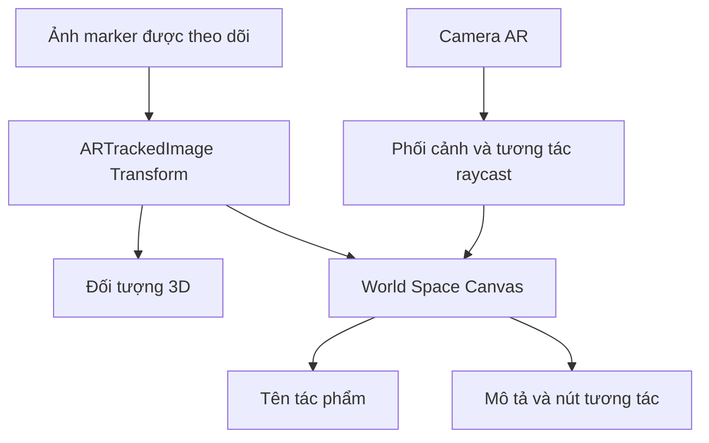

# Bài 04 — Tạo giao diện World Space gắn với AR Marker

> **Lộ trình:** Mobile AR Development · **Chủ đề:** Add world space UI to your marker-based app · **Môi trường tham chiếu:** Unity 2022.3

## 1. Tổng quan

Trong một ứng dụng AR, không phải mọi nút bấm hay nhãn thông tin đều cần nằm cố định ở góc màn hình. Một **World Space Canvas** có thể được đặt vào không gian 3D và đi theo một marker. Ví dụ, khi người xem hướng camera vào bức tranh, một tấm bảng mô tả tác phẩm xuất hiện bên cạnh mô hình ảo.

Khác với giao diện Screen Space, World Space UI có **vị trí, hướng và kích thước trong không gian**. Khoảng cách từ camera, góc nhìn và thứ tự che khuất ảnh hưởng trực tiếp đến khả năng đọc và chạm.

## 2. Mục tiêu học tập

1. Phân biệt Canvas trong không gian màn hình và trong thế giới 3D.
2. Thiết lập `Render Mode = World Space` và gắn Canvas vào Transform của marker hoặc nội dung AR.
3. Tổ chức `RectTransform`, scale và các thành phần UI để giữ bố cục dễ đọc.
4. Kiểm tra raycast và thao tác người dùng trên thiết bị di động.

## 3. Nguyên lý hoạt động

| Tiêu chí | Screen Space UI | World Space UI |
| --- | --- | --- |
| Vị trí | Theo khung hình điện thoại | Theo tọa độ trong scene |
| Khi người dùng di chuyển camera | UI vẫn ở vị trí trên màn hình | UI thay đổi phối cảnh theo marker |
| Ứng dụng phù hợp | Nút điều khiển, thanh công cụ | Nhãn tên, bảng thông tin tại vật thể |
| Thách thức | Độ phân giải, vùng an toàn | Khoảng cách, kích thước, hướng, che khuất |



Trong cấu trúc này, mô hình và Canvas đều phụ thuộc Transform của ảnh. Vì thế khi ảnh di chuyển, cả hai giữ vị trí tương đối với nhau.

## 4. Xây dựng giao diện

### 4.1. Tạo Canvas và phần tử con

1. Tạo `Canvas` trong Hierarchy và đặt tên `ArtworkWorldCanvas`.
2. Chọn `Render Mode = World Space` trong Inspector.
3. Thêm Panel, TextMeshPro để hiển thị tiêu đề và đoạn mô tả ngắn.
4. Thêm Button nếu muốn cho phép bật/tắt mô tả hoặc phát âm thanh.
5. Đặt `RectTransform` theo kích thước mong muốn, rồi giảm **Transform Scale** sao cho bảng không quá lớn so với marker thực tế.
6. Căn chỉnh bảng để không che phần quan trọng của mô hình.

**Gợi ý kiểm tra:** nhìn vào scene dưới các góc nghiêng khác nhau. Một bảng đẹp ở hướng nhìn chính diện có thể rất khó đọc khi camera ở xa hoặc lệch sang bên.

### 4.2. Gắn với marker

Nếu Canvas cần đi theo ảnh tham chiếu, hãy đưa nó thành **con của `ARTrackedImage`** hoặc thành con của Prefab nội dung đã được gắn vào ảnh.

Cấu trúc mẫu:

```text
ARTrackedImage (runtime)
├── ArtworkModel
└── ArtworkWorldCanvas
    ├── Panel
    ├── TitleText
    ├── DescriptionText
    └── InfoButton
```

`localPosition` xác định khoảng cách từ bảng đến ảnh; `localRotation` xác định mặt bảng hướng về phía nào. Không nên dựa duy nhất vào tọa độ thế giới vì marker có thể di chuyển.

### 4.3. Làm cho nút bấm hoạt động

- Kiểm tra scene có `EventSystem` và input module tương thích với hệ thống input được chọn.
- Bảo đảm Canvas có `Graphic Raycaster` và đối tượng cần bấm cho phép nhận raycast.
- Trong trường hợp cần thiết, gán camera AR thích hợp làm `Event Camera` của World Space Canvas.
- Kết nối `Button.OnClick` đến phương thức public trong script điều khiển.
- Thử **chạm màn hình trên điện thoại**, không chỉ kiểm tra bằng chuột trong Editor.

Với thành phần đồ họa chồng nhau, đối tượng nằm phía trước có thể chặn raycast của nút phía sau. Cần kiểm tra cài đặt `Raycast Target` trên Image/Text không sử dụng để nhận sự kiện.

## 5. Ví dụ: bật/tắt bảng thông tin

```csharp
using UnityEngine;

public class ArtworkInfoPanel : MonoBehaviour
{
    [SerializeField] private GameObject descriptionPanel;

    public void ToggleDetails()
    {
        if (descriptionPanel == null) return;
        descriptionPanel.SetActive(!descriptionPanel.activeSelf);
    }
}
```

Gắn script trên đối tượng luôn hoạt động (chẳng hạn Canvas gốc), kéo panel vào `Description Panel`, rồi nối `InfoButton.OnClick()` với `ToggleDetails()`.

**Lưu ý:** Không đặt script trên chính Panel bị tắt nếu thao tác bật lại phụ thuộc vào nó. Nút điều khiển phải còn hoạt động khi panel mô tả được ẩn.

## 6. Kích thước, bố cục và trải nghiệm

World Space UI có thể gây khó đọc nếu kích thước quá nhỏ, hoặc lấn át mô hình nếu quá lớn. Hãy đánh giá bằng kích thước thực của marker và khoảng cách quan sát dự kiến, không dùng một bộ thông số cố định cho mọi thiết bị.

Các nguyên tắc nên áp dụng:

- Văn bản ngắn, độ tương phản đủ cao.
- Nút đủ lớn để chạm, tránh các vùng chạm sát nhau.
- Tránh đặt bảng quá sát mặt phẳng ảnh khiến mô hình hoặc bảng bị che khuất.
- Thử trên nhiều góc nhìn và trạng thái tracking; khi marker mất tracking, cân nhắc tạm ẩn bảng cùng mô hình.
- Không nhầm **góc quay của bảng** với góc quay của mô hình nghệ thuật.

## 7. Gỡ lỗi

| Hiện tượng | Cách kiểm tra |
| --- | --- |
| Canvas không xuất hiện | Render Mode, active state, parent, local scale và camera clipping |
| Bảng hiện nhưng chữ cực nhỏ | Kích thước RectTransform và Scale trong thế giới |
| Nút hiển thị nhưng không bấm được | EventSystem, Graphic Raycaster, Event Camera, Raycast Target |
| Canvas lơ lửng không theo ảnh | Parent không gắn đúng `ARTrackedImage` hoặc prefab |
| Bảng bị che bởi model | Thứ tự và khoảng cách trong không gian 3D |

## 8. Bài tập thực hành

Thiết kế một bảng giới thiệu tác phẩm có **tên**, **một câu mô tả**, và **nút hiển thị/ẩn thông tin**. Đặt bảng lệch nhẹ bên cạnh mô hình. Sau đó thử di chuyển điện thoại quanh marker để quan sát mức độ dễ đọc từ các góc nhìn khác nhau.

**Deliverable:** ảnh Hierarchy, ảnh Inspector của Canvas, video thể hiện Canvas theo marker và một lần bấm nút thành công.

## 9. Câu hỏi ôn tập

**Câu 1.** Khác biệt chính của World Space Canvas là gì?  
A. Nó không chứa Button · B. Nó tồn tại trong hệ tọa độ 3D của scene · C. Nó không cần Camera · D. Nó luôn cố định ở mép màn hình  
**Đáp án: B.** World Space UI thay đổi góc nhìn theo vị trí trong thế giới 3D.

**Câu 2.** Để bảng thông tin di chuyển theo marker, cách phù hợp là gì?  
A. Tăng FPS · B. Đặt bảng dưới `Audio Listener` · C. Tắt AR Session · D. Gắn bảng làm con của Transform được theo dõi  
**Đáp án: D.** Parent–child bảo toàn vị trí tương đối với ảnh.

**Câu 3.** Nút trên World Space UI không nhận chạm, nên kiểm tra gì trước?  
A. EventSystem và Graphic Raycaster · B. Chỉ thay màu nền · C. Đổi tên prefab · D. Tăng âm lượng  
**Đáp án: A.** Các thành phần này tham gia xử lý tương tác UI.

**Câu 4.** Vì sao cần thử nhiều góc nhìn?  
A. Để giảm số lượng marker · B. Để đổi tên class · C. Vì UI 3D bị ảnh hưởng bởi phối cảnh và che khuất · D. Để vô hiệu Collider  
**Đáp án: C.** Độ đọc được của bảng phụ thuộc camera và vị trí không gian.

**Câu 5.** Trong ví dụ bật/tắt panel, script điều khiển nên nằm ở đâu?  
A. Trên panel luôn bị tắt · B. Trên đối tượng vẫn hoạt động khi panel bị ẩn · C. Chỉ trên AR Camera · D. Trên file AudioClip  
**Đáp án: B.** Script cần tiếp tục nhận sự kiện để bật bảng trở lại.

## 10. Tổng kết

World Space UI giúp người dùng xem thông tin **ngay tại vị trí của vật thể AR**, nhưng đòi hỏi quản lý đúng Transform, kích thước, raycast và khả năng đọc. Một bố cục tốt phải được kiểm tra trên thiết bị thật khi marker di chuyển.

**Tham khảo:** [Unity Learn — Create a marker-based AR app](https://learn.unity.com/pathway/mobile-ar-development/unit/create-a-marker-based-ar-app?version=2022.3). Nội dung thực hành được biên soạn độc lập.
