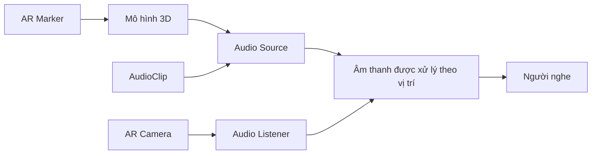

# Bài 05 — Thêm âm thanh không gian cho ứng dụng AR Marker

> **Lộ trình:** Mobile AR Development · **Chủ đề:** Add spatial audio to your marker-based app · **Môi trường tham chiếu:** Unity 2022.3

## 1. Tổng quan

Âm thanh không gian (*spatial audio*) giúp người dùng cảm nhận rằng tiếng động đến từ **một vị trí trong thế giới 3D**. Ví dụ, mô hình một chiếc hộp nhạc xuất hiện trên bức tranh; khi người xem di chuyển điện thoại ra xa, âm nghe nhỏ dần theo cách cấu hình suy giảm khoảng cách.

Khác với âm thanh giao diện 2D (nút bấm, thông báo), âm thanh 3D chịu ảnh hưởng của **vị trí nguồn phát, vị trí người nghe và quy tắc suy giảm**. Trong Unity, hai thành phần cốt lõi là `Audio Source` và `Audio Listener`.

## 2. Mục tiêu học tập

1. Phân biệt `AudioClip`, `Audio Source` và `Audio Listener`.
2. Cấu hình Spatial Blend để thử âm thanh dạng 2D và 3D.
3. Gắn nguồn âm với đối tượng AR để tiếng phát đi theo marker.
4. Kiểm thử `Volume`, `Loop`, `Play On Awake` và đặc tính suy giảm theo khoảng cách.
5. Gỡ lỗi các tình huống không phát ra tiếng hoặc tiếng bị chồng lặp.

## 3. Cấu trúc âm thanh trong AR



`AudioClip` chứa dữ liệu âm thanh. `Audio Source` phát clip tại một Transform. `Audio Listener` biểu diễn vị trí tiếp nhận, thông thường nằm trên Camera. Đối với ứng dụng marker-based AR, đặt `Audio Source` trên model hoặc GameObject con của marker để âm thanh di chuyển theo nội dung được theo dõi.

## 4. Thông số quan trọng

| Thông số | Tác dụng | Cách dùng để kiểm chứng |
| --- | --- | --- |
| `AudioClip` | Tệp âm thanh được phát | Kiểm tra clip đã được gán |
| `Play On Awake` | Phát khi đối tượng được kích hoạt | Bật/tắt để so sánh |
| `Loop` | Lặp clip | Thử âm môi trường và âm sự kiện |
| `Volume` | Cường độ nguồn âm | Thử mức nghe phù hợp |
| `Spatial Blend` | Pha trộn giữa 2D và 3D | So sánh hai đầu giá trị 2D/3D |
| `Min Distance`, `Max Distance` | Tham gia mô hình suy giảm theo khoảng cách | Di chuyển camera đến gần/xa |
| `Rolloff Mode` | Quy tắc giảm âm theo khoảng cách | So sánh các chế độ trong Inspector |

**Cần phân biệt:** `Spatial Blend = 1` giúp nguồn âm hoạt động theo không gian 3D, nhưng **không tự bảo đảm âm thanh binaural chất lượng cao** trên mọi thiết bị. Kết quả thực tế còn phụ thuộc thiết bị, loa/tai nghe và cấu hình âm thanh.

## 5. Các bước thực hành

### 5.1. Tạo nguồn phát âm

1. Chuẩn bị một `AudioClip` có quyền sử dụng phù hợp.
2. Chọn mô hình 3D được tạo từ marker hoặc thêm GameObject con đặt gần mô hình.
3. Thêm Component `Audio Source`, kéo clip vào trường `AudioClip`.
4. Đặt `Spatial Blend` về 3D, chỉnh `Volume` và chế độ suy giảm để nghe thử.
5. Tùy mục tiêu, chọn `Loop` cho âm liên tục hoặc tắt Loop cho âm sự kiện.

### 5.2. Kiểm tra vị trí người nghe

Xác nhận có **một Audio Listener đang hoạt động**, thường nằm trên AR Camera. Hai listener cùng hoạt động có thể gây cảnh báo hoặc hành vi không mong muốn. Nếu không có listener hoạt động, âm sẽ không được nghe theo cách dự kiến.

### 5.3. Gắn âm thanh với marker

Nếu Audio Source là Component của GameObject con trong Prefab AR, nó sẽ kế thừa chuyển động của marker. Khi ứng dụng quyết định ẩn mô hình do mất tracking, có thể cân nhắc dừng hoặc làm im nguồn âm tương ứng để tránh tiếng phát từ vị trí thiếu tin cậy.

## 6. Ví dụ phát âm khi bấm nút

```csharp
using UnityEngine;

public class ArtworkAudioController : MonoBehaviour
{
    [SerializeField] private AudioSource artworkAudio;

    public void PlaySound()
    {
        if (artworkAudio == null || artworkAudio.clip == null) return;
        if (!artworkAudio.isPlaying)
            artworkAudio.Play();
    }

    public void StopSound()
    {
        if (artworkAudio != null)
            artworkAudio.Stop();
    }
}
```

Gán `AudioSource` trong Inspector. Nếu dùng nút UI, nối sự kiện `On Click()` đến `PlaySound()` và `StopSound()` trên đối tượng có script. Ví dụ chặn việc bấm liên tục khiến cùng một clip tự khởi động lặp từ đầu, nhưng bạn vẫn cần thiết kế riêng nếu muốn phát nhiều hiệu ứng ngắn chồng nhau có kiểm soát.

## 7. Thử nghiệm đối chứng

Thực hiện hai lần thử với cùng một clip:

- **Lần A — âm 2D:** đặt `Spatial Blend` về 2D; di chuyển camera xa nguồn và ghi nhận sự thay đổi âm lượng bằng tai nghe/loa đang dùng.
- **Lần B — âm 3D:** đặt `Spatial Blend` về 3D; di chuyển gần và xa mô hình AR, kiểm tra âm lượng thay đổi theo cấu hình suy giảm.

Thử thêm một trường hợp nhấn nút khi model đang hiển thị, sau đó che marker để làm gián đoạn tracking. Ghi lại ứng dụng phản hồi thế nào. Không khẳng định kết quả định lượng nếu chưa sử dụng thiết bị đo.

## 8. Lỗi thường gặp

| Triệu chứng | Nguyên nhân cần kiểm tra | Hành động |
| --- | --- | --- |
| Không nghe thấy tiếng | Clip chưa gán, Volume 0 hoặc không có Listener | Kiểm tra Audio Source và Camera |
| Âm phát quá nhỏ | Nguồn cách Listener xa hoặc suy giảm mạnh | Kiểm tra khoảng cách, Min/Max Distance, Rolloff |
| Âm không thay đổi khi di chuyển | Spatial Blend đang ở phía 2D | Thử chế độ 3D và so sánh |
| Âm bị phát lặp, chồng quá mức | Gọi Play nhiều lần hoặc tạo nhiều nguồn | Theo dõi số instance và cơ chế kích hoạt |
| Không có tiếng khi mô hình ẩn | GameObject chứa AudioSource bị vô hiệu hóa | Xác định hành vi mong muốn khi mất tracking |

## 9. Bài tập

Tạo một mô hình AR nhỏ có **âm thanh không gian**. Thêm hai nút `Phát` và `Dừng`, sau đó kiểm tra ba tình huống: marker ở gần, marker ở xa, marker mất tracking. Trình bày nhận xét về phản hồi giác quan và cách ứng dụng xử lý mất tracking.

**Sản phẩm cần lưu:** ảnh Inspector của Audio Source, ảnh Audio Listener trên Camera, video test và mô tả ngắn các trường hợp kiểm thử.

## 10. Câu hỏi ôn tập

**Câu 1.** Component nào phát âm thanh từ một vị trí trong scene?  
A. `Canvas` · B. `Mesh Renderer` · C. `AR Session` · D. `Audio Source`  
**Đáp án: D.** Audio Source phát clip tại vị trí Transform của nó.

**Câu 2.** `Audio Listener` thường đặt ở đâu trong ứng dụng AR?  
A. Trên camera người dùng · B. Trên file AudioClip · C. Trong Reference Image Library · D. Trên mọi Button  
**Đáp án: A.** Camera đại diện cho góc nhìn và vị trí tiếp nhận âm của người dùng.

**Câu 3.** Thông số nào quyết định pha trộn âm 2D và 3D?  
A. Anchor · B. Spatial Blend · C. Layer Mask · D. Play Mode  
**Đáp án: B.** Spatial Blend điều chỉnh mức không gian của nguồn phát.

**Câu 4.** Vì sao âm 3D có thể nhỏ khi đứng xa model?  
A. Vì mô hình không có Collider · B. Vì nút UI sai màu · C. Vì âm suy giảm theo khoảng cách đến listener · D. Vì tên clip quá dài  
**Đáp án: C.** Khoảng cách và rolloff ảnh hưởng mức âm đến người nghe.

**Câu 5.** Khi clip không phát ra tiếng, bước kiểm tra hợp lý là gì?  
A. Thay toàn bộ hệ tọa độ · B. Tắt XR Origin · C. Xóa scene · D. Kiểm tra clip, source, volume và listener  
**Đáp án: D.** Đây là những điều kiện tối thiểu của đường phát âm.

## 11. Tổng kết

Âm thanh không gian làm ứng dụng AR giàu tính tương tác hơn khi **nguồn âm gắn với nội dung 3D** và người nghe di chuyển cùng camera. Hãy kiểm tra cả cấu hình Unity lẫn kết quả cảm nhận trên thiết bị thật.

**Tham khảo:** [Unity Learn — Create a marker-based AR app](https://learn.unity.com/pathway/mobile-ar-development/unit/create-a-marker-based-ar-app?version=2022.3). Bài thực hành được biên soạn độc lập.
