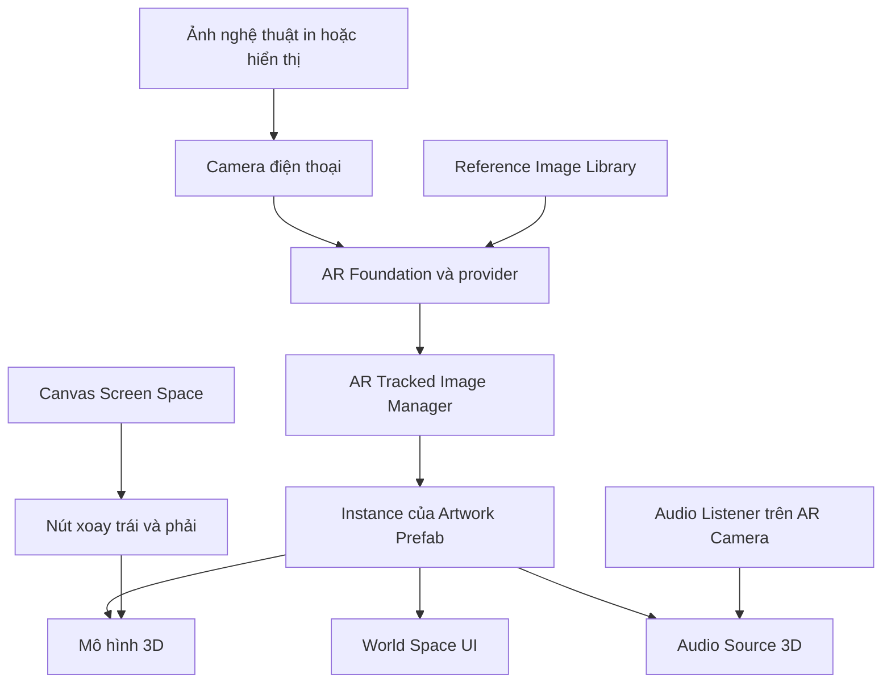
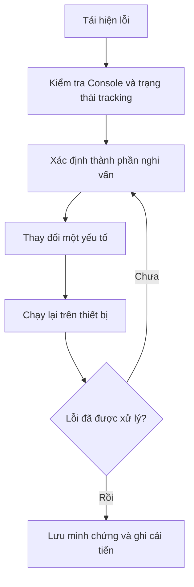

# Bài 06 — Bài thực hành cuối: Đưa tác phẩm nghệ thuật vào đời thực bằng AR

> **Lộ trình:** Mobile AR Development · **Bài đánh giá:** Submission: Bring art to life with AR · **Môi trường tham chiếu:** Unity 2022.3

## 1. Bối cảnh và yêu cầu sản phẩm

Một phòng triển lãm muốn tạo trải nghiệm cho khách tham quan: khi đưa camera điện thoại về phía hình ảnh một tác phẩm, khách nhìn thấy **mô hình 3D được gắn vào tác phẩm**, có thể **xoay mô hình**, **xem thông tin** và **nghe âm thanh minh họa**.

Nhiệm vụ là xây dựng một **bản mẫu AR marker-based chạy được**. Người học có thể chọn tranh tự vẽ, hình ảnh có bản quyền sử dụng phù hợp hoặc một hình minh họa đơn giản. Không cần nhiều hiệu ứng; ưu tiên khả năng tương tác, ổn định và kiểm chứng kết quả.

## 2. Mục tiêu đánh giá

Sản phẩm hoàn thành khi người học có thể:

1. Cấu hình ứng dụng AR sử dụng ảnh tham chiếu trên một thiết bị tương thích.
2. Tạo mô hình ảo xuất hiện đúng trên marker, quản lý hành vi khi mất tracking.
3. Cung cấp ít nhất một thao tác tương tác với phản hồi dễ quan sát; khuyến khích dùng nút xoay và bảng thông tin.
4. Tạo, kiểm tra và mô tả âm thanh không gian nếu đưa tính năng này vào sản phẩm.
5. Nộp project hoặc bản build, minh chứng chạy thử, tình huống lỗi và một cải tiến sau lần kiểm tra đầu.

## 3. Kiến trúc gợi ý

Đối tượng ảo, bảng thông tin và nguồn âm cùng dùng hệ tọa độ liên quan đến marker. Các nút điều khiển trên màn hình có thể nằm trong Canvas riêng để người dùng dễ thao tác khi đang quan sát tác phẩm.

## 4. Phạm vi và chuẩn bị

**Phần bắt buộc tối thiểu:** project hoặc bản build chạy được; ảnh marker nhận diện được; ít nhất một mô hình/đối tượng ảo xuất hiện; ít nhất một thao tác và phản hồi quan sát được; có minh chứng kiểm thử.

**Phần nâng cao khuyến khích:** hai nút xoay, World Space UI, âm thanh 3D, xử lý mất tracking và cải thiện trải nghiệm người dùng.

Chuẩn bị Unity và các package AR tương thích, điện thoại hỗ trợ AR, một ảnh tham chiếu rõ nét, một asset 3D nhẹ và một AudioClip hợp lệ nếu sử dụng âm thanh.

## 5. Các giai đoạn thực hiện

### 5.1. Mốc 1 — Ứng dụng nhận diện ảnh

- Tạo project, scene và `Reference Image Library`.
- Thêm `AR Session`, `XR Origin` và `AR Tracked Image Manager`.
- Build lên thiết bị và kiểm tra camera nhận marker.

**Checkpoint:** đưa marker vào camera và xác nhận ảnh có trạng thái tracking hợp lệ.

### 5.2. Mốc 2 — Nội dung ảo bám vào tác phẩm

- Tạo `ArtworkPrefab` chứa mô hình cần trưng bày.
- Tạo một instance theo ảnh được phát hiện; dùng Transform của `ARTrackedImage` làm parent.
- Kiểm tra việc di chuyển camera/marker, xử lý ẩn hoặc dọn nội dung khi tracking thay đổi.

**Checkpoint:** mô hình không sinh bản sao vô hạn và không tách khỏi marker khi thử nghiệm thông thường.

### 5.3. Mốc 3 — Giao diện tương tác

- Tạo hai nút Screen Space để xoay mô hình trái/phải.
- Gắn `Button.OnClick()` với script điều khiển Transform của mô hình.
- Tạo World Space UI chứa tên và mô tả ngắn về tác phẩm nếu thực hiện phần nâng cao.
- Kiểm tra anchor, text, vùng chạm và event raycast trên điện thoại.

**Checkpoint:** nhấn một lần có phản hồi một lần; người xem vẫn nhìn thấy tác phẩm.

### 5.4. Mốc 4 — Âm thanh và hoàn thiện

- Thêm Audio Source gắn gần mô hình; thiết lập clip, Spatial Blend và suy giảm phù hợp.
- Kiểm tra listener ở AR Camera, thử nghe gần/xa marker.
- Điều chỉnh kích thước mô hình, vị trí bảng và phản hồi khi mất tracking.
- Ghi màn hình thử nghiệm và thu thập lỗi.

**Checkpoint:** các tính năng đã chọn hoạt động cùng nhau, không có lỗi nghiêm trọng chặn thao tác chính.

## 6. Kịch bản kiểm thử

| ID | Tình huống | Kết quả kỳ vọng |
| --- | --- | --- |
| T01 | Mở ứng dụng và cấp quyền camera | Session hoạt động và camera hiển thị |
| T02 | Đưa marker vào vùng nhìn | Mô hình xuất hiện đúng bề mặt ảnh |
| T03 | Di chuyển marker vừa phải | Mô hình đi theo và không spawn vô hạn |
| T04 | Nhấn nút xoay trái/phải | Chỉ mô hình thay đổi hướng theo yêu cầu |
| T05 | Mở/ẩn bảng thông tin (nếu có) | UI thay đổi trạng thái và vẫn đọc được |
| T06 | Di chuyển camera gần/xa (nếu có âm 3D) | Âm phản hồi theo cấu hình khoảng cách |
| T07 | Che marker hoặc mất tracking | Ứng dụng xử lý có chủ đích, không crash |
| T08 | Chạy lại ở điều kiện ánh sáng khác | Ghi nhận mức độ ổn định và lỗi gặp phải |

Đánh dấu kết quả **Pass/Fail**, thiết bị dùng thử và bằng chứng (ảnh/video/Console) cho từng tình huống. Không đánh dấu Pass nếu chưa chạy thử thực tế.

## 7. Gỡ lỗi có phương pháp

Đối với lỗi camera, tập trung vào quyền và provider. Đối với lỗi mô hình, kiểm tra Prefab và parent Transform. Đối với lỗi UI, kiểm tra EventSystem, `OnClick` và raycast. Đối với lỗi âm thanh, kiểm tra AudioClip, nguồn phát, listener và khoảng cách.

## 8. Hồ sơ sản phẩm cần nộp

- [ ] Project Unity hoặc một bản build cài đặt/chạy được.
- [ ] Ảnh marker và các asset được phép sử dụng.
- [ ] Ảnh chụp scene, Hierarchy và các cấu hình trọng yếu.
- [ ] Video chứng minh **phát hiện marker → hiện mô hình → tương tác**.
- [ ] Bảng kết quả kiểm thử, tối thiểu gồm một trường hợp thành công và một trường hợp lỗi.
- [ ] Nhật ký mô tả **một cải tiến sau lần thử đầu tiên** và kết quả kiểm chứng sau chỉnh sửa.

## 9. Tiêu chí đánh giá gợi ý

Đây là bảng rubric để **tự đánh giá**, không phải quy định chấm điểm chính thức của Unity Learn.

| Tiêu chí | Tỷ trọng gợi ý | Dấu hiệu đạt |
| --- | ---: | --- |
| Cấu hình và nhận diện marker | 25% | Ứng dụng nhận ảnh trên thiết bị thật |
| Nội dung AR bám đúng ảnh | 25% | Mô hình hiện đúng và được quản lý vòng đời |
| Tương tác và phản hồi | 20% | Có thao tác tạo phản hồi rõ ràng |
| Trải nghiệm và tính ổn định | 15% | UI/âm thanh đã chọn hoạt động hợp lý, không lỗi chặn |
| Minh chứng, debug và cải tiến | 15% | Có video, ghi nhận lỗi, cải tiến và thử lại |

Phần giao diện World Space và âm thanh 3D là cách tăng chất lượng bản mẫu. Nếu không sử dụng những phần này, cần đảm bảo bài nộp vẫn có **tương tác thực sự và phản hồi quan sát được**.

## 10. Câu hỏi ôn tập

**Câu 1.** Yếu tố nào chứng minh đây là ứng dụng marker-based AR?  
A. Chỉ có text trên màn hình · B. Có nhạc nền · C. Nội dung được neo vào ảnh tham chiếu đã phát hiện · D. Sử dụng prefab trong Editor  
**Đáp án: C.** Marker là cơ sở để xác định pose nội dung trong không gian.

**Câu 2.** Trong một lần kiểm thử mô hình không xuất hiện, kiểm tra nào nên được ưu tiên?  
A. Tracking, Prefab và tham chiếu trong Inspector · B. Đổi logo project · C. Tăng số lượng nút · D. Đổi tên bài học  
**Đáp án: A.** Cần xác nhận việc nhận diện và khởi tạo nội dung trước.

**Câu 3.** Vì sao nên ghi lại trường hợp lỗi trong báo cáo?  
A. Để thay thế video thành công · B. Để bỏ qua kiểm thử lại · C. Để giảm kích thước project · D. Để chứng minh khả năng tái hiện và cải tiến sản phẩm  
**Đáp án: D.** Một báo cáo kỹ thuật cần mô tả lỗi, cách xử lý và kết quả thử lại.

**Câu 4.** Trong ứng dụng có hai nút xoay, đối tượng nên nhận góc quay là gì?  
A. Camera và XR Origin · B. Mô hình ảo được lựa chọn · C. Toàn bộ scene · D. Audio Listener  
**Đáp án: B.** Tương tác nên thay đổi nội dung nghệ thuật, không làm sai tracking.

**Câu 5.** Cách nghiệm thu nào đầy đủ nhất?  
A. Chỉ xem ảnh Hierarchy · B. Chỉ build thành công · C. Kiểm thử thiết bị thật, tương tác, ghi lỗi và cải tiến · D. Chỉ chạy Game View  
**Đáp án: C.** Sản phẩm AR cần được đánh giá bằng hoạt động thực và minh chứng.

## 11. Kết luận

Một bản mẫu “Bring art to life with AR” tốt cần ghép được các khâu: **nhận diện hình ảnh, tạo nội dung ảo, tương tác, phản hồi giác quan và kiểm thử**. Giá trị của bài thực hành không chỉ nằm ở hiệu ứng trình diễn mà còn ở khả năng giải thích và kiểm chứng cách ứng dụng hoạt động.

**Tham khảo:** [Unity Learn — Create a marker-based AR app](https://learn.unity.com/pathway/mobile-ar-development/unit/create-a-marker-based-ar-app?version=2022.3). Đây là đề bài thực hành được biên soạn và mở rộng để tự học, không phải rubric chính thức của Unity.
