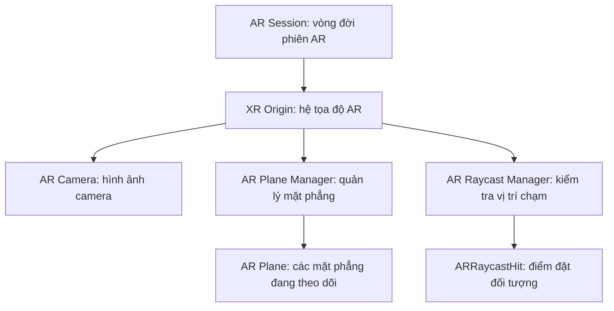

# Bài 01 — Thiết lập scene AR có khả năng phát hiện mặt phẳng

> **Khóa học:** Mobile AR Development · **Chủ đề:** Create a plane detection AR app · **Môi trường tham chiếu:** Unity 2022.3, AR Foundation.  
> **Kết quả:** Camera AR nhận diện được mặt sàn/mặt bàn và có thể hiển thị vùng mặt phẳng được theo dõi.

## 1. Tổng quan

**Plane detection** là khả năng ước lượng các bề mặt phẳng trong thế giới thật từ dữ liệu camera và cảm biến. Ứng dụng dùng kết quả ấy để đặt một nhân vật hoặc cổng không gian ảo ở vị trí có ý nghĩa vật lý. Mặt phẳng được nhận diện có thể thay đổi ranh giới và tư thế khi hệ thống thu thập thêm thông tin; không nên xem kết quả ban đầu là hình học cố định.

## 2. Mục tiêu học tập

- Phân biệt chức năng của `AR Session`, `XR Origin`, `AR Plane Manager` và `AR Raycast Manager`.
- Cấu hình scene cho phép phát hiện ít nhất một mặt phẳng ngang.
- Kiểm tra quyền camera, khả năng AR trên điện thoại và trạng thái tracking.
- Giải thích được vì sao kết quả trên thiết bị thật có thể khác Play mode trong Editor.

## 3. Kiến trúc của scene

`AR Session` kích hoạt và quản lý tracking. `XR Origin` biến đổi tọa độ do thiết bị cung cấp thành tọa độ trong Unity. `AR Plane Manager` phát hiện và cập nhật các `ARPlane`. `AR Raycast Manager` thực hiện phép thử từ điểm trên màn hình vào các đối tượng được AR theo dõi; đây là bước chuẩn bị cho các bài tương tác.

| Thành phần | Nhiệm vụ | Sai sót điển hình |
|---|---|---|
| `AR Session` | Khởi tạo, duy trì AR | Thiếu session, tracking không hoạt động |
| `XR Origin` | Quản lý gốc tọa độ và camera AR | Camera tham chiếu sai |
| `AR Camera` | Hiển thị nền thế giới thật | Chưa cấu hình camera background/quyền camera |
| `AR Plane Manager` | Tìm và quản lý mặt phẳng | Detection mode không phù hợp |
| `AR Raycast Manager` | Truy vấn hit-test vào trackable | Không có hit khi người dùng chạm |

## 4. Chuẩn bị

1. Tạo hoặc mở dự án Unity tương thích AR Foundation. Trong **Window > Package Manager**, kiểm tra package AR Foundation và package của nền tảng: **ARCore XR Plugin** (Android) hoặc **ARKit XR Plugin** (iOS).
2. Bật nhà cung cấp XR tương ứng trong **Project Settings > XR Plug-in Management** nếu cấu hình dự án sử dụng mục này.
3. Chuẩn bị điện thoại có hỗ trợ AR, cáp hoặc phương thức triển khai, và khu vực có đủ ánh sáng với bề mặt có chi tiết thị giác.
4. Lưu scene với tên dễ nhận biết, chẳng hạn `PlaneDetectionScene`.

> **Lưu ý phiên bản:** Với AR Foundation 5.x, đối tượng gốc thường mang tên `XR Origin`. Tài liệu hoặc project AR Foundation cũ có thể dùng tên `AR Session Origin`; đối chiếu đúng phiên bản package trước khi thao tác.

## 5. Thực hành tạo scene

**Bước 1 — Tạo cấu trúc AR.** Trong Hierarchy, tạo `AR Session` và `XR Origin` theo menu XR có sẵn. Nếu template đã tạo sẵn camera AR, tránh để thêm một `Main Camera` hoạt động trùng lặp.

**Bước 2 — Thêm khả năng phát hiện mặt phẳng.** Chọn `XR Origin`, thêm `AR Plane Manager`. Đặt **Detection Mode** là mặt phẳng ngang (Horizontal) cho bài thử trên sàn/bàn; chỉ dùng Vertical nếu muốn nhận diện tường và thiết bị hỗ trợ.

**Bước 3 — Trực quan hóa.** Gán prefab hiển thị mặt phẳng phù hợp vào trường **Plane Prefab** nếu cần quan sát hình dạng. Một `ARPlane` chỉ biểu diễn dữ liệu trackable, không mặc nhiên tạo một vùng màu có thể nhìn thấy. Có thể dùng prefab/visualizer tương thích từ các sample của package đang cài.

**Bước 4 — Chuẩn bị tương tác.** Thêm `AR Raycast Manager` trên đối tượng quản lý AR; chức năng này sẽ được dùng để chạm chọn một bề mặt.

**Bước 5 — Build & kiểm thử.** Thêm scene vào Build Settings, chọn Android/iOS, cấp quyền camera, triển khai lên điện thoại. Di chuyển máy chậm quanh bàn/sàn, đợi tracking ổn định và quan sát các mặt phẳng mới xuất hiện/cập nhật.

## 6. Điểm kiểm tra và xử lý lỗi

| Hiện tượng | Cách chẩn đoán |
|---|---|
| Chỉ thấy màn hình đen | Kiểm tra quyền camera, camera AR, hỗ trợ AR của thiết bị |
| Không phát hiện mặt phẳng | Thử khu vực sáng hơn, có họa tiết; kiểm tra `AR Plane Manager` và Detection Mode |
| Mặt phẳng rung hoặc thay đổi | Chờ tracking ổn định, di chuyển chậm, không cố định đối tượng bằng kết quả chưa đáng tin cậy |
| Chạy trong Editor nhưng không như điện thoại | Kiểm tra sự khác biệt giữa mô phỏng XR và dữ liệu camera thật |
| Đối tượng có vị trí/scale sai | Kiểm tra `XR Origin`, hệ tọa độ và đơn vị đo của mô hình |

**Checkpoint:** ghi ảnh hoặc video thấy mặt phẳng ảo phủ lên mặt bàn hoặc mặt sàn thật; chụp Inspector cho biết manager đã được cấu hình.

## 7. Bài tập vận dụng

- Chạy thử lần lượt ở bề mặt có họa tiết và bề mặt ít chi tiết, giải thích sự khác biệt.
- Thay đổi chế độ phát hiện ngang/dọc và kiểm tra chỉ loại mặt phẳng nào được phát hiện.
- Viết báo cáo ngắn gồm thiết bị, package, điều kiện ánh sáng, kết quả mong đợi, kết quả quan sát và lỗi đã khắc phục.

## 8. Câu hỏi ôn tập

**Câu 1.** Thành phần nào chịu trách nhiệm phát hiện và cập nhật các `ARPlane`?  
A. `AR Plane Manager` · B. `Audio Listener` · C. `Canvas` · D. `Animator`  
**Đáp án: A.** `AR Plane Manager` quản lý tập mặt phẳng được theo dõi.

**Câu 2.** Vai trò chủ yếu của `XR Origin` là gì?  
A. Nén video camera · B. Tải vật liệu · C. Chuyển đổi hệ tọa độ AR sang scene · D. Tạo UI  
**Đáp án: C.** `XR Origin` ánh xạ hệ tọa độ theo dõi vào thế giới Unity.

**Câu 3.** Vì sao cần kiểm thử trên thiết bị thật?  
A. Vì Editor không có Scene view · B. Vì tracking và camera phụ thuộc phần cứng/môi trường · C. Vì prefab không chạy trong Editor · D. Vì Unity không có Console  
**Đáp án: B.** Môi trường thật quyết định chất lượng dữ liệu AR.

**Câu 4.** Nếu muốn nhận diện sàn, chế độ phù hợp nhất là gì?  
A. Disabled · B. Vertical · C. Face tracking · D. Horizontal  
**Đáp án: D.** Sàn và mặt bàn thường là mặt phẳng ngang.

**Câu 5.** Khi không có hình trực quan của mặt phẳng, kết luận nào chính xác?  
A. Tracking chắc chắn hỏng · B. Thiết bị chắc chắn không hỗ trợ AR · C. Có thể thiếu prefab/visualizer, dù tracking đang chạy · D. Cần xóa `AR Session`  
**Đáp án: C.** Dữ liệu `ARPlane` và hình biểu diễn của nó là hai phần khác nhau.

## 9. Tổng kết

Một scene phát hiện mặt phẳng cần **phiên AR**, **gốc tọa độ/camera** và **plane manager**; tương tác bằng điểm chạm sẽ cần thêm **raycast manager**. Đánh giá kết quả bằng quan sát trên điện thoại, không chỉ bằng Play mode.

**Đọc thêm:** [Unity Learn — Create a plane detection AR app](https://learn.unity.com/pathway/mobile-ar-development/unit/create-a-plane-detection-ar-app?version=2022.3) · [AR Foundation setup](https://developers.google.com/ar/develop/unity-arf/getting-started-ar-foundation).
