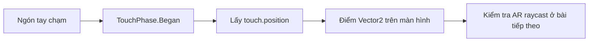

# Bài 02 — Phát hiện thao tác chạm của người dùng

> **Khóa học:** Mobile AR Development · **Chủ đề:** Create a plane detection AR app · **Môi trường tham chiếu:** Unity 2022.3.  
> **Kết quả:** Nhận biết một lần chạm màn hình và xác định được tọa độ chạm.

## 1. Tổng quan

Trong ứng dụng AR, camera liên tục di chuyển nhưng người dùng vẫn cần chọn một vị trí cụ thể để tương tác. Bước đầu tiên là nhận diện **sự kiện chạm** (touch input) và lấy tọa độ của nó trên màn hình. Đây mới là thông tin trong không gian 2D; việc xác định vị trí 3D trên mặt phẳng thật là bước riêng.

## 2. Mục tiêu học tập

- Phân biệt tọa độ màn hình `Vector2` với vị trí thế giới `Vector3`.
- Nhận biết số lượng chạm, pha bắt đầu và tọa độ của lần chạm.
- Tránh thực thi hành động nhiều lần trong lúc người dùng giữ ngón tay.
- Kiểm tra cách ứng dụng nhận input trên thiết bị Android/iOS.

## 3. Cơ chế nhận touch

Mỗi ngón tay tạo ra một chuỗi trạng thái: `Began` → `Moved` hoặc `Stationary` → `Ended` (hoặc `Canceled`). Nếu chỉ muốn đặt vật thể **một lần khi chạm**, kiểm tra `TouchPhase.Began` thay vì chạy trong mọi frame có ngón tay trên màn hình.



Đơn vị của `touch.position` là pixel màn hình, gốc thông thường ở góc dưới bên trái. Không thể sử dụng trực tiếp một `Vector2` này làm vị trí cố định trong thế giới 3D.

## 4. Thực hành với C#

Tạo script `TouchReporter.cs`, gắn lên một `GameObject` đang hoạt động trong scene.

```csharp
using UnityEngine;

public class TouchReporter : MonoBehaviour
{
    private void Update()
    {
        if (Input.touchCount == 0) return;

        Touch touch = Input.GetTouch(0);
        if (touch.phase != TouchPhase.Began) return;

        Vector2 screenPosition = touch.position;
        Debug.Log($"Touch began at: {screenPosition}");
    }
}
```

**Giải thích:**

1. `Update()` được gọi mỗi frame để kiểm tra input.
2. `Input.touchCount == 0` ngăn truy cập `GetTouch(0)` khi chưa có ngón tay nào chạm.
3. `TouchPhase.Began` chỉ kích hoạt tại thời điểm bắt đầu chạm, giảm nguy cơ sinh nhiều đối tượng ngoài ý muốn.
4. `touch.position` trả về tọa độ màn hình để chuyển sang bước hit-test AR.

Ví dụ dùng **API Input kiểu cũ** (`Input.GetTouch`). Nếu dự án chỉ bật hệ Input System mới, cần điều chỉnh **Active Input Handling** phù hợp hoặc thay bằng API của Input System theo package đang cài. Không nên trộn hai hệ input mà không kiểm tra cấu hình.

## 5. Kiểm chứng

**Bước 1:** Build scene lên điện thoại, mở Console/nhật ký thiết bị bằng công cụ debug phù hợp.  
**Bước 2:** Chạm một lần và kiểm tra chỉ có một thông báo tại pha `Began`.  
**Bước 3:** Giữ ngón tay rồi kéo; script mẫu không ghi thêm cho đến lần chạm mới.  
**Bước 4:** Chạm hai ngón gần đồng thời; script chỉ xử lý `GetTouch(0)`, chưa phải bộ nhận diện đa điểm đầy đủ.

| Thử nghiệm | Kết quả mong đợi |
|---|---|
| Không chạm | Không có thông báo mới |
| Chạm ngắn một lần | Ghi một tọa độ `Vector2` |
| Giữ ngón tay lâu | Không sinh sự kiện `Began` liên tục |
| Chạm ở góc khác | Tọa độ thay đổi theo vị trí trên màn hình |

## 6. Lỗi thường gặp

- **Lỗi truy cập chỉ số touch:** gọi `Input.GetTouch(0)` trước khi xác nhận `Input.touchCount > 0`.
- **Sự kiện lặp:** xử lý tại mọi frame mà không kiểm tra `TouchPhase.Began`.
- **Không phát hiện input:** cấu hình `Active Input Handling` không phù hợp với API trong script.
- **Chạm giao diện UI nhưng vẫn đặt vật thể:** cần kiểm tra/loại trừ vùng UI trước khi thực hiện tương tác AR.
- **Kỳ vọng có vị trí thế giới:** `touch.position` chưa cung cấp tọa độ bề mặt 3D.

## 7. Bài tập củng cố

Thay `Debug.Log` bằng một nhãn UI hoặc đếm số lần chạm hợp lệ. Thử bổ sung điều kiện bỏ qua lần chạm thứ hai khi người dùng đang thao tác bằng nhiều ngón; mô tả cách xử lý và kiểm tra thực tế.

## 8. Câu hỏi ôn tập

**Câu 1.** Loại dữ liệu phù hợp để biểu diễn tọa độ touch là gì?  
A. `Quaternion` · B. `Vector2` · C. `Color` · D. `Texture2D`  
**Đáp án: B.** Vị trí chạm là một điểm 2D trên màn hình.

**Câu 2.** Khi nào nên kích hoạt lệnh đặt đối tượng một lần?  
A. Mọi `Update()` · B. `TouchPhase.Stationary` · C. `TouchPhase.Began` · D. `TouchPhase.Moved`  
**Đáp án: C.** Pha bắt đầu giúp tránh lặp khi giữ ngón tay.

**Câu 3.** Vì sao phải kiểm tra `touchCount`?  
A. Để tránh đọc touch không tồn tại · B. Để bật camera · C. Để tạo prefab · D. Để khởi động ARKit  
**Đáp án: A.** `GetTouch(0)` không hợp lệ khi không có touch.

**Câu 4.** Muốn biết người dùng chạm vào mặt bàn thật, cần bổ sung bước nào?  
A. Dùng `Animator` · B. Đọc `Time.time` · C. Đổi màu camera · D. Raycast vào mặt phẳng AR  
**Đáp án: D.** Hit-test nối tọa độ 2D với trackable 3D.

**Câu 5.** Script `GetTouch` không phản hồi trong project dùng Input System mới độc quyền. Nên kiểm tra gì trước?  
A. Đèn trong scene · B. Active Input Handling · C. Vật liệu của portal · D. Chất lượng texture  
**Đáp án: B.** Hệ input đang bật phải tương thích với API sử dụng.

## 9. Tổng kết

Phát hiện touch là bước **thu thập ý định tương tác**, chưa phải phát hiện bề mặt. Sử dụng pha bắt đầu và xác nhận có touch hợp lệ trước khi chuyển tọa độ sang phép raycast AR.

**Đọc thêm:** [Unity Learn — Create a plane detection AR app](https://learn.unity.com/pathway/mobile-ar-development/unit/create-a-plane-detection-ar-app?version=2022.3).
