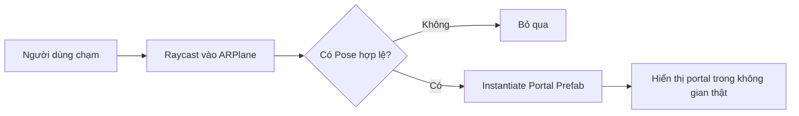

# Bài 04 — Tạo cổng không gian ảo trên mặt phẳng được phát hiện

> **Khóa học:** Mobile AR Development · **Môi trường tham chiếu:** Unity 2022.3.  
> **Kết quả:** Người dùng chạm vào mặt phẳng hợp lệ và một `Portal Prefab` xuất hiện đúng vị trí đó.

## 1. Tổng quan

Một **Prefab** là mẫu GameObject có thể tái sử dụng: mô hình, material, collider và các script được cấu hình sẵn. `Instantiate` tạo bản sao trong lúc ứng dụng đang chạy. Với ứng dụng AR, khác biệt quan trọng là tọa độ sinh prefab phải đến từ **`ARRaycastHit.pose`**, thay vì một vị trí tùy ý trước mặt camera.

## 2. Mục tiêu

- Chuẩn bị một `Portal Prefab` có gốc tọa độ, kích thước và hướng phù hợp.
- Kết nối touch, AR raycast và lệnh `Instantiate` thành một thao tác.
- Hạn chế tạo nhiều portal khi người dùng chạm liên tiếp.
- Chẩn đoán lỗi prefab không được gán, spawn sai hướng và spawn ngoài mặt phẳng.

## 3. Luồng hoạt động



Nếu chỉ cho phép một portal, có thể lưu tham chiếu đến đối tượng đã tạo và **di chuyển** nó khi có hit mới. Cách này tiết kiệm hơn việc liên tục tạo và hủy nhiều prefab nặng.

## 4. Chuẩn bị prefab

1. Tạo GameObject gốc `PortalRoot`, đặt mô hình khung cổng và nội dung thế giới ảo làm đối tượng con.
2. Kiểm tra điểm gốc (pivot) của `PortalRoot`: đặt tại chân cổng để `Pose.position` của mặt sàn tương ứng với chân portal.
3. Chỉnh kích thước theo tỷ lệ phù hợp với thực tế; tránh scale quá lớn khiến cổng bị chìm hoặc che kín màn hình.
4. Kéo `PortalRoot` từ Hierarchy sang Project để tạo asset `PortalPrefab`.
5. Thử kéo prefab trở lại scene tĩnh để xác minh hướng trục trước khi tích hợp AR.

## 5. Script tạo portal trên mặt phẳng

Tạo script `PortalPlacer.cs` và gắn lên một GameObject luôn hoạt động trong scene.

```csharp
using System.Collections.Generic;
using UnityEngine;
using UnityEngine.XR.ARFoundation;
using UnityEngine.XR.ARSubsystems;

public class PortalPlacer : MonoBehaviour
{
    [SerializeField] private ARRaycastManager raycastManager;
    [SerializeField] private GameObject portalPrefab;

    private GameObject spawnedPortal;
    private static readonly List<ARRaycastHit> Hits = new List<ARRaycastHit>();

    private void Update()
    {
        if (raycastManager == null || portalPrefab == null) return;
        if (Input.touchCount == 0) return;

        Touch touch = Input.GetTouch(0);
        if (touch.phase != TouchPhase.Began) return;
        if (!raycastManager.Raycast(touch.position, Hits,
                TrackableType.PlaneWithinPolygon)) return;
        if (Hits.Count == 0) return;

        Pose pose = Hits[0].pose;
        if (spawnedPortal == null)
        {
            spawnedPortal = Instantiate(portalPrefab, pose.position, pose.rotation);
        }
        else
        {
            spawnedPortal.transform.SetPositionAndRotation(
                pose.position, pose.rotation);
        }
    }
}
```

**Cấu hình Inspector:** kéo component `AR Raycast Manager` vào `raycastManager`; kéo asset `PortalPrefab` vào `portalPrefab`. `spawnedPortal` giữ một instance duy nhất. Code minh họa dùng API Input cũ và giả định prefab có hướng trục phù hợp với pose mặt phẳng; nếu cổng quay sai, điều chỉnh rotation offset ở prefab hoặc trong logic đặt.

## 6. Thực hành và checkpoint

- **Kiểm tra 1 — Có hit:** chạm trên sàn đã phát hiện → portal xuất hiện tại vị trí chạm.
- **Kiểm tra 2 — Không hit:** chạm vào vùng chưa được theo dõi → portal không sinh sai vị trí.
- **Kiểm tra 3 — Chạm lần nữa:** portal hiện tại chuyển sang vị trí mới; trong Hierarchy không xuất hiện thêm nhiều clone.
- **Kiểm tra 4 — Quan sát từ góc khác:** portal giữ kích thước hợp lý và không xuyên mặt sàn do pivot sai.

## 7. Lỗi thường gặp

| Sự cố | Nguyên nhân khả dĩ | Cách khắc phục |
|---|---|---|
| Không thấy portal | `portalPrefab`/manager chưa gán, không có raycast hit | Xem Inspector và log kiểm tra hit |
| Portal chìm trong sàn | Pivot ở giữa mô hình, không ở chân | Di chuyển mesh con tương đối so với `PortalRoot` |
| Portal nằm ngang | Hướng prefab không phù hợp với `pose.rotation` | Kiểm tra trục local và áp dụng offset phù hợp |
| Nhiều portal chồng nhau | Gọi `Instantiate` ở mọi touch hoặc frame | Lưu instance và tái sử dụng |
| Portal giật theo camera | Đặt parent theo camera thay vì tọa độ thế giới | Xem lại parent và hệ tọa độ AR |

## 8. Bài tập mở rộng

Thiết kế tùy chọn **Đặt lại portal**: xóa instance hiện tại bằng `Destroy` khi bấm nút UI, sau đó cho phép người dùng chọn mặt phẳng khác. Mô tả khi nào nên tái sử dụng instance và khi nào nên hủy để giải phóng tài nguyên.

## 9. Câu hỏi ôn tập

**Câu 1.** `Instantiate` dùng để làm gì?  
A. Lấy FPS · B. Sinh bản sao prefab lúc runtime · C. Tìm ARPlane · D. Xin quyền camera  
**Đáp án: B.** Lệnh tạo instance của đối tượng mẫu.

**Câu 2.** Để portal nằm trên mặt bàn đúng vị trí chạm, nên lấy tọa độ từ đâu?  
A. `Time.time` · B. Camera far clip · C. `Input.touchCount` · D. `ARRaycastHit.pose`  
**Đáp án: D.** Pose được xác định bởi raycast vào bề mặt AR.

**Câu 3.** Vì sao cần chỉnh pivot ở chân portal?  
A. Để chân portal tương ứng mặt phẳng đặt · B. Để mở microphone · C. Để có thêm shader · D. Để thay đổi FPS  
**Đáp án: A.** Origin của prefab được đặt đúng vị trí hit.

**Câu 4.** Cách phù hợp nếu chỉ muốn một portal được phép tồn tại?  
A. Spawn mỗi frame · B. Không kiểm tra touch · C. Lưu instance và di chuyển nó · D. Tạo hàng trăm prefab  
**Đáp án: C.** Tái sử dụng tránh nhân bản ngoài ý muốn.

**Câu 5.** Khi không có raycast hit, lệnh nào nên được thực hiện?  
A. Tạo ở gốc tọa độ · B. Bỏ qua thao tác đặt · C. Tạo ở vị trí camera · D. Tăng scale vô hạn  
**Đáp án: B.** Chưa có vị trí 3D hợp lệ để spawn.

## 10. Tổng kết

Tương tác đặt portal đáng tin cậy gồm **Prefab đúng pivot**, **Raycast hợp lệ** và **quản lý vòng đời instance**. Việc spawn tại điểm hit là điều kiện cốt lõi giúp mô hình gắn với thế giới thật.

**Đọc thêm:** [Unity Learn — Create a plane detection AR app](https://learn.unity.com/pathway/mobile-ar-development/unit/create-a-plane-detection-ar-app?version=2022.3).
