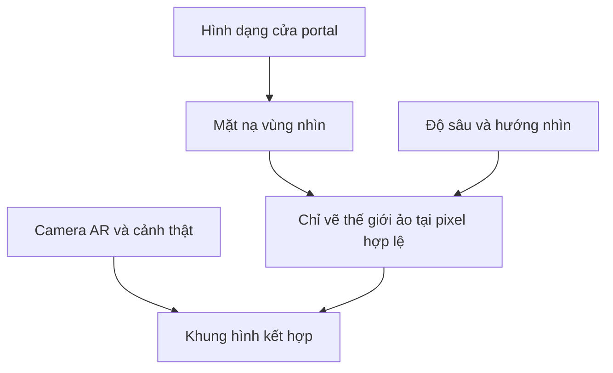

# Bài 06 — Giới hạn vùng nhìn thấy của thế giới bên trong portal

> **Khóa học:** Mobile AR Development · **Môi trường tham chiếu:** Unity 2022.3.  
> **Kết quả:** Người xem chỉ nhìn thấy nội dung thế giới ảo qua vùng mở của portal, thay vì thấy toàn bộ cảnh 3D tràn ra môi trường thật.

## 1. Bài toán hiển thị

Portal AR tạo cảm giác có một “cửa sổ” dẫn tới thế giới khác. Nếu đơn giản đặt một scene ảo đằng sau khung cổng, các đối tượng trong cảnh đó có thể vẫn hiện ra **bên ngoài** khung. Bài toán là quản lý vùng pixel được phép hiển thị (visibility mask), đồng thời duy trì đúng thứ tự lớp với hình ảnh camera.

Đây là bài học về **giới hạn vùng hiển thị**, không đồng nhất với việc xóa các vật thể ngoài khung khỏi scene. Che hình ảnh chưa chắc đã tiết kiệm hết chi phí dựng hình.

## 2. Mục tiêu

- Phân biệt **che hiển thị** (masking), **culling** (bỏ qua vật thể không cần render) và **occlusion** (che khuất theo chiều sâu).
- Mô tả được nguyên lý dùng stencil/depth để giới hạn vùng portal.
- Thiết lập kiểm thử ở ba góc nhìn: trực diện, xiên và phía bên ngoài khung.
- Nhận biết các sai sót khiến vật thể ảo “rò rỉ” ra thế giới thật.

## 3. Nguyên lý mask portal

Có nhiều kỹ thuật hiện thực hóa cùng mục tiêu:

| Kỹ thuật | Ý tưởng | Điều cần cân nhắc |
|---|---|---|
| `Stencil Buffer` | Đánh dấu pixel thuộc cửa; render thế giới ảo khi stencil đúng | Shader và Render Pipeline phải tương thích |
| `Depth Mask` | Dùng vật liệu ghi chiều sâu/che các vùng không mong muốn | Sai thứ tự render có thể làm vật thể biến mất |
| Render Texture + Mask | Render thế giới ảo sang texture rồi cắt theo vùng cửa | Chi phí render thêm, xử lý phối cảnh |
| Frustum/Layer Culling | Hạn chế vật thể/camera không cần vẽ | Không thay thế hoàn toàn mask hình dạng cửa |

**Ví dụ tư duy stencil:** vẽ hình cửa vào stencil với giá trị `1`, sau đó chỉ cho phép pixel của thế giới portal hiển thị khi stencil bằng `1`. Các thao tác phụ thuộc shader và pipeline thực tế nên không thể chỉ gắn một `Material` bất kỳ là mặc nhiên có hiệu quả.

## 4. Thực hành có thể kiểm chứng

**Bước 1 — Phân tách đối tượng.** Trong prefab, tạo ba nhóm: `PortalFrame` (khung), `PortalOpening` (mặt phẳng xác định vùng mở) và `PortalWorld` (nội dung ảo phía sau). Kiểm tra vị trí tương đối và hướng của các nhóm.

**Bước 2 — Tạo mask.** Chọn kỹ thuật khả dụng trong Render Pipeline hiện tại. Với stencil, cần material/shader ghi stencil tại hình cửa và shader cho thế giới portal đọc stencil tương ứng. Với render texture, cần camera phụ và vật liệu hiển thị texture qua hình cửa.

**Bước 3 — Kiểm tra thứ tự render.** Xác nhận mask được chuẩn bị trước khi render đối tượng cần giới hạn, đồng thời tránh để khung portal che sai chiều sâu. Đặc biệt kiểm tra transparent objects và shader không ghi depth.

**Bước 4 — Thử góc nhìn.** Đặt portal lên mặt sàn; di chuyển từ chính diện sang góc xiên. Quan sát xem các vật thể trong `PortalWorld` có xuất hiện ngoài `PortalOpening` không.

**Bước 5 — Đánh giá hiệu năng.** Đo lại FPS/frame time trên cùng thiết bị như bài kiểm thử hiệu năng. Nếu dùng camera phụ/Render Texture, ghi riêng chi phí tăng thêm.

## 5. Checklist nghiệm thu

- [ ] Nội dung thế giới ảo nhìn thấy **qua** cửa portal.
- [ ] Nội dung không tràn ra vùng ngoài cửa khi thay đổi góc nhìn.
- [ ] Khung cổng vẫn được render đúng.
- [ ] Không có phần mặt nạ hiện thành khối màu che camera một cách ngoài ý muốn.
- [ ] Không xuất hiện lỗi khác nhau không giải thích được giữa các góc nhìn.
- [ ] FPS và frame time được kiểm tra lại sau thay đổi shader/mask.

## 6. Xử lý lỗi

| Biểu hiện | Điều cần kiểm tra |
|---|---|
| Toàn bộ thế giới ảo hiển thị ngoài cổng | Shader portal không đọc mask hoặc layer/camera render bỏ qua mask |
| Thế giới ảo biến mất hoàn toàn | Giá trị stencil không khớp, render order sai, mask quay ngược |
| Cửa portal bị một mặt màu che kín | Vật liệu mask vẫn ghi màu thay vì chỉ làm nhiệm vụ che |
| Khi xoay máy có viền hở | Geometry cửa và khung không trùng, clipping/precision hoặc độ sâu sai |
| FPS giảm sau khi dùng render texture | Camera phụ hoặc độ phân giải texture tạo chi phí bổ sung |

## 7. Bài tập

Dựng một portal thử nghiệm gồm khung chữ nhật và một khối 3D nằm phía sau. Thử làm cho khối chỉ thấy trong vùng cửa, chụp ba góc nhìn và ghi kỹ thuật đã sử dụng. Nếu có thể, đo FPS trước và sau khi thêm mask và giải thích kết quả.

## 8. Câu hỏi ôn tập

**Câu 1.** Mục tiêu quan trọng nhất của visibility mask trong portal là gì?  
A. Chỉ cho phép cảnh ảo xuất hiện qua vùng mở · B. Tăng số particle · C. Cấp quyền camera · D. Tạo trackable mới  
**Đáp án: A.** Mask điều khiển pixel nào được nhìn thấy.

**Câu 2.** `Stencil Buffer` thường được dùng như thế nào?  
A. Lưu âm thanh · B. Đọc GPS · C. Đánh dấu và kiểm tra pixel hợp lệ · D. Tính tốc độ di chuyển  
**Đáp án: C.** Stencil cho phép ràng buộc việc vẽ theo giá trị đã ghi.

**Câu 3.** Vì sao chỉ che hình ảnh không đảm bảo FPS tăng?  
A. Vì máy không có camera · B. Vì mask không cần shader · C. Vì plane manager dừng · D. Vì nội dung có thể vẫn tốn chi phí render  
**Đáp án: D.** Visibility và chi phí dựng hình không hoàn toàn đồng nhất.

**Câu 4.** Khi thế giới ảo biến mất hoàn toàn, bước nào hợp lý nhất?  
A. Xóa AR Session · B. Kiểm tra stencil/depth và thứ tự render · C. Tăng số prefab · D. Tắt debug  
**Đáp án: B.** Vấn đề thường liên quan điều kiện mask hoặc thứ tự xử lý.

**Câu 5.** Tình huống kiểm thử nào có ích để phát hiện rò rỉ hiển thị?  
A. Chỉ đứng trực diện · B. Chỉ kiểm tra asset trong Project · C. Di chuyển sang góc xiên và bên cạnh cửa · D. Chỉ nhìn Scene view  
**Đáp án: C.** Các góc nhìn khác nhau bộc lộ lỗi hình học và mask.

## 9. Tổng kết

Portal tạo được cảm giác “cửa sổ sang thế giới khác” khi **khung**, **vùng mở** và **cảnh ảo** phối hợp chính xác. Chọn giải pháp mask phù hợp với Render Pipeline, kiểm thử nhiều góc nhìn và đo lại hiệu năng.

**Đọc thêm:** [Unity Learn — Create a plane detection AR app](https://learn.unity.com/pathway/mobile-ar-development/unit/create-a-plane-detection-ar-app?version=2022.3).
