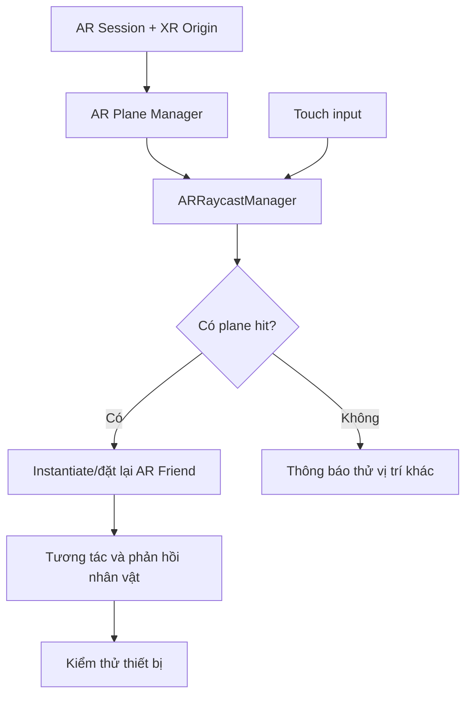

# Bài 07 — Dự án thực hành: AR Friend

> **Khóa học:** Mobile AR Development · **Loại:** Bài tập dự án/nộp sản phẩm · **Môi trường tham chiếu:** Unity 2022.3.  
> **Sản phẩm:** Một ứng dụng AR đơn giản cho phép người dùng đặt người bạn 3D lên mặt phẳng thật và quan sát/tương tác với nhân vật.

## 1. Bối cảnh dự án

Trong bài tập **AR Friend**, người học tự thiết kế một trải nghiệm AR nhỏ dựa trên khả năng nhận diện mặt phẳng và thao tác chạm. Người bạn 3D có thể là một nhân vật đơn giản hoặc prefab có sẵn được phép sử dụng. Mục tiêu không phải tạo mô hình phức tạp mà là xây dựng một vòng tương tác đầy đủ: **quét không gian → chọn vị trí → đặt đối tượng → nhận phản hồi → kiểm thử**.

Đây là đề bài thực hành **tự biên soạn** theo chủ đề bài nộp; yêu cầu cụ thể và cách chấm chính thức cần đối chiếu trong trang Unity Learn của khóa học.

## 2. Kết quả cần đạt

- Ứng dụng chạy được trên thiết bị hỗ trợ AR, truy cập camera và phát hiện được mặt phẳng.
- Một lần chạm hợp lệ trên mặt phẳng đặt được nhân vật 3D.
- Nhân vật có ít nhất một phản hồi nhìn thấy được, chẳng hạn xoay nhẹ, chuyển animation hoặc thay đổi trạng thái khi bấm nút.
- Người dùng có cách đặt lại vị trí hoặc bắt đầu lại thử nghiệm.
- Có minh chứng chạy trên thiết bị thực và ghi chú về lỗi/hiệu năng.

## 3. Kiến trúc tối thiểu

Nên chia logic thành ba nhóm: **AR tracking**, **xử lý touch/đặt vật thể** và **hành vi nhân vật**. Cách tách này giúp debug vì mỗi nhóm có thể được xác minh độc lập.

## 4. Các mốc triển khai

### 4.1. Mốc 1 — Hoàn thiện scene AR

Tạo `AR Session`, `XR Origin`, `AR Plane Manager` và `AR Raycast Manager`. Kiểm tra trên điện thoại rằng ít nhất một bề mặt ngang được nhận diện. Nếu thất bại, chưa nên ghép nhân vật phức tạp.

### 4.2. Mốc 2 — Chuẩn bị nhân vật

Chọn một prefab đơn giản, thống nhất pivot ở đáy và scale phù hợp. Nếu nhân vật có animation, đảm bảo animator hoạt động độc lập trong scene tĩnh trước khi dùng AR. Chú ý bản quyền model/texture khi trình bày sản phẩm.

### 4.3. Mốc 3 — Đặt nhân vật trên mặt phẳng

Nhận `TouchPhase.Began`, gọi raycast với `PlaneWithinPolygon`; nếu có hit, tạo prefab tại `Pose` tương ứng. Giới hạn một instance hoặc quản lý danh sách instance một cách chủ động. Không spawn tại camera khi hit thất bại.

### 4.4. Mốc 4 — Thêm tương tác

Chọn tối thiểu một phản hồi có thể kiểm chứng: bấm một nút `Wave` để nhân vật vẫy tay, bấm `Rotate` để xoay theo bước, hoặc bấm `Reset` để đặt lại. Kiểm tra touch trên UI không đồng thời gây ra một lệnh đặt nhân vật mới.

### 4.5. Mốc 5 — Kiểm thử và hoàn thiện

Thử trong các điều kiện sáng khác nhau; kiểm tra mất tracking, chạm ngoài plane và bấm nhiều lần. Đo sơ bộ FPS khi nhân vật xuất hiện và xác nhận không có nhiều clone không chủ đích.

## 5. Ma trận kiểm thử

| ID | Trường hợp | Kết quả mong đợi |
|---|---|---|
| T01 | Mở ứng dụng, cấp camera | Hình ảnh camera và tracking hoạt động |
| T02 | Quét mặt bàn, chạm vào vùng hợp lệ | Nhân vật xuất hiện trên mặt bàn |
| T03 | Chạm vùng chưa có plane | Không sinh nhân vật sai vị trí |
| T04 | Chạm nút tương tác | Nhân vật phản hồi đúng một lần |
| T05 | Chạm vị trí hợp lệ mới | Nhân vật được di chuyển/đặt lại theo thiết kế |
| T06 | Lia camera sang góc khác | Nhân vật giữ kích thước và tư thế hợp lý |

## 6. Đầu ra cần nộp

- **Project Unity** có scene chính và prefab nhân vật; không cần đóng gói những file cache không thiết yếu khi chia sẻ.
- **Bản build** cho nền tảng mục tiêu, nếu thiết bị/quy trình nộp hỗ trợ.
- **Video minh chứng** cho chuỗi quét mặt phẳng → đặt nhân vật → tương tác → thử lại.
- **README ngắn** ghi cách mở dự án, phiên bản Unity/package, yêu cầu thiết bị, chức năng đã làm và hạn chế còn tồn tại.
- **Bảng kiểm thử** có kết quả quan sát thực tế, không điền số đo giả định.

## 7. Tiêu chí tự đánh giá

| Nhóm | Điều kiện hoàn thành |
|---|---|
| AR cơ bản | Tracking hoạt động và phát hiện được bề mặt |
| Tương tác | Touch hợp lệ tạo/di chuyển nhân vật; touch không hợp lệ được xử lý an toàn |
| Trải nghiệm | Có phản hồi của AR Friend; mô hình đặt đúng tỷ lệ, không xuyên sàn |
| Chất lượng | Không có lỗi Console nghiêm trọng, chạy đủ ổn định để thử nghiệm |
| Minh chứng | Có video/ảnh và chỉ ra rõ cách tái hiện từng chức năng |

Không tự coi một tính năng đã hoàn thành nếu chỉ cấu hình trong Inspector mà chưa chạy thử trên thiết bị.

## 8. Câu hỏi ôn tập

**Câu 1.** Vì sao nên thử plane detection trước khi tích hợp nhân vật phức tạp?  
A. Để bỏ qua camera · B. Để xóa package · C. Để tăng texture · D. Để cô lập lỗi tracking khỏi lỗi nội dung 3D  
**Đáp án: D.** Kiểm thử từng lớp giúp tìm nguyên nhân nhanh.

**Câu 2.** Người dùng chạm vùng chưa có plane, ứng dụng nên làm gì?  
A. Không đặt vật thể và có thể hướng dẫn quét lại · B. Spawn ở gốc tọa độ · C. Tạo nhiều clone · D. Tắt camera  
**Đáp án: A.** Không có pose hợp lệ để đặt nhân vật.

**Câu 3.** Cách kiểm tra phản hồi của nhân vật hợp lý nhất là gì?  
A. Chỉ xem asset trong Project · B. Chỉ đọc tên script · C. Thực hiện thao tác trên điện thoại và quay video kết quả · D. Giả sử animator luôn chạy  
**Đáp án: C.** Cần minh chứng chức năng được kích hoạt thực sự.

**Câu 4.** Vì sao cần kiểm tra pivot nhân vật?  
A. Để mở Internet · B. Để chân nhân vật nằm đúng bề mặt · C. Để bật âm thanh · D. Để thay FPS  
**Đáp án: B.** Pivot quyết định tương quan giữa hit pose và hình học nhân vật.

**Câu 5.** Nội dung nào quan trọng trong README bàn giao?  
A. Chỉ tên tác giả · B. Chỉ ảnh quảng cáo · C. Chỉ lời chào · D. Phiên bản, hướng dẫn chạy, chức năng và giới hạn  
**Đáp án: D.** README giúp người khác mở, thử và đánh giá dự án.

## 9. Definition of Done

Ứng dụng đạt mức hoàn thành khi: (1) chạy trên điện thoại hỗ trợ AR; (2) đặt được AR Friend trên plane hợp lệ; (3) có tương tác và phản hồi quan sát được; (4) xử lý an toàn khi không có hit; (5) có minh chứng và hướng dẫn chạy.

**Tham khảo đề bài chính thức:** [Unity Learn — Create a plane detection AR app](https://learn.unity.com/pathway/mobile-ar-development/unit/create-a-plane-detection-ar-app?version=2022.3).
