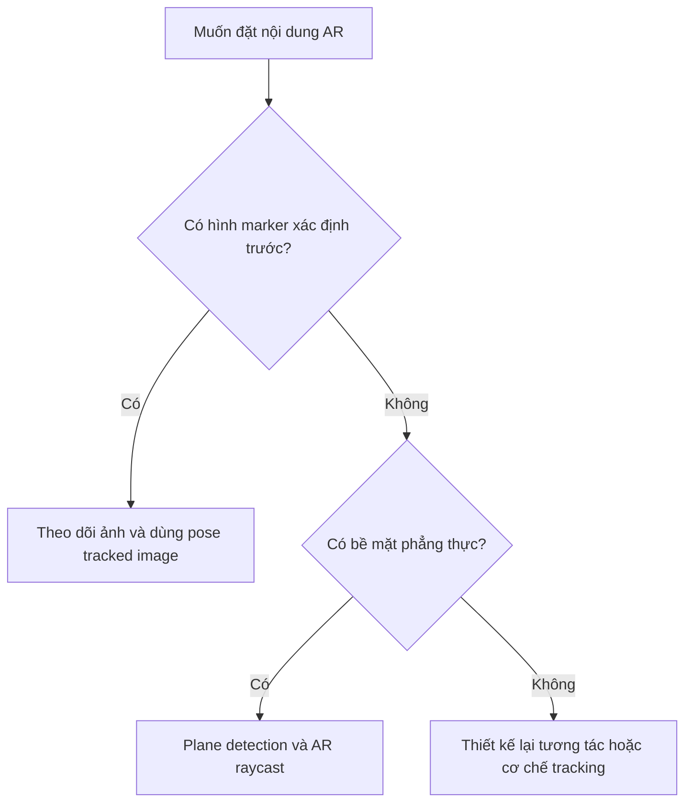

# Bài 08 — Trắc nghiệm tổng hợp: AR Marker và Plane Detection

> **Khóa học:** Mobile AR Development · **Loại:** Bài kiểm tra tự luyện.  
> **Phạm vi:** Phân biệt AR dựa trên marker và AR dựa trên mặt phẳng, thao tác chạm, raycast, prefab, hiệu năng, khả năng hiển thị portal.

## 1. Hướng dẫn làm bài

Hãy làm bài trước khi xem phần đáp án. Mỗi câu chỉ có **một lựa chọn đúng nhất**. Các tình huống phản ánh những kỹ năng thực hành trong Unity AR Foundation, không phải bản sao câu hỏi đánh giá chính thức của Unity Learn.

## 2. Bảng hệ thống hóa kiến thức

| Nội dung | Marker-based AR | Plane detection AR |
|---|---|---|
| Dữ liệu chính | Hình ảnh/mốc đã khai báo để theo dõi | Bề mặt thực được hệ thống ước lượng |
| Đối tượng quản lý thường dùng | `AR Tracked Image Manager` | `AR Plane Manager` |
| Cách xác định điểm đặt | Dựa trên pose của ảnh được theo dõi | Dựa trên pose từ hit-test vào plane |
| Tình huống phù hợp | Nội dung hiện khi camera nhìn thấy hình mục tiêu | Đặt nội dung lên sàn, bàn, mặt phẳng |
| Hạn chế tiêu biểu | Mất tracking khi ảnh bị che hoặc khó nhận diện | Cần bề mặt đủ điều kiện để phát hiện và theo dõi |

Dù chọn phương thức nào, scene vẫn cần được cấu hình phù hợp với nền tảng AR, camera, hệ tọa độ và vòng đời tracking.

## 3. Sơ đồ quyết định

Sơ đồ mô tả cách chọn **điểm neo nội dung**, không có nghĩa hai kỹ thuật loại trừ nhau trong mọi dự án.

## 4. Câu hỏi trắc nghiệm

### Câu 1

Một triển lãm muốn phát mô hình 3D khi camera nhận diện đúng bức tranh đã đăng ký. Thành phần nào phù hợp nhất?

A. `AR Plane Manager`  
B. `AR Tracked Image Manager`  
C. `Light Probe`  
D. `Character Controller`

### Câu 2

Ứng dụng cho phép đặt một chiếc ghế 3D lên mặt sàn bất kỳ đã được nhận diện. Cách nào phù hợp nhất?

A. Chỉ đọc `Input.touchCount` rồi spawn tại camera  
B. Bật face tracking  
C. Dùng `Time.deltaTime` làm tọa độ  
D. Phát hiện plane và raycast lấy pose hợp lệ

### Câu 3

Tại sao `touch.position` chưa đủ để đặt đối tượng trong thế giới AR?

A. Nó chỉ là tọa độ 2D trên màn hình  
B. Nó chỉ chứa FPS  
C. Nó luôn nằm ngoài màn hình  
D. Nó chính là tên prefab

### Câu 4

Khi sử dụng `TrackableType.PlaneWithinPolygon`, mục đích của bộ lọc là gì?

A. Đo tốc độ mạng  
B. Nhận diện khuôn mặt  
C. Chỉ chấp nhận hit trong đa giác mặt phẳng được theo dõi  
D. Tự động tối ưu shader

### Câu 5

Tình huống nào thường tạo ra quá nhiều bản sao portal?

A. Không có plane hit  
B. `Instantiate` bị gọi nhiều lần không kiểm soát  
C. Prefab bị đổi tên  
D. Xem scene từ nhiều góc

### Câu 6

Tại sao cần lưu một tham chiếu đến portal đang hiển thị?

A. Để có thể di chuyển hoặc xóa instance đã tạo một cách chủ động  
B. Để tăng số ngón tay  
C. Để tắt AR Session  
D. Để bỏ qua camera

### Câu 7

Để đánh giá hiệu năng thực tế của portal trên điện thoại, phương pháp nào tốt nhất?

A. Chỉ nhìn FPS của Unity Editor  
B. Chỉ đo khi chưa có portal  
C. Đổi nhiều cài đặt cùng lúc rồi suy đoán  
D. Đo trên thiết bị đích và so sánh baseline với tình huống có portal

### Câu 8

Một portal bị lộ các vật thể ảo bên ngoài khung cửa. Nhóm giải pháp nào phù hợp?

A. Tăng độ nhạy touch  
B. Thêm marker ngẫu nhiên  
C. Dùng visibility mask như stencil/depth theo Render Pipeline phù hợp  
D. Tắt mọi GameObject

### Câu 9

Mặt phẳng không xuất hiện khi quét sàn. Thao tác kiểm tra đầu tiên nào hợp lý?

A. Xóa toàn bộ project  
B. Xác minh `AR Plane Manager`, camera/tracking, thiết bị và điều kiện ánh sáng  
C. Đổi tên Prefab  
D. Tăng số particle

### Câu 10

Vì sao bài nộp AR Friend cần video thử nghiệm trên điện thoại?

A. Để thể hiện tracking, đặt đối tượng và phản hồi trong môi trường thật  
B. Vì không cần kiểm tra lỗi  
C. Vì video thay được toàn bộ project  
D. Vì chỉ Editor mới chạy được AR

## 5. Đáp án và giải thích

| Câu | Đáp án | Giải thích |
|---|---|---|
| 1 | **B** | AR tracked image manager quản lý hình ảnh mục tiêu đã khai báo. |
| 2 | **D** | Plane detection xác định bề mặt; raycast cho pose tại điểm chạm. |
| 3 | **A** | Tọa độ 2D chưa xác định được vị trí 3D trong thế giới. |
| 4 | **C** | `PlaneWithinPolygon` giới hạn hit trong hình học plane được theo dõi. |
| 5 | **B** | Spawn không kiểm soát khiến các clone chồng lên nhau hoặc tăng tải. |
| 6 | **A** | Giữ instance cho phép tái sử dụng và quản lý vòng đời. |
| 7 | **D** | Dữ liệu trên thiết bị thật kèm baseline giúp đánh giá chi phí portal. |
| 8 | **C** | Mask giới hạn pixel của thế giới ảo được phép hiển thị qua cửa. |
| 9 | **B** | Cần xác minh tracking và cấu hình trước khi sửa nội dung 3D. |
| 10 | **A** | Video chứng minh tương tác diễn ra ngoài đời thực, không chỉ trong Editor. |

## 6. Bài tập áp dụng sau trắc nghiệm

Vẽ sơ đồ ứng dụng có **hai chế độ**: (1) hiện mô hình khi nhận diện marker, (2) chạm đặt mô hình trên mặt bàn. Chỉ ra thành phần chung, thành phần riêng và cách xử lý khi mất tracking. Sau đó tự chạy thử ít nhất một chế độ trên thiết bị thật.

## 7. Checklist ôn tập

- [ ] Phân biệt được marker tracking và plane detection.
- [ ] Biết vì sao touch phải đi qua raycast để có pose 3D.
- [ ] Dùng prefab đúng vị trí, hướng và vòng đời.
- [ ] Biết cách kiểm tra và cải thiện hiệu năng portal.
- [ ] Hiểu nguyên tắc che vùng nhìn của thế giới portal.

**Đối chiếu chương trình:** [Unity Learn — Create a plane detection AR app](https://learn.unity.com/pathway/mobile-ar-development/unit/create-a-plane-detection-ar-app?version=2022.3). Các câu hỏi trên là bộ tự luyện, không phải đáp án bài quiz chính thức.
