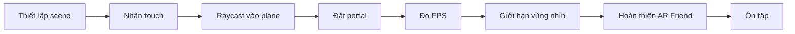

# Create a Plane Detection AR App — Bộ bài học tiếng Việt

**Pathway:** Mobile AR Development  
**Mission:** Create a plane detection AR app  
**Môi trường tham chiếu:** Unity 2022.3, AR Foundation  
**Dạng tài liệu:** Giáo trình thực hành Markdown độc lập, tự biên soạn bằng tiếng Việt.

## Lộ trình

| Bài | Tên file | Nội dung chính |
|---|---|---|
| 01 | [001-set-up-a-scene-with-plane-detection.md](01-Tutorials/001-set-up-a-scene-with-plane-detection.md) | Tạo scene AR và phát hiện mặt phẳng |
| 02 | [002-detect-the-users-touch.md](01-Tutorials/002-detect-the-users-touch.md) | Nhận diện thao tác chạm |
| 03 | [003-detect-when-the-user-touches-a-plane.md](01-Tutorials/003-detect-when-the-user-touches-a-plane.md) | Hit-test từ touch vào AR plane |
| 04 | [004-instantiate-the-portal-on-a-plane.md](01-Tutorials/004-instantiate-the-portal-on-a-plane.md) | Sinh prefab portal đúng vị trí |
| 05 | [005-test-the-frame-rate-of-the-portal-world.md](01-Tutorials/005-test-the-frame-rate-of-the-portal-world.md) | Đo FPS và phân tích hiệu năng |
| 06 | [006-limit-the-visibility-of-the-portal-world.md](01-Tutorials/006-limit-the-visibility-of-the-portal-world.md) | Giới hạn vùng hiển thị bằng mask |
| 07 | [007-submission-ar-friend.md](02-Exercises/007-submission-ar-friend.md) | Bài tập sản phẩm AR Friend |
| 08 | [008-create-with-ar-markers-and-planes-quiz.md](03-Quizzes/008-create-with-ar-markers-and-planes-quiz.md) | Trắc nghiệm tự luyện AR marker và plane |

## Cách học đề xuất

Đọc từng bài, chạy ví dụ nhỏ trên điện thoại hỗ trợ AR, ghi lại kết quả thực tế trước khi chuyển sang bài kế tiếp. Các đoạn C# là ví dụ thực hành minh họa và phải được điều chỉnh nếu cấu hình package/Input System hoặc Render Pipeline của dự án khác nhau.

**Phạm vi:** Các file đầu vào là tài liệu tự biên soạn ở mức đề cương, không phải transcript hay hướng dẫn chính thức đầy đủ. Bộ bài này tổ chức lại kiến thức và bổ sung bài thực hành minh họa; câu hỏi trắc nghiệm và yêu cầu dự án là tài liệu tự luyện, không được xem là đề hoặc đáp án chính thức.

**Nguồn tham khảo:** [Unity Learn — Create a plane detection AR app](https://learn.unity.com/pathway/mobile-ar-development/unit/create-a-plane-detection-ar-app?version=2022.3) · [AR Foundation setup](https://developers.google.com/ar/develop/unity-arf/getting-started-ar-foundation) · [ARRaycastManager hit-test](https://developers.google.com/ar/develop/unity-arf/hit-test/developer-guide).
