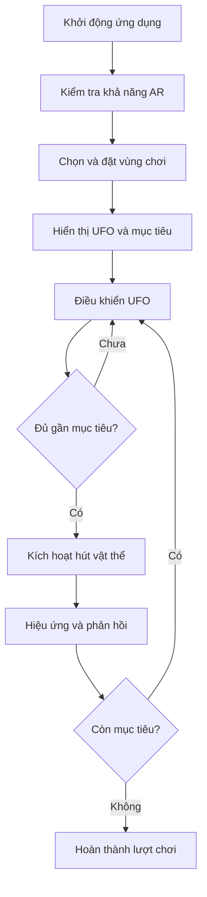

# Bài 01 — Tổng quan dự án UFO

> **Chủ đề:** Thiết kế trải nghiệm thực tế tăng cường (AR) với Unity, minh họa xuyên suốt bằng trò chơi UFO.  
> **Định hướng:** Đọc độc lập, thực hành theo từng bước và kiểm chứng trực tiếp trong Unity; các ví dụ minh họa không phải toàn văn hoặc mã nguồn chính thức của Unity Learn.

## 1. Bài toán và kết quả mong muốn

Một trò chơi UFO thông thường có thể cho người chơi điều khiển đĩa bay, tiếp cận một vật thể và kích hoạt hành động **hút vật thể** (*abduction*). Khi đưa trải nghiệm này sang AR, người chơi không còn nhìn một thế giới 3D tách biệt: cảnh ảo được đặt trong môi trường thật do camera điện thoại ghi lại. Do đó, thiết kế phải giải quyết đồng thời **khung hình, vị trí đặt vùng chơi, điều khiển và phản hồi**.

Kết quả tối thiểu của bản thử nghiệm là: một UFO xuất hiện ở vị trí dễ quan sát, người chơi có thể cho nó di chuyển, chọn mục tiêu và nhận được phản hồi khi hút thành công. Không cần xây dựng toàn bộ trò chơi để đánh giá chất lượng tương tác.

## 2. Mục tiêu học tập

- Giải thích được vai trò của `Scene`, `GameObject`, `Component` và `Camera` trong cấu trúc game UFO.
- Phác thảo được vòng lặp tương tác: chuẩn bị vùng chơi → di chuyển → tiếp cận → hút → phản hồi.
- Phân biệt được góc nhìn `Perspective` và `Orthographic` qua một thử nghiệm trong Game view.
- Xác định các dấu hiệu hoàn thành của một prototype AR đơn giản.

## 3. Kiến trúc trải nghiệm và vòng lặp chơi

Sơ đồ thể hiện logic sản phẩm, **không phải** sơ đồ các lớp đã được viết sẵn. Mỗi bước cần có trạng thái và phản hồi để người chơi biết ứng dụng đang hoạt động. Ví dụ, trong lúc quét mặt phẳng, nên hiện lời nhắc “Di chuyển điện thoại chậm để tìm bề mặt” thay vì để màn hình trống.

| Thành phần | Nhiệm vụ thiết kế | Cách kiểm chứng |
|---|---|---|
| `Scene` | Chứa bố cục và các đối tượng đang chạy | Mở đúng scene và chạy Play mode |
| `UFO` | Chủ thể được điều khiển | Di chuyển được theo thao tác |
| `Target` | Vật thể có thể tương tác | Nhìn thấy, xác định được điều kiện hút |
| `Camera` | Quy định khung quan sát | UFO và mục tiêu không bị cắt mất |
| UI | Hướng dẫn, nút thao tác, trạng thái | Hiển thị đúng trong các thời điểm quan trọng |

## 4. Camera và bố cục hình ảnh

`Perspective` thể hiện sự thay đổi kích thước theo khoảng cách, phù hợp khi cần cảm giác không gian 3D. `Orthographic` không tạo hiệu ứng phối cảnh dựa trên khoảng cách, thường thuận tiện cho các kiểu game nhìn phẳng. Với AR, camera theo dõi vị trí thiết bị nên không thể tùy tiện thay đổi cách đặt camera như game 3D truyền thống.

`Field of View` ảnh hưởng độ rộng góc nhìn; `Near/Far Clipping Planes` ảnh hưởng khoảng cách đối tượng có thể được render; `Culling Mask` cho phép camera chọn layer nào được hiển thị. Nếu UFO biến mất, cần kiểm tra cả vị trí, layer, clipping và trạng thái GameObject, không chỉ prefab.

## 5. Thực hành tạo prototype quan sát được

1. Mở một scene Unity, tạo ba đối tượng đơn giản tượng trưng cho UFO, mục tiêu và mặt nền. Đặt tên rõ ràng trong `Hierarchy`.
2. Chọn camera và thử thay đổi bố cục giữa cận cảnh, trung cảnh và toàn cảnh. Ghi nhận khi nào UFO và mục tiêu cùng dễ nhìn nhất.
3. Thử chuyển chế độ `Perspective`/`Orthographic` trong **scene thử nghiệm không dùng camera AR**, quan sát khác biệt về kích thước và chiều sâu.
4. Phác giao diện gồm hướng dẫn bắt đầu, vùng điều khiển và nút hành động. Chưa cần kết nối tất cả nút với logic.
5. Ghi lại luồng thao tác một lượt chơi bằng ảnh hoặc video ngắn. Mỗi ảnh phải trả lời được: “Người chơi đang ở bước nào?”.

**Checkpoint:** người khác xem được prototype và có thể chỉ ra nơi đặt UFO, cách điều khiển, mục tiêu và trạng thái hoàn thành.

## 6. Điểm dễ sai và kiểm thử

- **Khung hình bị cắt:** xem lại `Field of View`, clipping, layer và vị trí camera.
- **Mất đối tượng khi sang AR:** kiểm tra tọa độ và tỷ lệ thực tế của đối tượng trước khi điều chỉnh camera.
- **UI che vùng chơi:** giảm diện tích nút điều khiển và đặt lời nhắc ở vùng không che mục tiêu.
- **Chỉ có hình ảnh, chưa có trò chơi:** thêm ít nhất một thao tác có phản hồi rõ ràng.

## 7. Sản phẩm và checklist

- [ ] Có một scene prototype với UFO và mục tiêu.
- [ ] Có sơ đồ hoặc mô tả vòng lặp chơi.
- [ ] Ghi rõ vai trò của camera và điều kiện đối tượng bị cắt khỏi khung hình.
- [ ] Có một ảnh/video thể hiện tương tác và phản hồi.
- [ ] Có ghi chép *mong đợi → thực tế → nguyên nhân → cách sửa*.

## 8. Câu hỏi ôn tập

**Câu 1. Vì sao cần một vòng lặp chơi rõ ràng trước khi dựng hiệu ứng UFO?**

A. Để không cần kiểm thử  
B. Để biết người chơi thao tác gì và phản hồi nào cần xuất hiện  
C. Để thay thế AR Session  
D. Để tăng kích thước prefab  

**Đáp án:** B. **Giải thích:** Vòng lặp chơi nối hành động của người chơi với phản hồi và mục tiêu, giúp xác định chức năng tối thiểu.

**Câu 2. Camera trong Unity có vai trò chính nào?**

A. Chỉ lưu asset  
B. Chỉ xử lý vật lý  
C. Quyết định vùng cảnh được hiển thị qua góc nhìn  
D. Tự sửa lỗi Console  

**Đáp án:** C. **Giải thích:** Camera kiểm soát cách khung cảnh được trình bày bằng góc nhìn, FOV và clipping.

**Câu 3. Lợi ích của chia UFO thành các GameObject/Component?**

A. Mọi thứ phải nằm trong một script  
B. Tách trách nhiệm để dễ cấu hình và kiểm thử  
C. Không cần prefab  
D. Làm game luôn đạt FPS cao  

**Đáp án:** B. **Giải thích:** Thành phần độc lập giúp cô lập vấn đề và tái sử dụng.

**Câu 4. Khi thiết kế camera theo UFO, chỉ số nào thường cần kiểm tra?**

A. Âm lượng loa  
B. Dung lượng RAM của editor  
C. Tên project  
D. Framing và vùng cắt gần/xa  

**Đáp án:** D. **Giải thích:** Các tham số khung hình quyết định UFO và mục tiêu có hiện lên đúng hay không.

**Câu 5. Kết quả nào thể hiện bản prototype có thể đánh giá?**

A. Có cảnh nhưng chưa chạy  
B. Có một tương tác cùng phản hồi quan sát được  
C. Chỉ có hình chụp Inspector  
D. Chỉ có tên script  

**Đáp án:** B. **Giải thích:** Prototype phải cho phép tái hiện hành động và quan sát kết quả.

---

**Đọc thêm:** [Unity Learn — AR Experience Design](https://learn.unity.com/pathway/mobile-ar-development/unit/ar-experience-design?version=2022.3). Nội dung các bước và ví dụ trong tài liệu này là bài tập tự biên soạn, có thể cần điều chỉnh theo cấu trúc project và package thực tế.
