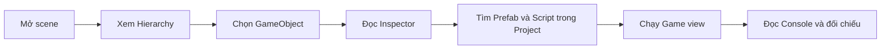

# Bài 02 — Khám phá cấu trúc dự án Unity

> **Chủ đề:** Thiết kế trải nghiệm thực tế tăng cường (AR) với Unity, minh họa xuyên suốt bằng trò chơi UFO.  
> **Định hướng:** Đọc độc lập, thực hành theo từng bước và kiểm chứng trực tiếp trong Unity; các ví dụ minh họa không phải toàn văn hoặc mã nguồn chính thức của Unity Learn.

## 1. Tổng quan

Một dự án Unity thường chứa nhiều tài nguyên, scene và script. Trước khi chuyển game UFO sang AR, cần phân biệt **tài nguyên đang nằm trên đĩa** với **đối tượng đang xuất hiện trong scene**. Việc khám phá cấu trúc trước giúp tránh sửa nhầm prefab, thay đổi camera không đúng hoặc xóa mất tham chiếu từ Component.

## 2. Mục tiêu học tập

- Dò tìm được UFO, camera, mục tiêu và các script trong `Hierarchy`, `Project` và `Inspector`.
- Sử dụng `W`, `E`, `R` để di chuyển, xoay và thay đổi tỷ lệ đối tượng.
- Giải thích được khác biệt giữa tọa độ `Local` và `Global`.
- Ghi lại được những thay đổi có được giữ sau Play mode.

## 3. Bốn vùng làm việc quan trọng

| Vùng | Điều cần quan sát | Câu hỏi đặt ra |
|---|---|---|
| `Hierarchy` | Danh sách GameObject trong scene, quan hệ cha–con | UFO nằm dưới đối tượng gốc nào? |
| `Inspector` | Transform, script và Component gắn trên đối tượng | Bộ phận nào điều khiển chuyển động? |
| `Scene view` | Cảnh ở góc quan sát của người biên tập | Đối tượng có được đặt đúng vị trí? |
| `Game view` | Hình ảnh được camera render | Người chơi nhìn thấy gì? |
| `Project` | Asset, prefab, scene, mã nguồn | File chứa UFO được lưu ở đâu? |
| `Console` | Cảnh báo, lỗi, nhật ký | Khi chạy có lỗi tham chiếu không? |

`Transform` gồm `Position`, `Rotation`, `Scale`. Nếu UFO là đối tượng con của `PlayArea`, `localPosition` mô tả vị trí theo cha; vị trí thế giới còn phụ thuộc Transform của `PlayArea`. Đây là nguyên nhân thường gặp khi game chạy đúng trong Editor nhưng vật thể lệch vị trí sau khi đặt vào môi trường AR.

## 4. Quy trình khám phá có hệ thống

Sơ đồ bắt đầu từ những gì đang hiển thị trong scene, lần ngược về asset và script, rồi kiểm tra bằng runtime. Không nên thay đổi nhiều Component trước khi hiểu trách nhiệm của chúng.

## 5. Bài thực hành

1. **Sao lưu bản thử nghiệm:** tạo bản sao scene hoặc tạo nhánh Git trước khi sửa.
2. **Lập bản đồ đối tượng:** trong `Hierarchy`, tìm camera, UFO, mục tiêu, mặt nền, UI. Nếu dự án không có các đối tượng này, tạo GameObject mẫu với tên tương ứng.
3. **Phân tích UFO:** chọn UFO trong `Inspector`, ghi giá trị Position/Rotation/Scale và tên Component đáng chú ý. Đối chiếu các script trong `Project`.
4. **Thử Transform:** nhấn `W` để Move, `E` để Rotate, `R` để Scale; thử Local/Global khi đối tượng có cha được xoay. Ghi hình trước và sau.
5. **Đối chiếu Scene/Game:** đặt đối tượng ở ngoài góc nhìn camera; chứng minh rằng vẫn tìm thấy nó trong Scene view nhưng không còn thấy ở Game view.
6. **Thử Play mode:** thay đổi một số giá trị khi chạy, dừng và kiểm tra thay đổi nào không được giữ; nếu cần lưu lâu dài, chỉnh trong Edit mode.

**Checkpoint:** có bảng tên đối tượng → prefab/script → chức năng → trạng thái kiểm thử. Tối thiểu phải mô tả được đường đi từ thao tác của người chơi tới GameObject nhận hành động.

## 6. Xử lý lỗi

| Dấu hiệu | Nguyên nhân nên kiểm tra | Kiểm chứng |
|---|---|---|
| UFO không hiện | Camera, layer, active state, clipping | Chọn UFO trong Hierarchy, kiểm tra từng phần |
| Giá trị Transform khác dự đoán | Local/Global hoặc Transform cha | Tạm quan sát hệ trục và vị trí cha |
| Script không hoạt động | Component bị vô hiệu hóa, thiếu tham chiếu | Đọc Inspector và Console |
| Thay đổi mất sau khi dừng | Sửa khi Play mode | Thực hiện lại trong Edit mode |

## 7. Deliverable và checklist

- [ ] Có sơ đồ hoặc bảng cấu trúc scene.
- [ ] Tìm được camera, UFO, target và script liên quan.
- [ ] Thao tác được Move/Rotate/Scale và giải thích Local/Global.
- [ ] Có minh chứng Scene view khác Game view.
- [ ] Ghi chép một lỗi đã tái hiện và cách kiểm tra.

## 8. Câu hỏi ôn tập

**Câu 1. Muốn xem Component của UFO thì cần mở vùng nào?**

A. Project Settings  
B. Inspector sau khi chọn UFO  
C. Console  
D. Package Manager  

**Đáp án:** B. **Giải thích:** Inspector hiển thị các Component của GameObject đang được chọn.

**Câu 2. Khác biệt chính giữa Scene view và Game view?**

A. Cùng một chế độ nên không khác  
B. Scene view là cửa sổ file, Game view là Console  
C. Scene view phục vụ biên tập, Game view cho thấy góc nhìn camera  
D. Game view cho phép sửa mã C# trực tiếp  

**Đáp án:** C. **Giải thích:** Scene view dùng xây dựng bố cục, còn Game view phản ánh camera render.

**Câu 3. Phím tắt thường dùng để di chuyển đối tượng là gì?**

A. W  
B. R  
C. E  
D. F  

**Đáp án:** A. **Giải thích:** Unity sử dụng W cho Move, E cho Rotate và R cho Scale trong bố cục mặc định.

**Câu 4. Vì sao chỉnh Inspector trong Play mode có thể bị mất?**

A. Vì Unity tự xóa prefab  
B. Vì máy thiếu mạng  
C. Vì camera khóa Transform  
D. Vì trạng thái thử nghiệm thường được khôi phục khi thoát Play mode  

**Đáp án:** D. **Giải thích:** Các chỉnh sửa runtime thường không được giữ lại như chỉnh sửa lúc Edit mode.

**Câu 5. Muốn kiểm tra UFO lệch vị trí do cha-con, nên xem gì?**

A. FPS  
B. Local và Global Transform  
C. Tên file âm thanh  
D. Màu Console  

**Đáp án:** B. **Giải thích:** Transform cục bộ chịu ảnh hưởng của đối tượng cha, khác với tọa độ thế giới.

---

**Đọc thêm:** [Unity Learn — AR Experience Design](https://learn.unity.com/pathway/mobile-ar-development/unit/ar-experience-design?version=2022.3). Nội dung các bước và ví dụ trong tài liệu này là bài tập tự biên soạn, có thể cần điều chỉnh theo cấu trúc project và package thực tế.
