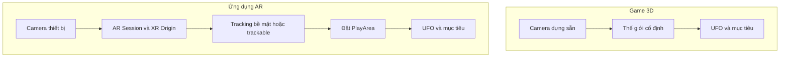

# Bài 03 — Bắt đầu chuyển trò chơi UFO sang AR

> **Chủ đề:** Thiết kế trải nghiệm thực tế tăng cường (AR) với Unity, minh họa xuyên suốt bằng trò chơi UFO.  
> **Định hướng:** Đọc độc lập, thực hành theo từng bước và kiểm chứng trực tiếp trong Unity; các ví dụ minh họa không phải toàn văn hoặc mã nguồn chính thức của Unity Learn.

## 1. Tổng quan

**Port** là quá trình điều chỉnh một game chạy trong môi trường 3D thông thường để hoạt động trong bối cảnh AR. Không phải chỉ thay hình nền bằng video camera: những vị trí vốn cố định trong scene phải được đặt theo môi trường thật, camera phải gắn với thiết bị, còn điều khiển cần tương thích với màn hình cảm ứng.

Trong bản thử nghiệm tối thiểu, ưu tiên chứng minh khả năng **nhận camera → duy trì AR Session → xác định vị trí hợp lệ → hiển thị UFO** trước khi thêm cơ chế hút vật thể.

## 2. Mục tiêu học tập

- Phân biệt được camera thông thường với camera của phiên AR.
- Giải thích vai trò của `AR Session`, `XR Origin` và các manager theo dõi.
- Thiết lập được bản thử nghiệm đơn giản trên thiết bị hỗ trợ ARCore hoặc ARKit.
- Kiểm tra được quyền camera và trường hợp tracking chưa sẵn sàng.

## 3. Mô hình thay đổi kiến trúc

Trong nhánh AR, `AR Session` quản lý phiên; `XR Origin` biểu diễn mối liên hệ giữa thiết bị và thế giới Unity. Việc nhận diện mặt phẳng, ảnh hoặc khuôn mặt cần manager phù hợp **và phụ thuộc khả năng của thiết bị**. Sơ đồ chỉ nêu trách nhiệm, không ấn định cấu trúc prefab bắt buộc.

## 4. Chuẩn bị

- Một project Unity 2022.3 dùng làm bản tham chiếu, hoặc project mới có các package XR/AR tương thích với phiên bản đã chọn.
- Thiết bị Android/iOS được xác nhận hỗ trợ dịch vụ AR tương ứng; cáp kết nối, quyền triển khai ứng dụng và quyền camera.
- Một prefab UFO đơn giản (có thể dùng Cube/Sphere để thử trước).
- Scene được sao lưu riêng để tránh ảnh hưởng bản game 3D ban đầu.

Chỉ cài đặt package và cấu hình platform theo **tài liệu chính thức tương ứng với bộ phiên bản đang dùng**. Các tên menu và yêu cầu build có thể khác giữa bản Unity/AR Foundation.

## 5. Triển khai thử nghiệm theo từng chặng

1. **Xác nhận thiết bị:** kiểm tra khả năng ARCore/ARKit và quyền camera. Nếu thiết bị không hỗ trợ, kết quả không thể dùng làm bằng chứng tracking thật.
2. **Tạo scene AR thử nghiệm:** thêm `AR Session` và cấu trúc `XR Origin`/camera theo hướng dẫn của bộ package đang cài. Tránh giữ đồng thời hai camera hoạt động ngoài ý muốn.
3. **Kiểm tra camera:** build ứng dụng tối giản lên máy. Nền phải là cảnh camera thật và không xuất hiện lỗi quyền truy cập.
4. **Thêm một vật thể ảo:** tạo prefab đơn giản, đặt nó tại vị trí tương ứng một mặt phẳng/trackable hợp lệ khi đã có tracking. Không đặt cố định ở trước camera rồi kết luận đã định vị được AR.
5. **Đo trạng thái:** ghi lại ba tình huống: chưa nhận diện được bề mặt, nhận diện được và tạm mất tracking.
6. **Đưa UFO vào:** thay vật thể thử bằng UFO với tỷ lệ hợp lý, bảo đảm không bị xuyên sàn hoặc quá lớn so với môi trường thật.

**Checkpoint 1:** camera được cấp quyền và hiển thị môi trường.  
**Checkpoint 2:** một đối tượng đứng tại vị trí không gian có ý nghĩa khi người dùng dịch chuyển điện thoại.  
**Checkpoint 3:** ứng dụng hiển thị phản hồi khi tracking không sẵn sàng.

## 6. Kiểm thử và gỡ lỗi

| Triệu chứng | Hướng kiểm tra đầu tiên |
|---|---|
| Nền camera đen | Quyền camera, cấu hình XR, khả năng thiết bị, log runtime |
| UFO không ổn định | Chất lượng tracking, vị trí anchor, môi trường thiếu đặc trưng |
| UFO không thấy | Scale, vị trí, active state, camera và clipping |
| Không phát hiện bề mặt | Manager có được bật và thiết bị hỗ trợ hay không |
| Chạy trong Editor nhưng lỗi trên máy | Build settings, package platform, permission và log thiết bị |

Từng lần thử cần ghi môi trường sáng/tối, loại bề mặt, kết quả dự kiến và kết quả thực tế; không kết luận hiệu năng chỉ từ Play mode.

## 7. Kết quả cần nộp

- [ ] Có scene AR thử nghiệm độc lập.
- [ ] Có video chạy trên thiết bị thật, cho thấy UFO tồn tại tại vị trí không gian.
- [ ] Có bảng trạng thái tracking và phản hồi UI ứng với mỗi trạng thái.
- [ ] Có nhật ký ít nhất một vấn đề về camera hoặc tracking.

## 8. Câu hỏi ôn tập

**Câu 1. Thành phần nào chịu trách nhiệm quản lý phiên AR?**

A. Collider  
B. AR Session  
C. Lightmap  
D. Animator  

**Đáp án:** B. **Giải thích:** AR Session quản lý vòng đời và trạng thái phiên theo dõi AR.

**Câu 2. Vì sao chạy được trong Editor chưa đủ để khẳng định AR hoạt động?**

A. Editor không có cửa sổ Project  
B. Vì script tự xóa  
C. Vì tracking, camera và dịch vụ AR phụ thuộc thiết bị thật  
D. Vì scene có quá ít GameObject  

**Đáp án:** C. **Giải thích:** AR đòi hỏi cảm biến, quyền camera và hệ thống tracking mà Game view không tự chứng minh.

**Câu 3. Khi đặt UFO lên mặt phẳng, vị trí nên gắn với gì?**

A. Góc nhìn màn hình cố định  
B. Màu màn hình  
C. Vị trí editor tự do  
D. Hệ tọa độ và điểm neo/trackable phù hợp  

**Đáp án:** D. **Giải thích:** Đối tượng AR cần bám môi trường thực qua vị trí không gian có ý nghĩa.

**Câu 4. Thứ tự hợp lý khi bắt đầu chuyển game sang AR?**

A. Xác minh thiết bị và session, sau đó thử đặt một đối tượng nhỏ  
B. Tối ưu shader trước khi có camera  
C. Đặt 100 đối tượng để thử hiệu năng  
D. Xóa toàn bộ script cũ  

**Đáp án:** A. **Giải thích:** Nền tảng tracking và đặt vật thể phải chạy trước khi mở rộng gameplay.

**Câu 5. Khi tracking mất tạm thời, ứng dụng nên làm gì?**

A. Giữ nguyên UI như không có sự cố  
B. Thông báo và tạm ngừng thao tác phụ thuộc vị trí chính xác  
C. Tạo thêm UFO liên tục  
D. Tắt ứng dụng ngay lập tức  

**Đáp án:** B. **Giải thích:** Phản hồi và kiểm soát trạng thái giúp tránh tương tác không đáng tin.

---

**Đọc thêm:** [Unity Learn — AR Experience Design](https://learn.unity.com/pathway/mobile-ar-development/unit/ar-experience-design?version=2022.3). Nội dung các bước và ví dụ trong tài liệu này là bài tập tự biên soạn, có thể cần điều chỉnh theo cấu trúc project và package thực tế.
