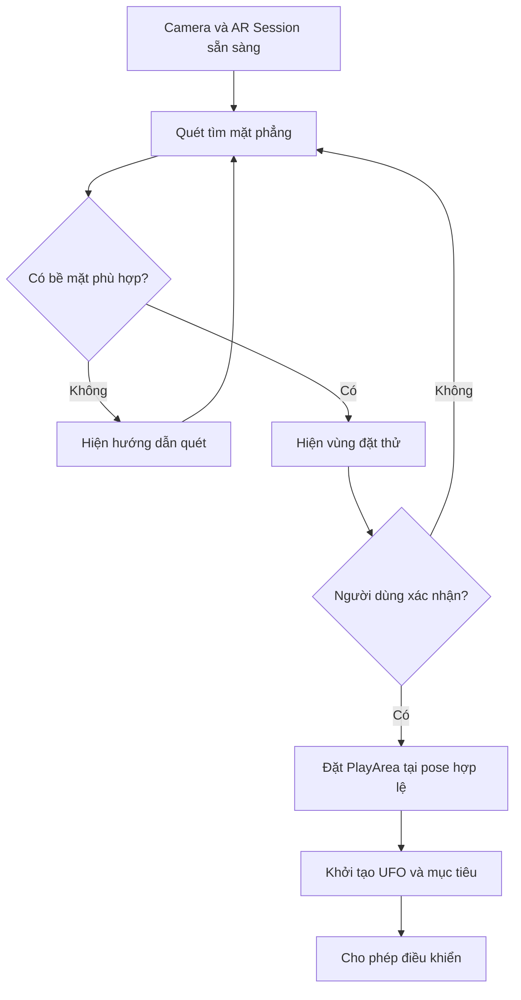

# Bài 05 — Kích hoạt vùng chơi trong không gian AR

> **Chủ đề:** Thiết kế trải nghiệm thực tế tăng cường (AR) với Unity, minh họa xuyên suốt bằng trò chơi UFO.  
> **Định hướng:** Đọc độc lập, thực hành theo từng bước và kiểm chứng trực tiếp trong Unity; các ví dụ minh họa không phải toàn văn hoặc mã nguồn chính thức của Unity Learn.

## 1. Bài toán

Game UFO cần một **vùng chơi** (*play area*) đủ ổn định để người chơi nhận biết nơi UFO bay và nơi các mục tiêu xuất hiện. Trong AR, vùng chơi thường được đặt dựa trên một bề mặt thật đã được hệ thống theo dõi. Nếu kích hoạt trò chơi ngay khi camera vừa mở, vị trí ban đầu có thể sai, không có đủ không gian hoặc không ổn định.

## 2. Mục tiêu học tập

- Giải thích được quan hệ giữa plane detection, điểm đặt và vùng chơi.
- Thiết kế được trạng thái chưa sẵn sàng, sẵn sàng và đang chơi.
- Lựa chọn vị trí đặt `PlayArea` có ý nghĩa trong môi trường thật.
- Kiểm thử được hành vi khi không tìm thấy bề mặt hoặc tracking bị suy giảm.

## 3. Quy trình nhận diện và kích hoạt

`Pose` mô tả vị trí và hướng trong không gian. “Vùng đặt thử” (*placement preview*) chỉ là một cách thiết kế giao diện để người chơi xác nhận trước khi bắt đầu, không phải thành phần mặc định bắt buộc của mọi app AR.

## 4. Những điều cần xét trước khi đặt

| Yếu tố | Kiểm tra | Nếu không đạt |
|---|---|---|
| Kích thước mặt phẳng | Đủ rộng cho UFO và mục tiêu | Gợi ý tìm bàn/sàn rộng hơn |
| Hướng bề mặt | Phù hợp kiểu game | Không cho đặt trên bề mặt ngoài dự kiến |
| Ánh sáng và chi tiết bề mặt | Tracking có ổn định khi di chuyển máy | Hướng dẫn đổi góc quét hoặc điều kiện sáng |
| Tỷ lệ thế giới | UFO trông hợp lý so với vật thật | Điều chỉnh scale toàn vùng, không sửa tùy tiện từng đối tượng |
| Khả năng nhìn thấy | Camera đủ khoảng cách và góc quan sát | Đề nghị đổi vị trí trước khi bắt đầu |

## 5. Thực hành theo checkpoint

1. Tạo `PlayArea` là một GameObject gốc, các đối tượng UFO và mục tiêu nằm bên dưới đối tượng gốc này.
2. Cấu hình thành phần nhận diện mặt phẳng theo phiên bản `AR Foundation` đang sử dụng; kiểm tra hỗ trợ từ thiết bị thật.
3. Hiển thị hướng dẫn khi chưa có bề mặt, ví dụ “Hướng camera vào một bàn hoặc sàn có đủ ánh sáng”.
4. Sau khi có bề mặt phù hợp, hiển thị mô hình khu vực dự kiến. Cho người dùng xác nhận bằng thao tác chạm nếu tương tác đặt đã được cấu hình.
5. Dịch chuyển/đặt `PlayArea` đến vị trí đã chọn; bảo đảm UFO được định vị **tương đối so với PlayArea**, không lẫn tọa độ màn hình với tọa độ thế giới.
6. Chỉ mở khóa điều khiển khi vùng chơi sẵn sàng. Thử tạm che camera hoặc di chuyển quá nhanh để quan sát cách ứng dụng phản hồi khi tracking kém.

**Checkpoint A:** không có mặt phẳng thì không sinh UFO sai vị trí.  
**Checkpoint B:** xác nhận vị trí thì vùng chơi xuất hiện ổn định.  
**Checkpoint C:** thay đổi góc nhìn camera không làm UFO “dính” vào màn hình.

## 6. Debug bằng triệu chứng

- **UFO đi theo camera thay vì đứng trong phòng:** kiểm tra parent và hệ tọa độ được dùng khi đặt.
- **Vùng chơi nằm xuyên mặt bàn:** xem lại vị trí đặt, độ cao gốc model và pivot của prefab.
- **Không tìm thấy mặt phẳng:** xác minh AR Session, plane manager, hỗ trợ phần cứng và ánh sáng.
- **Vùng chơi chỉ có trong Scene view:** kiểm tra camera AR, trạng thái GameObject và kết quả build.

## 7. Kết quả cần nộp

- [ ] Có sơ đồ trạng thái kích hoạt vùng chơi.
- [ ] Có cảnh báo khi chưa tìm được bề mặt.
- [ ] Vùng chơi được đặt trên một bề mặt hợp lệ.
- [ ] Có bằng chứng vùng chơi ổn định khi dịch chuyển điện thoại.
- [ ] Có nhật ký kiểm thử tình huống tracking yếu.

## 8. Câu hỏi ôn tập

**Câu 1. Khi chưa nhận diện được mặt phẳng, người dùng nên thấy gì?**

A. UFO tự rơi  
B. Hướng dẫn quét môi trường và trạng thái chờ  
C. Màn hình kết thúc  
D. Không cần phản hồi  

**Đáp án:** B. **Giải thích:** Thông báo trạng thái giúp người dùng hiểu vì sao chưa thể đặt vùng chơi.

**Câu 2. Vì sao cần tách giai đoạn dò bề mặt và giai đoạn chơi?**

A. Để giảm số prefab xuống 0  
B. Để buộc game Landscape  
C. Để không cho gameplay chạy trước khi có vị trí hợp lệ  
D. Để không cần tracking  

**Đáp án:** C. **Giải thích:** Vùng chơi chỉ nên được kích hoạt khi có điều kiện bề mặt phù hợp.

**Câu 3. Vị trí đặt PlayArea nên dựa trên yếu tố nào?**

A. Vị trí tùy ý ở đầu camera  
B. Tên scene  
C. Số lượng nút  
D. Điểm đặt hợp lệ trên bề mặt đã nhận diện  

**Đáp án:** D. **Giải thích:** Điểm thuộc trackable giúp vùng chơi có quan hệ với không gian thật.

**Câu 4. Một bề mặt được chọn nhưng quá nhỏ so với UFO, nên làm gì?**

A. Đề nghị tìm nơi rộng hơn hoặc chỉnh quy mô game  
B. Bỏ qua kích thước  
C. Tăng tốc UFO vô hạn  
D. Tắt tracking  

**Đáp án:** A. **Giải thích:** Kích thước vùng chơi phải hợp lý để không gây va chạm trực quan và khó thao tác.

**Câu 5. Nếu tracking giảm trong lúc chơi, điều nào phù hợp?**

A. Tự thêm mục tiêu mới liên tục  
B. Hạn chế thao tác cần vị trí chính xác và hướng dẫn quét lại  
C. Xóa toàn bộ project  
D. Chuyển sang camera Orthographic  

**Đáp án:** B. **Giải thích:** Kiểm soát trạng thái giúp tránh tương tác tại vị trí không đáng tin.

---

**Đọc thêm:** [Unity Learn — AR Experience Design](https://learn.unity.com/pathway/mobile-ar-development/unit/ar-experience-design?version=2022.3). Nội dung các bước và ví dụ trong tài liệu này là bài tập tự biên soạn, có thể cần điều chỉnh theo cấu trúc project và package thực tế.
