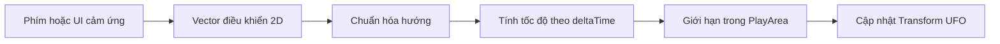

# Bài 06 — Phát triển chuyển động của UFO trong AR

> **Chủ đề:** Thiết kế trải nghiệm thực tế tăng cường (AR) với Unity, minh họa xuyên suốt bằng trò chơi UFO.  
> **Định hướng:** Đọc độc lập, thực hành theo từng bước và kiểm chứng trực tiếp trong Unity; các ví dụ minh họa không phải toàn văn hoặc mã nguồn chính thức của Unity Learn.

## 1. Bài toán và mục tiêu

Khi UFO đã xuất hiện trong vùng chơi, người chơi cần điều khiển nó đến gần mục tiêu. Bài này tập trung vào **tốc độ, hướng chuyển động, giới hạn vùng và khác biệt giữa input trong Editor với điện thoại**. Yêu cầu cốt lõi là UFO di chuyển nhất quán ở các mức FPS khác nhau và không vượt khỏi PlayArea.

Sau bài học, người học có thể xác định được không gian tọa độ phù hợp, viết một bộ điều khiển bằng `Transform`, dùng `Time.deltaTime` và `Mathf.Clamp`, đồng thời kiểm tra khi nhấn/thả điều khiển.

## 2. Nguyên tắc chuyển động

Khi cập nhật vị trí trực tiếp bằng Transform, quãng đường mỗi frame có thể được tính:

$$
\Delta \mathbf p = \mathbf d\,v\,\Delta t
$$

Trong đó $\mathbf d$ là hướng đã chuẩn hóa, $v$ là tốc độ tính theo đơn vị thế giới/giây và $\Delta t$ là `Time.deltaTime`. Nếu bỏ $\Delta t$, tốc độ thực tế có thể tăng/giảm khi FPS thay đổi.

Cần xác định rõ: UFO di chuyển theo trục của **thế giới** (`Space.World`) hay theo **PlayArea** (tọa độ local). Với game đặt trên mặt bàn có thể xoay, chuyển động trong hệ tọa độ local của PlayArea thường dễ giới hạn hơn.

## 3. Cấu trúc điều khiển đề xuất



Bản demo có thể đọc bàn phím trong Editor, nhưng khi build cho mobile cần nối Input System hoặc bộ điều khiển cảm ứng tương ứng. Đây là hai nguồn tín hiệu khác nhau, còn logic di chuyển có thể tái sử dụng.

## 4. Ví dụ C# cho chuyển động giới hạn trong PlayArea

Ví dụ sau minh họa một UFO là **con trực tiếp của PlayArea**, chỉ di chuyển trong mặt phẳng local XZ và giữ nguyên độ cao Y ban đầu.

```csharp
using UnityEngine;

public class UfoLocalMover : MonoBehaviour
{
    [SerializeField] private float speed = 0.5f;
    [SerializeField] private Vector2 halfExtent = new Vector2(0.4f, 0.4f);

    // Vector này do bộ đọc phím hoặc UI cảm ứng cung cấp.
    private Vector2 moveInput;

    public void SetMoveInput(Vector2 input)
    {
        moveInput = Vector2.ClampMagnitude(input, 1f);
    }

    private void Update()
    {
        Vector3 p = transform.localPosition;
        p += new Vector3(moveInput.x, 0f, moveInput.y) * speed * Time.deltaTime;
        p.x = Mathf.Clamp(p.x, -halfExtent.x, halfExtent.x);
        p.z = Mathf.Clamp(p.z, -halfExtent.y, halfExtent.y);
        transform.localPosition = p;
    }
}
```

`SetMoveInput` nhận tín hiệu trong khoảng từ -1 đến 1 theo hai trục; ví dụ **chưa bao gồm mã tạo joystick**. `halfExtent` là nửa chiều rộng/chiều dài vùng chơi tính theo đơn vị local. Giá trị chỉ mang tính minh họa và phải chỉnh theo tỷ lệ thật của scene. Không nên vừa dùng đoạn này vừa cho `Rigidbody` vật lý tự điều khiển cùng `Transform` nếu chưa thiết kế cách đồng bộ.

Để kiểm tra nhanh trong Editor với **Input Manager cũ**, có thể tạo adapter thử nghiệm:

```csharp
using UnityEngine;

public class KeyboardMoveAdapter : MonoBehaviour
{
    [SerializeField] private UfoLocalMover mover;

    private void Update()
    {
        if (mover == null) return;
        mover.SetMoveInput(new Vector2(
            Input.GetAxisRaw("Horizontal"),
            Input.GetAxisRaw("Vertical")));
    }
}
```

Chỉ dùng adapter này khi project cho phép Input Manager cũ; khi dùng Input System mới, kết nối Input Actions thay vì dựa vào `Input.GetAxisRaw`.

## 5. Quy trình thực hành

1. Bảo đảm UFO là con của PlayArea và `localPosition` có tọa độ dễ kiểm soát.
2. Gắn `UfoLocalMover` vào UFO, thử với input bàn phím phù hợp trong Editor.
3. Điều chỉnh `speed` và `halfExtent`, kiểm tra các biên trái/phải/trước/sau.
4. Chạy ở nhiều mức FPS hoặc tạo tải khác nhau để quan sát tốc độ theo thời gian.
5. Thay bộ đọc phím bằng nút hoặc joystick cảm ứng và truyền giá trị vào `SetMoveInput`.
6. Xoay PlayArea rồi thử di chuyển; kiểm tra hướng local có còn trực quan với người chơi.

**Checkpoint:** giữ điều khiển thì UFO di chuyển; thả điều khiển thì UFO dừng; đụng biên thì không vượt ra ngoài; tốc độ không đổi đáng kể khi FPS biến thiên.

## 6. Khắc phục lỗi và giao phẩm

| Lỗi | Điều cần xem |
|---|---|
| Di chuyển quá nhanh/chậm tùy máy | `Time.deltaTime`, giá trị tốc độ, input chuẩn hóa |
| Vượt biên | `Mathf.Clamp`, trục local, kích thước PlayArea |
| Không đáp ứng trên điện thoại | Adapter cảm ứng và cấu hình Input System |
| Đi chéo nhanh hơn đi thẳng | Giới hạn độ dài vector đầu vào |
| Rung khi dùng physics | Tránh cập nhật Transform trực tiếp cạnh điều khiển Rigidbody |

- [ ] UFO di chuyển được theo hai trục và dừng khi thả.
- [ ] Có giới hạn chơi thực tế.
- [ ] Có video kiểm tra khi chạm biên và khi xoay PlayArea.
- [ ] Có lời giải thích riêng về input Editor và input mobile.

## 7. Câu hỏi ôn tập

**Câu 1. Tại sao cần nhân tốc độ với Time.deltaTime khi cập nhật Transform?**

A. Để đối tượng có màu khác  
B. Để giảm phụ thuộc vào số frame trên giây  
C. Để bỏ qua tọa độ  
D. Để bắt buộc sử dụng Rigidbody  

**Đáp án:** B. **Giải thích:** Time.deltaTime quy đổi chuyển động theo thời gian mỗi frame.

**Câu 2. Clamp hữu ích nhất trong tình huống nào?**

A. Đổi màu camera  
B. Gọi hàm âm thanh  
C. Giới hạn vị trí UFO trong vùng chơi  
D. Đọc lỗi Console  

**Đáp án:** C. **Giải thích:** Mathf.Clamp giữ tọa độ trong các giới hạn thiết kế.

**Câu 3. Khi điều khiển vật bằng Rigidbody, điều gì nên tránh?**

A. Tùy tiện trộn cập nhật Transform trực tiếp với physics  
B. Dùng Collider  
C. Kiểm tra FixedUpdate  
D. Kiểm tra tốc độ  

**Đáp án:** A. **Giải thích:** Hai cơ chế cập nhật có thể gây chuyển động thiếu nhất quán.

**Câu 4. Vì sao Input.GetAxisRaw trong ví dụ không tự hoạt động trên nút cảm ứng mới?**

A. Vì Unity không hỗ trợ vector  
B. Vì prefab quá to  
C. Vì thiếu ánh sáng  
D. Vì nó minh họa Input Manager cũ, cần bộ chuyển input cho mobile  

**Đáp án:** D. **Giải thích:** Nguồn input của điện thoại cần được kết nối với lớp điều khiển phù hợp.

**Câu 5. UFO di chuyển sai chiều sau khi đặt PlayArea xoay. Nên kiểm tra gì?**

A. FPS trước  
B. Space.World, local axes và Transform cha  
C. Số mục tiêu  
D. Màu của nút hút  

**Đáp án:** B. **Giải thích:** Quy ước local/world quyết định hướng di chuyển tương đối với vùng chơi.

---

**Đọc thêm:** [Unity Learn — AR Experience Design](https://learn.unity.com/pathway/mobile-ar-development/unit/ar-experience-design?version=2022.3). Nội dung các bước và ví dụ trong tài liệu này là bài tập tự biên soạn, có thể cần điều chỉnh theo cấu trúc project và package thực tế.
