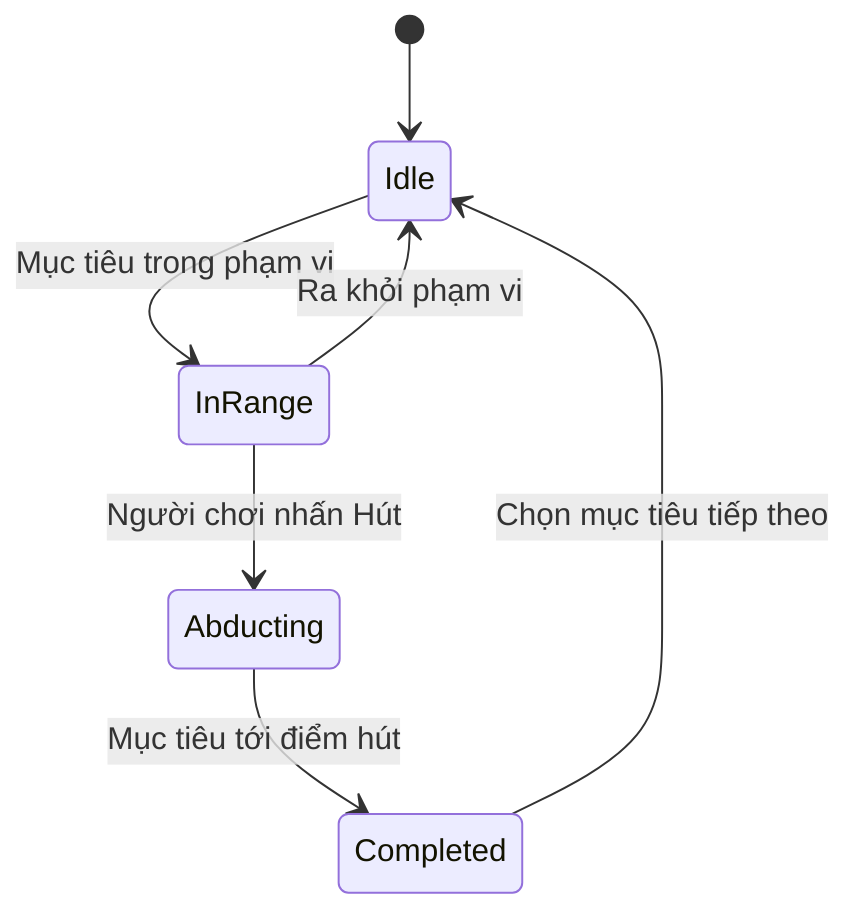

# Bài 07 — Phát triển hành động UFO hút vật thể

> **Chủ đề:** Thiết kế trải nghiệm thực tế tăng cường (AR) với Unity, minh họa xuyên suốt bằng trò chơi UFO.  
> **Định hướng:** Đọc độc lập, thực hành theo từng bước và kiểm chứng trực tiếp trong Unity; các ví dụ minh họa không phải toàn văn hoặc mã nguồn chính thức của Unity Learn.

## 1. Bài toán

Di chuyển mang UFO tới mục tiêu; **hành động hút vật thể** biến tiếp cận thành một tương tác có kết quả. Thiết kế tốt cần trả lời ba câu hỏi: **khi nào được hút, điều gì xảy ra trong lúc hút và người chơi nhận ra thành công bằng cách nào?**

Trong một prototype, có thể biểu diễn “hút” bằng cách đưa mục tiêu dần lên vị trí bên dưới UFO, ẩn mục tiêu và tăng điểm. Đây là **một ví dụ gameplay tự biên soạn**, không xác nhận đúng hiệu ứng hay code của game UFO chính thức.

## 2. Mục tiêu học tập

- Xây dựng được các trạng thái `Idle`, `InRange`, `Abducting` và `Completed`.
- Kiểm tra điều kiện khoảng cách trong không gian 3D.
- Tách lệnh của người chơi với quá trình animation và kết quả cuối.
- Kiểm thử được thao tác liên tục, mục tiêu biến mất hoặc mất tracking.

## 3. Thiết kế trạng thái



Bốn trạng thái giúp UI hiển thị nút hút đúng lúc. `Idle` nghĩa là chưa đủ điều kiện, `InRange` cho phép hành động, `Abducting` khóa thao tác lặp, `Completed` xác nhận thành công. Với AR, việc mất tracking có thể yêu cầu một trạng thái tạm dừng riêng tùy thiết kế ứng dụng.

## 4. Khoảng cách và vị trí đích

Cho $\mathbf u$ là vị trí của UFO và $\mathbf t$ là vị trí mục tiêu. Khoảng cách Euclid:

$$
d = \lVert\mathbf u - \mathbf t\rVert_2
$$

Chỉ cho phép hút khi $d \leq r$, với $r$ là bán kính tương tác **do người thiết kế chọn và thử nghiệm**. Lưu ý vị trí của `Transform` cần ở cùng hệ tọa độ (ví dụ đều dùng `position` theo world space). Không nên so sánh tùy tiện `localPosition` của hai đối tượng thuộc hai parent khác nhau.

## 5. Ví dụ C# tối giản

Script minh họa nhận một `Target`, kiểm tra khoảng cách, dịch mục tiêu về một `capturePoint`, sau đó ẩn mục tiêu. Để tập trung vào logic, hàm `TryAbduct` được gọi từ một nút UI hoặc bộ đọc input khác; script **không tự cấu hình nút**.

```csharp
using UnityEngine;

public class SimpleAbduction : MonoBehaviour
{
    [SerializeField] private Transform ufo;
    [SerializeField] private Transform target;
    [SerializeField] private Transform capturePoint;
    [SerializeField] private float radius = 0.3f;
    [SerializeField] private float liftSpeed = 0.5f;

    private bool abducting;

    public void TryAbduct()
    {
        if (abducting || ufo == null || target == null || capturePoint == null)
            return;

        if (Vector3.Distance(ufo.position, target.position) <= radius)
            abducting = true;
    }

    private void Update()
    {
        if (!abducting || target == null || capturePoint == null) return;

        target.position = Vector3.MoveTowards(
            target.position,
            capturePoint.position,
            liftSpeed * Time.deltaTime);

        if (Vector3.Distance(target.position, capturePoint.position) < 0.01f)
        {
            target.gameObject.SetActive(false);
            abducting = false;
            // Tại đây có thể gọi hệ thống cộng điểm / chọn mục tiêu khác.
        }
    }
}
```

Các giá trị `radius`, `liftSpeed` và ngưỡng hoàn tất chỉ là tham số thử nghiệm, không phải thông số của bài học gốc. Nếu mục tiêu chuyển động bằng vật lý, cần thiết kế cơ chế riêng để không tranh chấp `Transform` với `Rigidbody`.

## 6. Thực hành và kiểm thử

1. Tạo một UFO, một mục tiêu và một GameObject rỗng `CapturePoint` đặt ở vùng hút của UFO.
2. Liên kết ba Transform vào script; bảo đảm các trường Inspector không trống.
3. Đưa UFO ra ngoài phạm vi, nhấn nút hút và xác nhận **không có hành động**.
4. Đưa UFO lại gần, nhấn hút và quan sát mục tiêu dịch chuyển về `CapturePoint`.
5. Nhấn nhiều lần khi đang hút; kiểm tra mục tiêu không được hút lại từ đầu.
6. Khi hoàn tất, hiển thị phản hồi UI (ví dụ “Đã hút thành công”) hoặc tăng số mục tiêu hoàn thành.
7. Lặp lại trên thiết bị AR thật, kiểm tra vị trí mục tiêu có đúng với PlayArea khi camera chuyển động.

## 7. Lỗi thường gặp, giao phẩm

- **Nút hút bấm không có phản hồi:** kiểm tra sự kiện nút, reference và khoảng cách thế giới.
- **Hút từ quá xa:** giảm `radius` hoặc thiết kế một vùng đánh dấu rõ ràng.
- **Mục tiêu giật/teleport:** thống nhất cơ chế animation/physics, không để hai script tranh quyền điều khiển.
- **Hút hai lần:** thêm khóa trạng thái trong khi hút.
- **Mục tiêu mất khỏi vùng chơi:** kiểm tra transform cha của mục tiêu, UFO và `CapturePoint`.

- [ ] Ngoài phạm vi thì không hút.
- [ ] Trong phạm vi thì hút và kết thúc đúng một lần.
- [ ] UI hoặc âm thanh/hình ảnh xác nhận trạng thái thành công.
- [ ] Có video kiểm thử trường hợp bấm nhiều lần.

## 8. Câu hỏi ôn tập

**Câu 1. Điều kiện cơ bản nào hợp lý trước khi cho phép UFO hút mục tiêu?**

A. Đối tượng đích ở trong phạm vi tương tác  
B. Điện thoại xoay dọc  
C. Camera bật Orthographic  
D. Người chơi mở Console  

**Đáp án:** A. **Giải thích:** Cần điều kiện không gian rõ ràng trước khi kích hoạt hút.

**Câu 2. Dùng trạng thái Abducting để làm gì?**

A. Luôn cho phép chọn mục tiêu mới  
B. Ngăn kích hoạt lặp trong lúc hiệu ứng đang chạy  
C. Tự mở camera  
D. Thay Player Settings  

**Đáp án:** B. **Giải thích:** Trạng thái riêng giúp tránh xung đột input và xử lý hoàn tất nhất quán.

**Câu 3. Vì sao không nên kiểm tra khoảng cách giữa UFO và mục tiêu bằng vị trí màn hình tùy ý?**

A. Vì không có UI  
B. Vì màn hình chỉ có hai chiều  
C. Vì vị trí màn hình không trực tiếp đại diện khoảng cách thế giới 3D  
D. Vì các Vector luôn bằng 0  

**Đáp án:** C. **Giải thích:** Khoảng cách tương tác trong thế giới cần quy chiếu đến tọa độ không gian.

**Câu 4. Khi hút hoàn tất, phản hồi nào dễ hiểu nhất?**

A. Không thay đổi gì  
B. Tắt quyền camera  
C. Tự reset ngay không báo  
D. Cập nhật mục tiêu/điểm và hiệu ứng hoàn tất  

**Đáp án:** D. **Giải thích:** Phản hồi thông báo sự kiện đã kết thúc và cho biết tiến độ.

**Câu 5. Nếu người chơi nhấn hút liên tục trước khi xong animation, nên làm gì?**

A. Khóa hoặc bỏ qua input trùng trong trạng thái đang hút  
B. Sinh vô hạn mục tiêu  
C. Đổi layer của camera ngẫu nhiên  
D. Bỏ qua mọi trạng thái  

**Đáp án:** A. **Giải thích:** Kiểm soát trạng thái bảo vệ logic khỏi các yêu cầu trùng lặp.

---

**Đọc thêm:** [Unity Learn — AR Experience Design](https://learn.unity.com/pathway/mobile-ar-development/unit/ar-experience-design?version=2022.3). Nội dung các bước và ví dụ trong tài liệu này là bài tập tự biên soạn, có thể cần điều chỉnh theo cấu trúc project và package thực tế.
