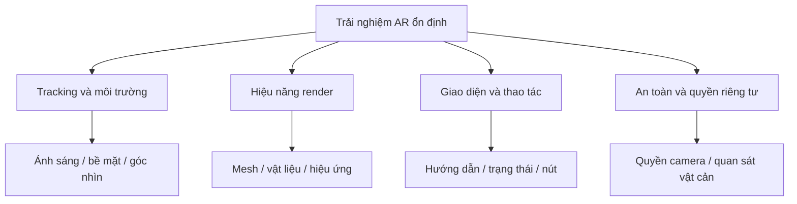

# Bài 08 — Những yếu tố bổ sung khi thiết kế AR

> **Chủ đề:** Thiết kế trải nghiệm thực tế tăng cường (AR) với Unity, minh họa xuyên suốt bằng trò chơi UFO.  
> **Định hướng:** Đọc độc lập, thực hành theo từng bước và kiểm chứng trực tiếp trong Unity; các ví dụ minh họa không phải toàn văn hoặc mã nguồn chính thức của Unity Learn.

## 1. Tổng quan

Một prototype có thể chạy được nhưng vẫn mang lại trải nghiệm kém: đối tượng trôi khỏi mặt bàn, nút điều khiển quá nhỏ, hiệu ứng gây giật hoặc người dùng không hiểu vì sao AR chưa sẵn sàng. Vì vậy, sau khi có đặt vùng chơi, di chuyển và hút mục tiêu, cần đánh giá thêm **độ ổn định tracking, hiệu năng, bố cục và an toàn khi tương tác với không gian thật**.

## 2. Mục tiêu học tập

- Phân tích được các rủi ro từ thiết bị, ánh sáng, bề mặt và quyền camera.
- Lập được checklist kiểm thử hiệu năng và trải nghiệm người dùng.
- Phân biệt vấn đề **tracking**, **rendering** và **gameplay** qua dấu hiệu quan sát được.
- Đề xuất cải tiến có thể kiểm chứng cho ứng dụng UFO AR.

## 3. Bản đồ các yếu tố chất lượng

Các nhóm có liên quan nhưng không đồng nhất. Ví dụ, UFO “nhảy” vị trí khi xoay máy có thể do tracking hoặc cách đặt parent; còn chuyển động giật nhưng vị trí bám mặt bàn ổn định có thể do cập nhật chuyển động hoặc hiệu năng.

## 4. Tracking và môi trường thật

AR cần nhận biết các đặc trưng của môi trường để ước lượng chuyển động. Điều kiện quá tối, bề mặt ít chi tiết hoặc quay máy nhanh có thể làm giảm chất lượng tracking. Trải nghiệm nên xử lý các giai đoạn:

| Trạng thái thực tế | Phản hồi gợi ý | Hành động gameplay |
|---|---|---|
| Chưa có tracking | “Di chuyển điện thoại chậm để quét” | Chưa cho đặt vùng chơi |
| Có tracking ổn định | Hiển thị vùng đặt hoặc khu vực đang chơi | Cho phép thao tác |
| Tracking bị hạn chế | Thông báo điều kiện cần cải thiện | Hạn chế hành động cần tọa độ chính xác |
| Phiên AR không khả dụng | Thông báo khả năng thiết bị/quyền | Không cố khởi tạo gameplay sai |

## 5. Hiệu năng và tính trực quan

Trên điện thoại, ứng dụng vừa xử lý camera/tracking vừa render đối tượng ảo. Khi FPS thấp, điều khiển có thể phản hồi chậm; nếu dùng hiệu ứng hạt, shadow và nhiều vật thể cùng lúc, nên thử tắt từng thành phần để xác định phần tốn tài nguyên.

Các nguyên tắc thiết kế đáng cân nhắc: dùng prefab/mesh đủ nhẹ cho mục đích quan sát; giới hạn hiệu ứng đồng thời; không sinh vô hạn đối tượng; tránh cập nhật không cần thiết mỗi frame; dùng phép đo trên thiết bị thay vì suy từ FPS trong Editor.

**Quy trình đo:** chọn một thiết bị thử → chạy kịch bản cố định (quét, đặt, di chuyển, hút) → ghi FPS/triệu chứng → thay một yếu tố → thử lại cùng kịch bản. Không tuyên bố đạt FPS mục tiêu nếu chưa đo thực tế.

## 6. Giao diện, an toàn và quyền riêng tư

- **Hướng dẫn thao tác:** viết thông báo ngắn, đúng thời điểm; hiển thị trạng thái khi người dùng cần quyết định.
- **Khả năng chạm:** nút đủ lớn, cách nhau hợp lý và tránh camera cutout/safe area.
- **Tính an toàn:** nhắc người chơi đứng ở khu vực thông thoáng và chú ý vật cản thật; không buộc họ di chuyển vội khi quan sát qua camera.
- **Quyền camera:** chỉ yêu cầu quyền cần thiết và giải thích vì sao cần camera. Không mặc định dữ liệu camera được lưu hoặc gửi đi; khả năng này chỉ tồn tại nếu ứng dụng thật sự thiết kế để làm vậy.
- **Tính công bằng:** phản hồi rõ ràng khi không thể đặt hoặc hút, thay vì để người chơi nghĩ mình thao tác sai.

## 7. Ma trận kiểm thử thực hành

| Kịch bản | Điều cần quan sát | Ghi chép |
|---|---|---|
| Mặt bàn sáng, nhiều chi tiết | Vùng chơi đứng yên tương đối với bàn | Đạt/chưa đạt + video |
| Mặt phẳng đơn sắc | Thời gian nhận diện, mất tracking | Ghi điều kiện và triệu chứng |
| Điện thoại xoay/chuyển chậm | UFO có trôi vị trí không | Ghi tình huống tái hiện |
| Chạm hút liên tục | Có bị cộng điểm hai lần không | Ghi trạng thái và log |
| Nhiều mục tiêu/hiệu ứng | FPS, độ trễ điều khiển | Ghi số lượng và thiết bị |
| Cấp/từ chối quyền camera | Có thông báo dễ hiểu không | Ảnh minh chứng |

## 8. Checklist và tổng kết

- [ ] Kiểm thử trên thiết bị thật trong hơn một điều kiện bề mặt/ánh sáng.
- [ ] Có minh chứng trường hợp tracking giảm.
- [ ] Có phép đo hoặc ghi nhận hiệu năng theo kịch bản.
- [ ] Không để UI che mục tiêu hoặc vùng thao tác chính.
- [ ] Có hướng dẫn an toàn và xử lý quyền camera.
- [ ] Phân biệt rõ lỗi tracking, hiển thị và logic gameplay.

## 9. Câu hỏi ôn tập

**Câu 1. Khi người dùng bước vào vùng thiếu sáng, điều nào có thể xảy ra?**

A. Tracking kém và cần thông báo để thay đổi điều kiện  
B. FPS luôn tăng  
C. Không ảnh hưởng bất kỳ thuật toán nào  
D. AR Session tự bỏ qua thế giới thật  

**Đáp án:** A. **Giải thích:** Tracking thị giác phụ thuộc điều kiện quan sát bề mặt và môi trường.

**Câu 2. Lý do cần tối ưu số lượng đối tượng và hiệu ứng cho AR mobile?**

A. Vì Unity không có mesh  
B. Vì còn phải xử lý camera và tracking trên thiết bị  
C. Vì điện thoại không có GPU  
D. Vì API chỉ dùng được trong Editor  

**Đáp án:** B. **Giải thích:** AR cần tài nguyên cho cả rendering lẫn nhận biết thế giới.

**Câu 3. Thế nào là phản hồi phù hợp khi tracking tạm mất?**

A. Bỏ qua mọi thông báo  
B. Tạo lại toàn bộ target liên tục  
C. Tạm dừng thao tác nhạy vị trí và hướng dẫn phục hồi  
D. Chuyển tất cả đối tượng sang Screen Space  

**Đáp án:** C. **Giải thích:** Khi vị trí không đáng tin, nên hạn chế cập nhật gameplay phụ thuộc vào nó.

**Câu 4. Điều nào quan trọng đối với trải nghiệm an toàn?**

A. Đòi người chơi chạy quanh nhanh  
B. Che toàn màn hình bằng UI  
C. Khuyến khích quay camera liên tục không giới hạn  
D. Nhắc người chơi quan sát không gian thật và tránh vật cản  

**Đáp án:** D. **Giải thích:** AR diễn ra giữa môi trường thật và cần tránh hành động gây mất an toàn.

**Câu 5. Dữ liệu nào hữu ích khi ghi lại lỗi hiệu năng?**

A. Tên màu nút  
B. FPS và hoàn cảnh kiểm thử trên thiết bị thật  
C. Tên tài khoản mạng xã hội  
D. Số lần mở Menu ngoài ứng dụng  

**Đáp án:** B. **Giải thích:** Đo theo thiết bị, môi trường và FPS giúp đối chiếu nguyên nhân.

---

**Đọc thêm:** [Unity Learn — AR Experience Design](https://learn.unity.com/pathway/mobile-ar-development/unit/ar-experience-design?version=2022.3). Nội dung các bước và ví dụ trong tài liệu này là bài tập tự biên soạn, có thể cần điều chỉnh theo cấu trúc project và package thực tế.
