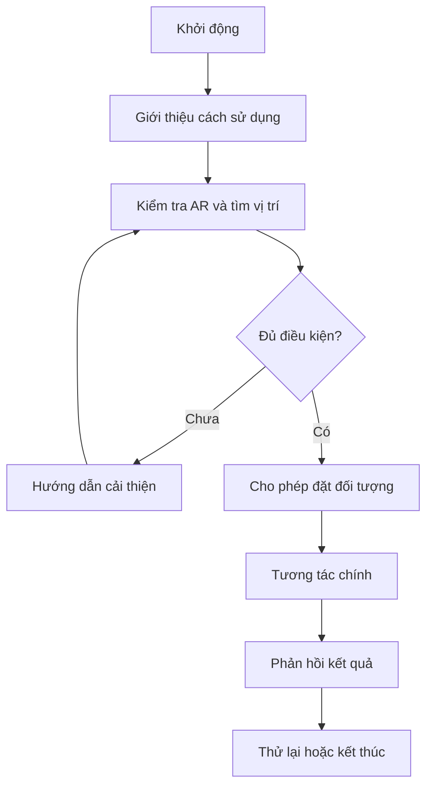

# Bài 09 — Thiết kế ứng dụng AR của riêng bạn

> **Chủ đề:** Thiết kế trải nghiệm thực tế tăng cường (AR) với Unity, minh họa xuyên suốt bằng trò chơi UFO.  
> **Định hướng:** Đọc độc lập, thực hành theo từng bước và kiểm chứng trực tiếp trong Unity; các ví dụ minh họa không phải toàn văn hoặc mã nguồn chính thức của Unity Learn.

## 1. Đề bài dự án

Hãy thiết kế và triển khai một **ứng dụng AR nhỏ**, thể hiện rõ mối liên hệ giữa môi trường thật và đối tượng ảo. Có thể tiếp tục mở rộng prototype UFO hoặc chọn ý tưởng khác như đặt một mô hình lên bàn, quan sát vật thể và kích hoạt thay đổi màu/hành vi. Tối thiểu phải có **một thao tác của người dùng và một phản hồi quan sát được**.

Bài tập đánh giá khả năng **đặt mục tiêu sản phẩm, tổ chức luồng tương tác, kiểm thử và cải tiến**. Không yêu cầu hoàn thành một sản phẩm thương mại. Không có một giải pháp duy nhất cho mọi ý tưởng.

## 2. Mục tiêu học tập

- Định nghĩa được người dùng, bối cảnh và vấn đề cần giải quyết.
- Lập được yêu cầu chức năng và tiêu chí nghiệm thu có thể kiểm chứng.
- Phác thảo kiến trúc Unity/AR và các trạng thái tương tác.
- Tạo được bản build hoặc scene chạy được, có minh chứng và nhật ký thử nghiệm.

## 3. Chọn ý tưởng và phạm vi tối thiểu

Điền vào bản mô tả ngắn:

| Câu hỏi | Nội dung cần điền |
|---|---|
| Ai sử dụng? | Người thử app, nhu cầu hoặc tình huống |
| Đặt ở đâu? | Bàn, sàn, marker, khuôn mặt hoặc môi trường phù hợp |
| Tương tác chính? | Chạm đặt, di chuyển, đổi màu, hút, chọn đối tượng… |
| Phản hồi là gì? | Đổi hình, âm thanh, điểm, thông báo, chuyển trạng thái |
| Điều kiện bắt đầu? | Camera/tracking/điểm đặt đã sẵn sàng |
| Kết thúc ra sao? | Người chơi thấy kết quả và có thể thao tác lại hoặc thoát |

Nếu chọn game UFO, một phạm vi hợp lý là: tìm mặt bàn → đặt PlayArea → điều khiển UFO → chạm hút một mục tiêu → thông báo hoàn tất. Nếu chọn ứng dụng khác, giữ nguyên nguyên tắc có sự kiện và phản hồi rõ ràng.

## 4. Thiết kế luồng tương tác

Đây là sơ đồ tham khảo giúp người học vẽ lại cho ý tưởng của mình. Điểm quan trọng là có nhánh xử lý khi điều kiện chưa đủ; ứng dụng AR không nên chỉ hoạt động trong tình huống lý tưởng.

## 5. Milestone triển khai

1. **Milestone A — Ý tưởng và wireframe:** viết mục tiêu ứng dụng trong 2–3 câu, vẽ một màn hình đang hoạt động và trạng thái chưa sẵn sàng.
2. **Milestone B — AR cơ bản:** chạy camera và AR Session trên thiết bị phù hợp; hiển thị được một đối tượng đúng vị trí.
3. **Milestone C — Tương tác:** nhận một hành động cụ thể và thay đổi ít nhất một trạng thái nhìn thấy được.
4. **Milestone D — Trải nghiệm:** có thông báo, nút hoặc hướng dẫn khi không thể tương tác; tránh che nội dung chính.
5. **Milestone E — Kiểm thử và cải tiến:** thử ít nhất một trường hợp thành công và một trường hợp lỗi, sửa một hạn chế được tìm thấy.

Sau mỗi milestone, lưu scene hoặc commit để có thể quay lại phiên bản hoạt động. Nếu chưa có thiết bị phù hợp, có thể phát triển logic trong Editor nhưng phải ghi rõ phần **AR trên thiết bị thật chưa được kiểm chứng**.

## 6. Đề xuất cách kiểm thử

| Test case | Thao tác | Kết quả mong đợi |
|---|---|---|
| T1 — Bắt đầu | Mở ứng dụng | Có hướng dẫn rõ ràng |
| T2 — Chưa đủ điều kiện | Không quét được bề mặt/không có target | Không khởi tạo sai và có thông báo |
| T3 — Tương tác thành công | Đặt, chạm hoặc điều khiển đúng | Trạng thái thế giới thay đổi đúng |
| T4 — Thao tác lặp | Nhấn lặp trong thời gian ngắn | Không tạo kết quả trùng không chủ ý |
| T5 — Môi trường thay đổi | Di chuyển camera hoặc thay điều kiện sáng | Ứng dụng phản hồi phù hợp |

Ghi kết quả theo mẫu: **mã test → thiết bị/bối cảnh → mong đợi → thực tế → trạng thái đạt/chưa đạt → hướng sửa**.

## 7. Sản phẩm cần nộp

- File project hoặc scene (hay bản build) chạy được.
- Tài liệu mô tả ý tưởng, giao diện, luồng tương tác và yêu cầu chức năng.
- Ảnh hoặc video minh chứng trường hợp thành công.
- Mô tả cách tái hiện ít nhất một trường hợp lỗi.
- Một cải tiến rõ ràng sau lần thử ban đầu, kèm kết quả kiểm chứng.

## 8. Tiêu chí hoàn thành (Definition of Done)

- [ ] Có một ý tưởng AR có mục tiêu và người dùng cụ thể.
- [ ] Phân biệt được nội dung AR và UI thông thường.
- [ ] Có điều kiện bắt đầu và trạng thái lỗi/không sẵn sàng.
- [ ] Có ít nhất một tương tác cùng phản hồi quan sát được.
- [ ] Có sản phẩm chạy thử và minh chứng thực tế.
- [ ] Có nhật ký kiểm thử và tối thiểu một cải tiến.

**Tự đánh giá nâng cao:** thay đổi một tham số chính (tốc độ UFO, kích thước đối tượng hoặc phạm vi tương tác), dự đoán hệ quả trước khi chạy, rồi giải thích bằng kết quả thực nghiệm. Không cần nộp một lời giải cố định; cần thể hiện được quá trình thiết kế và kiểm chứng.

## 9. Câu hỏi ôn tập

**Câu 1. Một yêu cầu chức năng cho ứng dụng AR nên được viết thế nào?**

A. Ứng dụng phải thật tuyệt  
B. Ứng dụng cần rất hiện đại  
C. Khi chạm nút đặt trên bề mặt hợp lệ, một vật thể xuất hiện tại đó  
D. Ứng dụng phải giống mọi game khác  

**Đáp án:** C. **Giải thích:** Yêu cầu đo được và xác minh được bằng kịch bản kiểm thử.

**Câu 2. Tiêu chí nào là bắt buộc trước khi nghiệm thu app AR nhỏ?**

A. Có ít nhất một tương tác và phản hồi có thể quan sát  
B. Có nhiều chục shader  
C. Có server riêng  
D. Có hiệu ứng cao cấp  

**Đáp án:** A. **Giải thích:** Phạm vi bài tập yêu cầu sản phẩm hoạt động và kiểm chứng được.

**Câu 3. Vì sao cần phát triển theo milestone?**

A. Để không bao giờ thử  
B. Để xác nhận từng năng lực trước khi tăng độ phức tạp  
C. Để không cần báo lỗi  
D. Để chỉ kiểm tra lần cuối  

**Đáp án:** B. **Giải thích:** Milestone giảm rủi ro và giúp cô lập vấn đề.

**Câu 4. Nếu ứng dụng chỉ chạy trong Editor mà chưa thử điện thoại, báo cáo nên viết gì?**

A. AR đã hoàn thiện  
B. Đạt mọi tiêu chí tracking  
C. Không cần kiểm thử  
D. Chưa xác minh hành vi AR trên thiết bị thật  

**Đáp án:** D. **Giải thích:** Không thể suy diễn tracking và permission trên điện thoại từ Game view.

**Câu 5. Phản hồi nào chứng minh vòng lặp tương tác hoàn chỉnh?**

A. Nút chưa nối script  
B. Prefab có tên đẹp  
C. Người dùng thao tác, thế giới đổi trạng thái và app thông báo kết quả  
D. Chỉ hiện camera thật  

**Đáp án:** C. **Giải thích:** Trải nghiệm cần có hành động, chuyển trạng thái và phản hồi.

---

**Đọc thêm:** [Unity Learn — AR Experience Design](https://learn.unity.com/pathway/mobile-ar-development/unit/ar-experience-design?version=2022.3). Nội dung các bước và ví dụ trong tài liệu này là bài tập tự biên soạn, có thể cần điều chỉnh theo cấu trúc project và package thực tế.
