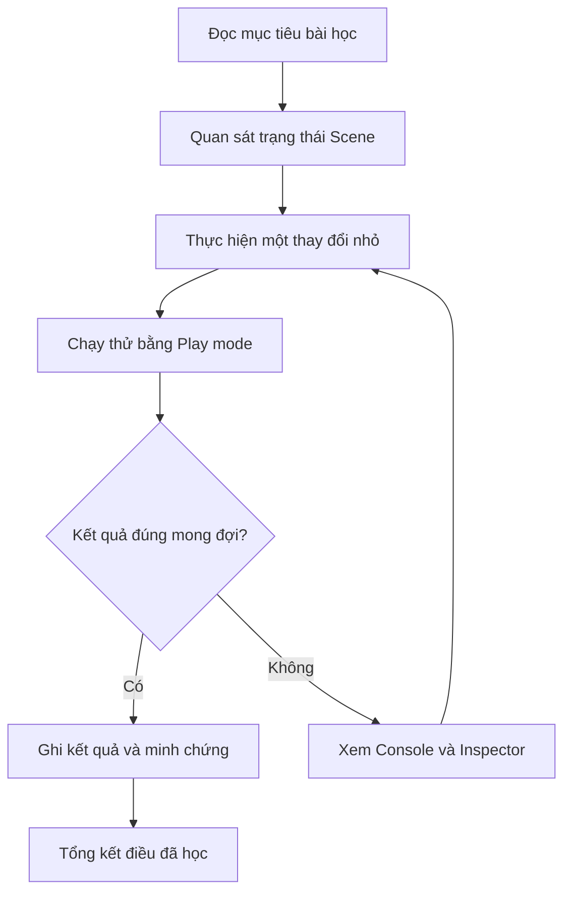

# Bài 01 — Chào mừng đến với lộ trình Game Development

> **Lộ trình:** Game Development → Get started in Unity  
> **Phiên bản tham chiếu:** Unity 6.3  
> **Nguồn:** [Unity Learn — Get started in Unity](https://learn.unity.com/pathway/game-development/unit/get-started-in-unity?version=6.3)  
> **Lưu ý:** Tài liệu tiếng Việt biên tập và mở rộng từ các tệp được cung cấp; không phải bản dịch chính thức hoặc bản ghi đầy đủ của Unity Learn. Những bài tập minh họa bổ sung được đánh dấu là *thực hành đề xuất*.

## 1. Tổng quan

Bài mở đầu giới thiệu cách học Unity theo chu trình **đặt mục tiêu → thực hành → quan sát → kiểm chứng → rút kinh nghiệm**. Thay vì chỉ ghi nhớ các thao tác, người học cần tạo được kết quả có thể quan sát và giải thích được cách tạo ra kết quả đó.

## 2. Mục tiêu học tập

- Hiểu mục đích của lộ trình và cách học theo nhiệm vụ.
- Phân biệt Scene, GameObject, Component và Play mode.
- Biết chuẩn bị dự án thử nghiệm, ghi lại bằng chứng và kiểm tra lỗi.

## 3. Các khái niệm đầu tiên

| Thuật ngữ | Giải thích | Ví dụ |
|---|---|---|
| **Scene** | Không gian tổ chức những đối tượng của một màn chơi hoặc một phần ứng dụng | `SampleScene` |
| **GameObject** | Đối tượng cơ bản trong Scene | Camera, Cube, Light |
| **Component** | Thành phần thêm dữ liệu và chức năng cho GameObject | Transform, Mesh Renderer |
| **Inspector** | Bảng xem/sửa thành phần và thuộc tính của đối tượng đang chọn | Sửa Position X |
| **Play mode** | Chế độ chạy thử dự án trong Editor | Kiểm tra đối tượng hiển thị |
| **Console** | Nơi đọc thông báo, cảnh báo và lỗi | Kiểm tra lỗi script |

## 4. Thực hành từng bước

1. Mở Unity Hub và chọn một dự án học tập phù hợp, hoặc tạo dự án mới.
2. Mở Scene và nhận diện các đối tượng hiện có trong **Hierarchy**.
3. Chọn một GameObject, tìm thành phần **Transform** trong Inspector.
4. Thử thay đổi một giá trị Position, quan sát Scene view trước và sau.
5. Nhấn **Play**, quan sát Game view, sau đó thoát Play mode.
6. Ghi lại kết quả mong đợi, kết quả thực tế và ảnh minh chứng.

> **Nguyên tắc:** Thử từng thay đổi một để dễ xác định nguyên nhân khi có lỗi.

## 5. Thực hành đề xuất

Tạo Scene đơn giản có **Cube** và **Main Camera**; thay đổi vị trí của Cube sao cho có thể nhìn thấy trong Game view. Ghi lại ba điều đã học, một vấn đề và cách xử lý.

## 6. Khi gặp lỗi

| Hiện tượng | Cách kiểm tra |
|---|---|
| Không thấy đối tượng trong Game view | Kiểm tra vị trí Camera, hướng nhìn, trạng thái GameObject |
| Thay đổi không như mong đợi | Xem lại giá trị Transform và đối tượng đang chọn |
| Console báo lỗi | Đọc thông báo cụ thể, sửa một nguyên nhân rồi chạy lại |

## 7. Checklist

- [ ] Mô tả được Scene, GameObject, Component và Play mode.
- [ ] Thực hiện được ít nhất một thay đổi quan sát được.
- [ ] Có ảnh chụp trước/sau hoặc video ngắn.
- [ ] Ghi được nguyên nhân một vấn đề phát sinh.
- [ ] Đối chiếu nội dung tại liên kết Unity Learn ở trên.
