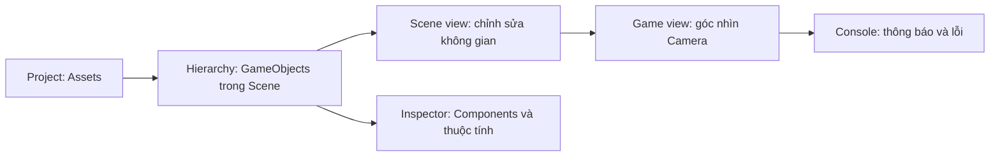

# Bài 02 — Bắt đầu sử dụng Unity Editor (In-Editor Tutorial)

> **Lộ trình:** Game Development → Get started in Unity  
> **Phiên bản tham chiếu:** Unity 6.3  
> **Nguồn:** [Unity Learn — Get started in Unity](https://learn.unity.com/pathway/game-development/unit/get-started-in-unity?version=6.3)  
> **Lưu ý:** Tài liệu tiếng Việt biên tập và mở rộng từ các tệp được cung cấp; không phải bản dịch chính thức hoặc bản ghi đầy đủ của Unity Learn. Những bài tập minh họa bổ sung được đánh dấu là *thực hành đề xuất*.

## 1. Tổng quan

Bài học thực hành làm quen với giao diện Unity Editor, thao tác trên các đối tượng và kiểm tra kết quả trong Scene view và Game view.

## 2. Mục tiêu

- Nhận biết chức năng của **Hierarchy, Scene, Game, Inspector, Project, Console**.
- Chọn và biến đổi GameObject bằng **Move (W), Rotate (E), Scale (R)**.
- Hiểu khác biệt cơ bản giữa hệ tọa độ **Local** và **Global**.
- Biết lưu Scene và kiểm tra hành vi trong Play mode.

## 3. Cấu trúc Unity Editor

| Khu vực | Vai trò | Việc nên thử |
|---|---|---|
| Hierarchy | Danh sách GameObject đang thuộc Scene | Chọn Main Camera hoặc Cube |
| Inspector | Hiển thị Component và thông số | Thay đổi Transform |
| Scene view | Di chuyển, xoay, phóng to khi thiết kế | Định vị một khối |
| Game view | Xem khung hình được Camera xuất ra | Quan sát khi Play |
| Project | Quản lý Asset trong dự án | Tìm Scenes và Assets |
| Console | Hiển thị log/cảnh báo/lỗi | Mở khi thử nghiệm |

## 4. Transform và phím tắt

| Công cụ | Phím | Tác dụng |
|---|---|---|
| Move | `W` | Di chuyển GameObject |
| Rotate | `E` | Xoay GameObject |
| Scale | `R` | Thay đổi kích thước |

- **Position (X, Y, Z):** vị trí trong không gian.
- **Rotation (X, Y, Z):** góc xoay theo các trục.
- **Scale (X, Y, Z):** tỉ lệ kích thước.
- **Global:** trục theo hệ tọa độ thế giới; **Local:** trục gắn với đối tượng, có thể đổi hướng sau khi xoay.

## 5. Thực hành có kiểm chứng

1. Mở Scene; tìm **Main Camera**, **Directional Light** và ít nhất một GameObject trong Hierarchy.
2. Nếu chưa có vật thể, thêm một **3D Object → Cube** từ menu tạo GameObject (tùy giao diện phiên bản).
3. Chọn Cube, nhấn **W**, di chuyển theo trục X; kiểm tra Position trong Inspector.
4. Nhấn **E** để xoay và **R** để đổi Scale; ghi lại giá trị đã thay đổi.
5. Thử chuyển công cụ từ **Global** sang **Local** và quan sát hướng trục điều khiển.
6. So sánh **Scene view** với **Game view**; kiểm tra Cube có nằm trong khung hình Camera không.
7. **Lưu Scene trước khi chạy**, vào Play mode rồi thoát. So sánh các giá trị trước và sau.

> **Chú ý:** Các chỉnh sửa khi đang Play mode thường không được giữ lại sau khi thoát; hãy thực hiện và lưu những thay đổi cần giữ trong chế độ chỉnh sửa.

## 6. Bài tập đề xuất

Tạo một Scene có ba khối Cube ở ba vị trí khác nhau. Đặt Camera sao cho nhìn thấy cả ba, lưu Scene và chụp ảnh Game view. Thử xoay một Cube, phân biệt Local và Global.

### Tiêu chí hoàn thành

- [ ] Có Scene lưu được và chạy thử được.
- [ ] Dùng đúng W/E/R.
- [ ] Giải thích được sự khác nhau giữa Scene view và Game view.
- [ ] Có ảnh minh chứng và một nhận xét về Local/Global.
- [ ] Giải thích được vì sao thay đổi trong Play mode có thể biến mất.

## 7. Khắc phục lỗi

| Vấn đề | Nguyên nhân cần kiểm tra |
|---|---|
| Không nhìn thấy Cube trong Game view | Cube nằm ngoài khung hình, Camera sai hướng hoặc đối tượng bị tắt |
| Không thao tác đúng trục | Công cụ Move/Rotate/Scale hoặc chế độ Local/Global chưa đúng |
| Thay đổi bị mất | Đã sửa trong Play mode mà không thực hiện lại sau khi thoát |
| Khó tìm đối tượng | Chọn đối tượng trong Hierarchy rồi lấy tiêu điểm trong Scene view |

**Tự đánh giá:** Hãy giải thích vì sao hai đối tượng cùng Position có thể cho hình ảnh khác nhau trên Game view.
