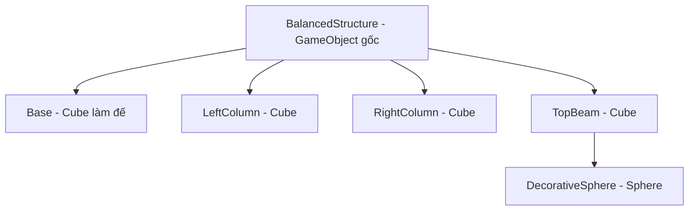
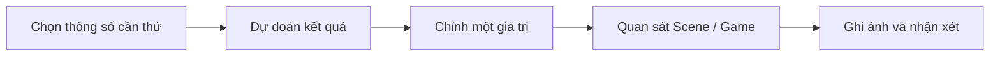

# Bài 03 — Tạo cấu trúc cân bằng bằng các khối cơ bản

> **Lộ trình:** Game Development → Get started in Unity  
> **Phiên bản tham chiếu:** Unity 6.3  
> **Nguồn:** [Unity Learn — Get started in Unity](https://learn.unity.com/pathway/game-development/unit/get-started-in-unity?version=6.3)  
> **Lưu ý:** Tài liệu tiếng Việt biên tập và mở rộng từ các tệp được cung cấp; không phải bản dịch chính thức hoặc bản ghi đầy đủ của Unity Learn. Những bài tập minh họa bổ sung được đánh dấu là *thực hành đề xuất*.

## 1. Tổng quan

Bài thực hành có tên gốc **Create a balanced primitive structure**. Mục tiêu là tạo một mô hình nhỏ từ các **Primitive GameObject**, quan sát hình dạng, tỉ lệ và bố cục của các khối trong Scene. Tệp gốc chỉ nêu định hướng bài tập; mô hình cụ thể dưới đây là **thực hành đề xuất**, không phải hướng dẫn chính thức của Unity.

## 2. Mục tiêu

- Tạo và sắp xếp các khối cơ bản như Cube, Sphere hoặc Cylinder.
- Thay đổi **Position, Rotation, Scale** để xây dựng bố cục cân bằng về hình ảnh.
- Kiểm tra cấu trúc từ nhiều góc nhìn, lưu Scene và trình bày kết quả.
- Tập thay đổi một thông số mỗi lần để quan sát ảnh hưởng.

## 3. Kiến thức nền

| Khái niệm | Ý nghĩa |
|---|---|
| Primitive | Các hình học cơ bản Unity cung cấp để dựng nhanh Scene |
| Transform | Vị trí, góc xoay, kích thước của GameObject |
| Hierarchy | Cây đối tượng, có thể dùng để tổ chức các bộ phận |
| Scene view | Quan sát cấu trúc từ nhiều hướng |
| Game view | Kiểm tra cách Camera hiển thị kết quả |

**Cân bằng thị giác** khác với **cân bằng vật lý**: một cấu trúc có thể trông đối xứng nhưng vẫn đổ nếu mô phỏng Rigidbody/Collider và trọng lực. Tài liệu gốc không chỉ rõ yêu cầu mô phỏng vật lý, vì vậy bài tập chính tập trung vào bố cục.

## 4. Sơ đồ cấu trúc tham khảo

## 5. Thực hành đề xuất từng bước

1. Mở hoặc tạo Scene mới và lưu dưới tên `BalancedStructure`.
2. Tạo một Cube làm đế, điều chỉnh Scale để tạo nền rộng.
3. Tạo hai Cube dựng đứng ở hai bên; cho chúng cùng kích thước và có Position đối xứng qua tâm đế.
4. Thêm Cube nằm ngang làm thanh phía trên, điều chỉnh kích thước để nối hai cột.
5. Thêm Sphere làm chi tiết trang trí phía trên (không bắt buộc).
6. Kiểm tra từ góc **Front**, **Side** và **Perspective** để phát hiện phần bị lệch.
7. Chọn các đối tượng, đặt tên rõ nghĩa trong Hierarchy; có thể tạo GameObject rỗng làm đối tượng cha để nhóm.
8. Lưu Scene, nhấn Play để quan sát Game view và chụp ảnh minh chứng.

### Bộ giá trị thử nghiệm (tham khảo, không phải thông số bắt buộc)

| Đối tượng | Position (X,Y,Z) | Scale (X,Y,Z) |
|---|---|---|
| Base | (0, 0, 0) | (5, 0.5, 2) |
| LeftColumn | (-1.5, 1.5, 0) | (0.5, 2.5, 0.5) |
| RightColumn | (1.5, 1.5, 0) | (0.5, 2.5, 0.5) |
| TopBeam | (0, 2.9, 0) | (4, 0.4, 0.7) |

Các tọa độ là ví dụ tạo bố cục, không bảo đảm tương tác vật lý hay cân bằng động. Hãy thay đổi và quan sát theo Scene thực tế.

## 6. Thử nghiệm mở rộng

- **Đối xứng:** thay đổi vị trí cột phải rồi thử khôi phục để hai bên cân nhau.
- **Tỉ lệ:** tăng chiều cao hai cột và điều chỉnh thanh phía trên.
- **Cơ chế vật lý (tùy chọn):** nếu muốn thử mô phỏng đổ, cần kiểm tra Collider, Rigidbody, trạng thái Is Kinematic và trọng lực.

## 7. Lỗi thường gặp

| Hiện tượng | Kiểm tra |
|---|---|
| Các khối lệch nhau | Position và kích thước trái/phải |
| Thanh trên không nằm đúng vị trí | Trục Y và Scale của từng đối tượng |
| Không thấy toàn bộ cấu trúc | Vị trí/hướng Camera và góc nhìn |
| Mất chỉnh sửa sau khi chạy | Có chỉnh trong Play mode hay không |

## 8. Checklist

- [ ] Scene có ít nhất đế, hai cột và thanh phía trên.
- [ ] Biết giải thích bố cục cân bằng bằng Position/Scale.
- [ ] Quan sát cấu trúc ở ít nhất hai góc nhìn.
- [ ] Lưu Scene và có ảnh Game view.
- [ ] Ghi lại một thay đổi thử nghiệm và kết quả quan sát.
