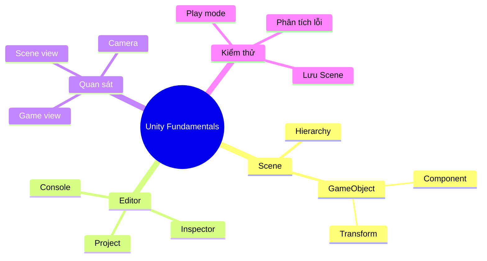
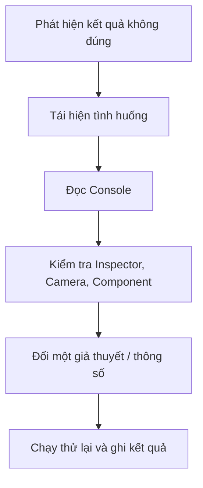

# Bài 04 — Ôn tập Unit 1: Những kiến thức cơ bản về Unity

> **Lộ trình:** Game Development → Get started in Unity  
> **Phiên bản tham chiếu:** Unity 6.3  
> **Nguồn:** [Unity Learn — Get started in Unity](https://learn.unity.com/pathway/game-development/unit/get-started-in-unity?version=6.3)  
> **Lưu ý:** Tài liệu tiếng Việt biên tập và mở rộng từ các tệp được cung cấp; không phải bản dịch chính thức hoặc bản ghi đầy đủ của Unity Learn. Những bài tập minh họa bổ sung được đánh dấu là *thực hành đề xuất*.

## 1. Tổng quan

Bài tổng kết kiến thức làm việc với Unity Editor, cách tổ chức GameObject và kiểm chứng kết quả. **Các câu hỏi sau đây được biên soạn để ôn tập**, không phải câu hỏi quiz chính thức trên Unity Learn.

## 2. Sơ đồ kiến thức

## 3. Kiến thức cần nhớ

| Khái niệm | Nội dung cốt lõi |
|---|---|
| Scene | Chứa và tổ chức các GameObject |
| GameObject | Đối tượng có thể gắn nhiều Component |
| Component | Chứa thông số/hành vi cho GameObject |
| Transform | Position, Rotation và Scale |
| Hierarchy | Xem các đối tượng đang có trong Scene |
| Inspector | Xem/sửa Component của đối tượng được chọn |
| Scene view | Không gian thao tác thiết kế |
| Game view | Hình ảnh Camera hiển thị |
| Play mode | Chạy thử; chỉnh sửa trong chế độ này thường không được lưu |
| Console | Xem thông báo, cảnh báo và lỗi |

## 4. Câu hỏi tự kiểm tra

1. Scene và GameObject khác nhau như thế nào? Cho ví dụ.
2. Component là gì? Vì sao Transform quan trọng?
3. Hierarchy và Inspector có vai trò khác nhau ra sao?
4. Scene view và Game view có thể hiển thị khác nhau vì sao?
5. Phím `W`, `E`, `R` tương ứng với thao tác nào?
6. Phân biệt thao tác theo trục Local và Global.
7. Vì sao những thay đổi thực hiện trong Play mode có thể biến mất?
8. Nếu không nhìn thấy Cube trong Game view, em sẽ kiểm tra điều gì trước?
9. Làm thế nào để xác nhận một Scene đã lưu và chạy đúng?
10. Khi một thay đổi gây lỗi, vì sao nên thử sửa một yếu tố mỗi lần?

## 5. Gợi ý trả lời

1. Scene là không gian tổ chức; GameObject là từng đối tượng thuộc Scene.
2. Component bổ sung dữ liệu/chức năng; Transform xác định vị trí, xoay và tỉ lệ.
3. Hierarchy là danh sách đối tượng; Inspector hiển thị thuộc tính đối tượng được chọn.
4. Game view phụ thuộc góc Camera; Scene view dùng cho biên tập và có thể quan sát từ hướng khác.
5. `W` là Move, `E` là Rotate, `R` là Scale.
6. Global theo trục thế giới; Local theo trục của đối tượng.
7. Play mode chủ yếu để chạy thử, không phải nơi lưu chỉnh sửa thiết kế lâu dài.
8. Xem trạng thái GameObject, Position và hướng nhìn Camera.
9. Lưu Scene, chạy Play, so sánh kết quả quan sát với mục tiêu.
10. Để xác định rõ thay đổi nào gây ra lỗi.

## 6. Bài đánh giá thực hành (đề xuất)

Tạo Scene gồm một đế và hai khối, đặt tên từng GameObject. Dùng Transform làm bố cục đối xứng, điều chỉnh Camera để các khối hiện đầy đủ trong Game view, lưu Scene rồi chạy thử.

**Minh chứng cần chuẩn bị:** ảnh Hierarchy, Inspector khi chọn một đối tượng, Scene view và Game view.

### Tiêu chí tự chấm (10 điểm)

| Tiêu chí | Điểm |
|---|---:|
| Tạo và đặt tên đối tượng hợp lý | 2 |
| Sử dụng Transform chính xác | 2 |
| Phân biệt Scene/Game view | 2 |
| Lưu và chạy thử Scene | 2 |
| Giải thích một lỗi/kiểm thử | 2 |

## 7. Quy trình xử lý sự cố

## 8. Checklist hoàn thành Unit 1

- [ ] Nêu đúng các thuật ngữ chính.
- [ ] Thực hành được thao tác Move / Rotate / Scale.
- [ ] Biết sử dụng Hierarchy, Inspector, Scene và Game view.
- [ ] Lưu được Scene và xác minh kết quả Play mode.
- [ ] Trả lời được ít nhất 8/10 câu tự kiểm tra và giải thích bằng ví dụ.
- [ ] Đọc lại bài gốc trên Unity Learn để đối chiếu nội dung chính thức.
