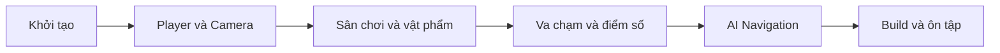

> **Lưu ý nguồn:** Tài liệu tiếng Việt tự biên soạn theo đề mục bài học Unity Learn, không phải bản dịch hoặc transcript chính thức. [Tham khảo Mission gốc](https://learn.unity.com/pathway/game-development/unit/create-a-basic-3d-game?version=6.3).

# Bài 01 — Giới thiệu Unit 2: Lập trình trò chơi 3D cơ bản

## Mục tiêu

- Biết thứ tự các công việc để xây dựng trò chơi 3D nhỏ trong Unity.
- Hiểu cách học bằng mục tiêu, thực hành và đánh giá kết quả trong Editor.
- Xác định sản phẩm đầu ra: nhân vật di chuyển, camera theo dõi, vật phẩm thu thập, điểm số và build độc lập.

## Khái niệm cơ bản

| Thuật ngữ | Ý nghĩa |
|---|---|
| Scene | Không gian chứa các đối tượng của trò chơi |
| GameObject | Đối tượng được cấu tạo từ các Component |
| Inspector | Nơi điều chỉnh thuộc tính Component |
| Play mode | Chế độ chạy thử trong Unity Editor |

## Sơ đồ lộ trình

## Thực hành

1. Tạo hoặc mở một dự án Unity 3D.
2. Khảo sát Hierarchy, Inspector, Project, Scene view và Game view.
3. Lưu một scene thử nghiệm và chạy Play mode.
4. Ghi lại một mục tiêu có thể kiểm chứng cho từng bài học tiếp theo.

## Tự kiểm tra

- [ ] Giải thích được Scene, GameObject và Component.
- [ ] Lưu và chạy thử một scene.
- [ ] Trình bày được chuỗi tính năng cần hoàn thành trong Unit 2.
