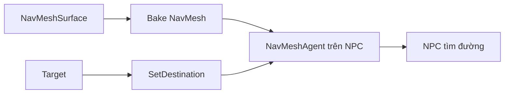

> **Lưu ý nguồn:** Tài liệu tiếng Việt tự biên soạn theo đề mục bài học Unity Learn, không phải bản dịch hoặc transcript chính thức. [Tham khảo Mission gốc](https://learn.unity.com/pathway/game-development/unit/create-a-basic-3d-game?version=6.3).

# Bài 09 — Thêm điều hướng AI (Adding AI Navigation)

## Mục tiêu

- Hiểu vai trò của NavMesh, NavMeshSurface và NavMeshAgent.
- Tạo NPC tự tìm đường tới mục tiêu trên sân chơi.
- Xác định được các lỗi phổ biến khi NPC không di chuyển.

## Kiến thức trọng tâm

NavMesh biểu diễn bề mặt có thể đi được; NavMeshSurface cung cấp cách xây dựng dữ liệu điều hướng; NavMeshAgent điều khiển NPC tới một đích trên vùng NavMesh.



## Hướng dẫn thực hành

1. Trong Package Manager, kiểm tra/cài đặt package **AI Navigation**.
2. Thêm `NavMeshSurface` lên GameObject quản lý sân chơi rồi xây dựng (**Bake**) NavMesh.
3. Thêm Capsule NPC và component `NavMeshAgent`, đặt trên vùng NavMesh đã tạo.
4. Tạo GameObject `Target` ở vị trí có thể tới được.
5. Tạo `FollowTargetAgent.cs`, gắn vào NPC rồi kéo Target vào tham chiếu `target` trong Inspector.

```csharp
using UnityEngine;
using UnityEngine.AI;

[RequireComponent(typeof(NavMeshAgent))]
public class FollowTargetAgent : MonoBehaviour
{
    [SerializeField] private Transform target;
    private NavMeshAgent agent;

    void Awake() => agent = GetComponent<NavMeshAgent>();

    void Update()
    {
        if (target != null && agent.isOnNavMesh)
            agent.SetDestination(target.position);
    }
}
```

## Kiểm thử và khắc phục lỗi

| Hiện tượng | Điều cần kiểm tra |
|---|---|
| NPC đứng yên | Đã Bake NavMesh và NPC đang nằm trên NavMesh chưa? |
| NPC không tới đích | Target có thuộc vùng đi được hay bị chướng ngại cản? |
| Console báo lỗi | Tham chiếu target, trạng thái Agent, package và script |

## Checklist

- [ ] NPC có NavMeshAgent và nằm trên NavMesh.
- [ ] NPC di chuyển theo Target.
- [ ] Có ảnh/video cho kết quả và một tình huống debug.
