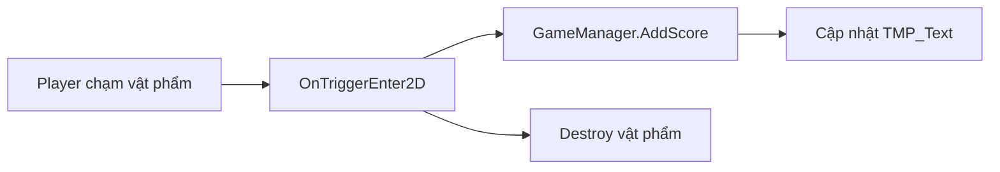

# Bài 06 — Xây dựng hệ thống tính điểm (Add a scoring system)

> **Nguồn đối chiếu:** [Unity Learn — Create a basic 2D game](https://learn.unity.com/pathway/game-development/unit/create-a-basic-2d-game?version=6.3). Đây là tài liệu học tập tự biên soạn, không phải bản dịch hay transcript chính thức.

## Mục tiêu

- Nắm được kỹ năng **xây dựng hệ thống tính điểm** và vai trò của nó trong game 2D.
- Thực hiện ví dụ trong Unity Editor và xác minh ở Play Mode.
- Tìm được ít nhất một lỗi có thể tái hiện và cách khắc phục.

## Kiến thức nền

- `Scene` là không gian bố trí GameObject; mỗi GameObject có các `Component` được chỉnh qua Inspector.
- `SpriteRenderer` hiển thị hình 2D; `Sorting Layer` và `Order in Layer` điều khiển thứ tự vẽ.
- Tương tác 2D sử dụng `Rigidbody2D`, `Collider2D` và callbacks như `OnTriggerEnter2D`.

## Kiểm thử và ghi chép

Ghi rõ **kết quả mong đợi → kết quả thực tế → ảnh hoặc Console → nhận xét**. Kiểm tra tham chiếu Inspector, trạng thái GameObject và cách cấu hình Input/Physics khi Play Mode không cho kết quả như dự đoán.

## Checklist

- [ ] Có scene chạy thử và không có lỗi nghiêm trọng trong Console.
- [ ] Kiểm tra được thay đổi một tham số trong Inspector tác động ra sao.
- [ ] Lưu ảnh/video minh chứng và tự giải thích một lỗi.
- [ ] Đối chiếu bài gốc Unity Learn nếu cần các bước, tài nguyên chính thức.

---

## 9. Bổ sung hệ thống điểm thực sự

Trong tài liệu cơ sở, đoạn `Pickup2D` chỉ ghi log khi thu thập vật và tự xóa, **chưa cộng điểm**. Phần mở rộng này gắn hành vi nhặt vật với hiển thị điểm số bằng TextMeshPro.



```csharp
using TMPro;
using UnityEngine;

public class ScoreManager2D : MonoBehaviour
{
    [SerializeField] TMP_Text scoreText;
    int score;
    void Start() => Refresh();
    public void AddScore(int amount)
    {
        score += amount;
        Refresh();
    }
    void Refresh()
    {
        if (scoreText != null) scoreText.text = $"Điểm: {score}";
    }
}

public class ScorePickup2D : MonoBehaviour
{
    [SerializeField] ScoreManager2D scoreManager;
    [SerializeField] int points = 10;
    void OnTriggerEnter2D(Collider2D other)
    {
        if (!other.CompareTag("Player")) return;
        if (scoreManager != null) scoreManager.AddScore(points);
        Destroy(gameObject);
    }
}
```

**Thiết lập:** đặt `ScoreManager2D` trên object quản lý, kéo `TMP_Text` vào `scoreText` và kéo manager vào từng prefab `ScorePickup2D` (hoặc dùng khởi tạo runtime nếu tạo Prefab asset). Khi spawn Prefab từ asset, tham chiếu tới object trong scene không thể lưu trực tiếp trên asset: cần gán sau khi Instantiate hoặc dùng kiến trúc event/manager. **Kiểm thử:** nhặt ba vật +10 điểm phải hiển thị 30; không cộng lại khi đối tượng đã bị hủy.
