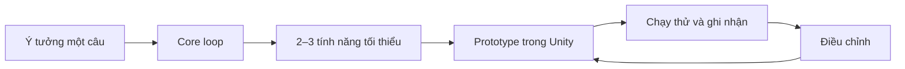

# Bài 01 — Introduction to Unit 4

> **Nguồn và phạm vi:** Bản biên tập tiếng Việt dựa trên tệp hướng dẫn người dùng cung cấp, vốn được tự biên soạn từ đề mục công khai. Phần ví dụ, bảng và sơ đồ được bổ sung để học tập; **không phải bản dịch chính thức, transcript hay câu hỏi quiz chính thức của Unity**.

**Bài gốc để đối chiếu:** [Unity Learn — Planning a game](https://learn.unity.com/pathway/game-development/unit/planning-a-game?version=6.3)

## 1. Vai trò của Unit 4

Sau khi đã làm quen với scene, nhân vật và vòng lặp trò chơi ở các unit trước, bước tiếp theo là **lập kế hoạch trước khi mở rộng sản phẩm**. Mục tiêu không phải là viết hết tính năng, mà là trả lời: trò chơi dành cho ai, hoạt động chính là gì và làm sao biết nó thú vị.

## 2. Ba khái niệm nền tảng

| Thuật ngữ | Ý nghĩa | Minh chứng thực hành |
|---|---|---|
| Core loop | Chuỗi hành động lặp tạo trải nghiệm | Di chuyển → thu thập → tăng điểm → tiếp tục |
| Prototype | Bản chạy thử để kiểm chứng cơ chế | Scene với hình khối thay cho đồ họa hoàn chỉnh |
| Iteration | Cải thiện dựa trên phản hồi | Sửa tốc độ sau khi người khác thử |
| Greyboxing | Dựng không gian bằng khối đơn giản | Thử chiều rộng đường đi và khoảng cách vật cản |

## 3. Quy trình từ ý tưởng tới nguyên mẫu

## 4. Bài thực hành

1. Viết một câu giới thiệu game (ví dụ: người chơi né vật cản để sống sót càng lâu càng tốt).
2. Chọn ba yếu tố cần có: điều khiển, vật cản, điều kiện thua.
3. Dựng một scene bằng primitive hoặc sprite mặc định; chưa cần menu phức tạp.
4. Đưa cho một người thử mà không giải thích trước; ghi xem họ có hiểu điều khiển và mục tiêu không.
5. Ghi một điều nên giữ, một điều nên đổi, một điều để sau.

**Đầu ra:** mô tả một câu, sơ đồ core loop, ảnh prototype và bảng phản hồi.

## 5. Checklist hoàn thành

- [ ] Nêu được mục tiêu và ít nhất hai khái niệm cốt lõi của bài.
- [ ] Có sản phẩm thực hành hoặc câu trả lời minh chứng.
- [ ] Ghi lại kết quả mong đợi, kết quả thực tế và bằng chứng.
- [ ] Đối chiếu giao diện, package và hướng dẫn với phiên bản Unity đang sử dụng.

---
*Ghi chú: vị trí menu và khả năng hỗ trợ platform có thể thay đổi giữa các phiên bản Unity. Các dữ liệu, con số trong ví dụ là giả định phục vụ học tập, không phải kết quả đo thực tế.*
