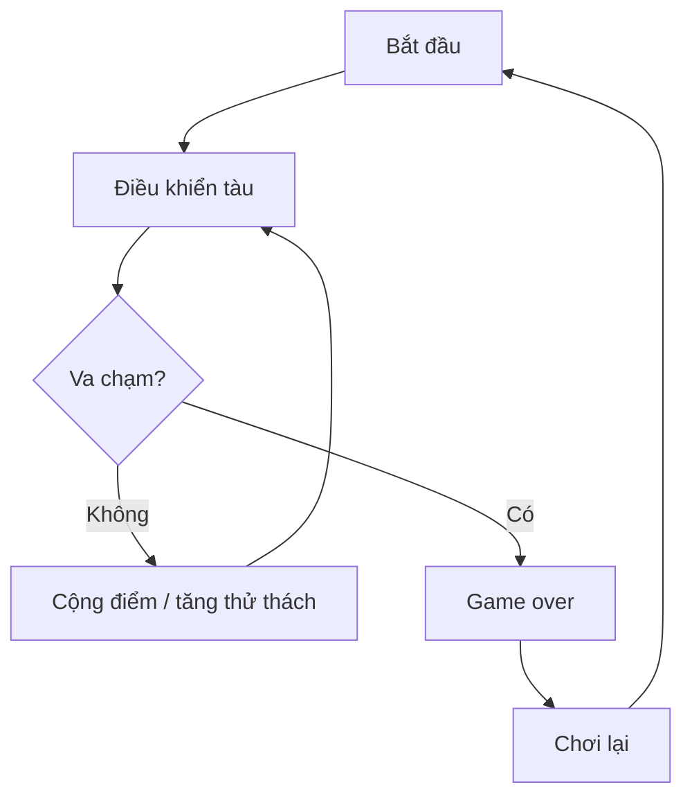

# Bài 02 — Create a Game Design Document

> **Nguồn và phạm vi:** Bản biên tập tiếng Việt dựa trên tệp hướng dẫn người dùng cung cấp, vốn được tự biên soạn từ đề mục công khai. Phần ví dụ, bảng và sơ đồ được bổ sung để học tập; **không phải bản dịch chính thức, transcript hay câu hỏi quiz chính thức của Unity**.

**Bài gốc để đối chiếu:** [Unity Learn — Planning a game](https://learn.unity.com/pathway/game-development/unit/planning-a-game?version=6.3)

## 1. Game Design Document (GDD) là gì?

GDD là tài liệu mô tả ý định thiết kế và các quyết định quan trọng. Nó giúp cá nhân hoặc nhóm thống nhất **trò chơi sẽ làm gì**, không thay thế việc thử nghiệm. Với dự án nhỏ, GDD ngắn gọn và cập nhật thường xuyên sẽ hữu ích hơn tài liệu dài nhưng không sử dụng.

## 2. Mẫu GDD tối thiểu

| Mục | Câu hỏi phải trả lời |
|---|---|
| Tên / elevator pitch | Mô tả game trong 1–2 câu? |
| Người chơi mục tiêu | Ai sẽ chơi, thời lượng một lượt bao lâu? |
| Genre và platform | Thể loại, thiết bị phát hành dự kiến? |
| Core loop | Người chơi làm gì → nhận phản hồi gì → tiến triển ra sao? |
| Điều khiển | Phím, chuột, chạm hay tay cầm? |
| Luật thắng/thua | Khi nào kết thúc, có thể chơi lại thế nào? |
| UI và phản hồi | Hiện điểm, máu, thời gian, âm thanh ở đâu? |
| MVP / ngoài phạm vi | Điều gì nhất thiết có ở bản đầu; điều gì hoãn lại? |
| Rủi ro / tiêu chí đạt | Giả định nào phải kiểm chứng và đo bằng gì? |

## 3. Ví dụ mini-GDD: Tránh thiên thạch

- **Pitch:** điều khiển tàu tránh thiên thạch đang rơi, cố gắng đạt điểm cao.
- **Đối tượng:** người chơi casual, một ván 1–3 phút (mục tiêu thiết kế, chưa phải số liệu kiểm thử).
- **Core loop:** né → sống sót → tăng điểm theo thời gian → độ khó tăng → thua → chơi lại.
- **Điều khiển:** A/D hoặc mũi tên trái/phải; có thể bổ sung chạm sau.
- **MVP:** di chuyển, sinh vật cản, phát hiện va chạm, điểm, nút chơi lại.
- **Để sau:** skin, hiệu ứng hạt phức tạp, bảng xếp hạng online.
- **Giả thuyết kiểm chứng:** người chơi hiểu mục tiêu và điều khiển mà không cần hướng dẫn miệng.

## 4. Thực hành và nghiệm thu

1. Sao chép bảng mẫu thành GDD cho trò chơi của bạn.
2. Xác định ba tính năng ưu tiên cao, mỗi tính năng kèm một điều kiện đạt cụ thể.
3. Đánh dấu các giả định chưa thử nghiệm là **giả thuyết**, không trình bày như kết luận.
4. Sau mỗi lần playtest, thêm ngày, quan sát và quyết định cập nhật.

**Đầu ra:** bản GDD 1–2 trang và danh sách MVP có thể kiểm chứng.

## 5. Checklist hoàn thành

- [ ] Nêu được mục tiêu và ít nhất hai khái niệm cốt lõi của bài.
- [ ] Có sản phẩm thực hành hoặc câu trả lời minh chứng.
- [ ] Ghi lại kết quả mong đợi, kết quả thực tế và bằng chứng.
- [ ] Đối chiếu giao diện, package và hướng dẫn với phiên bản Unity đang sử dụng.

---
*Ghi chú: vị trí menu và khả năng hỗ trợ platform có thể thay đổi giữa các phiên bản Unity. Các dữ liệu, con số trong ví dụ là giả định phục vụ học tập, không phải kết quả đo thực tế.*
