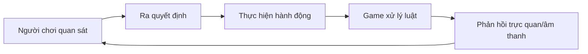

# Bài 03 — Game Design

> **Nguồn và phạm vi:** Bản biên tập tiếng Việt dựa trên tệp hướng dẫn người dùng cung cấp, vốn được tự biên soạn từ đề mục công khai. Phần ví dụ, bảng và sơ đồ được bổ sung để học tập; **không phải bản dịch chính thức, transcript hay câu hỏi quiz chính thức của Unity**.

**Bài gốc để đối chiếu:** [Unity Learn — Planning a game](https://learn.unity.com/pathway/game-development/unit/planning-a-game?version=6.3)

## 1. Thiết kế trò chơi là thiết kế quyết định

Game design kết hợp mục tiêu, luật, khả năng hành động, phản hồi và độ khó để tạo trải nghiệm. Khác với lập trình triển khai, thiết kế đặt câu hỏi **người chơi lựa chọn gì, vì sao và hệ thống phản hồi thế nào**.

## 2. Các thành phần cốt lõi

| Thành phần | Ví dụ với game thu thập vật phẩm |
|---|---|
| Goal | Thu thập đủ 10 vật phẩm |
| Rules | Chạm vật phẩm để nhận điểm; chạm kẻ địch mất lượt |
| Mechanics | Di chuyển, nhảy, nhặt vật phẩm |
| Feedback | Hiệu ứng sáng, âm thanh và số điểm thay đổi |
| Challenge | Vị trí vật phẩm khó tiếp cận, kẻ địch di chuyển |
| Progression | Tăng độ khó hoặc mở khóa màn |

**Luật chơi** mô tả điều được phép xảy ra; **cơ chế** mô tả hành động và tương tác; **phản hồi** giúp người chơi thấy hệ quả.

## 3. Tạo và kiểm chứng core loop

1. Chọn một hành động chính, ví dụ nhảy qua hố.
2. Ghi rõ input, điều kiện hợp lệ, kết quả thành công và thất bại.
3. Dùng greybox để kiểm tra khoảng cách nhảy; chưa cần art hoàn chỉnh.
4. Thử thay **một biến** (tốc độ, lực nhảy hoặc khoảng cách), quan sát sự thay đổi.
5. Cho người khác chơi; tránh dẫn dắt bằng cách giải thích trước.

## 4. Bảng playtest

| Giả thuyết | Cách thử | Điều quan sát | Quyết định |
|---|---|---|---|
| Người mới biết cách di chuyển | 1 phút chơi không chỉ dẫn | Có cần hỏi phím? | Bổ sung gợi ý nếu cần |
| Khoảng cách nhảy hợp lý | Thử 5 lần cùng một đoạn | Số lần thất bại và nguyên nhân | Chỉnh khoảng cách hoặc lực |

**Lưu ý:** các con số trong ví dụ chỉ là kế hoạch thử, không phải kết quả thực nghiệm.

## 5. Checklist hoàn thành

- [ ] Nêu được mục tiêu và ít nhất hai khái niệm cốt lõi của bài.
- [ ] Có sản phẩm thực hành hoặc câu trả lời minh chứng.
- [ ] Ghi lại kết quả mong đợi, kết quả thực tế và bằng chứng.
- [ ] Đối chiếu giao diện, package và hướng dẫn với phiên bản Unity đang sử dụng.

---
*Ghi chú: vị trí menu và khả năng hỗ trợ platform có thể thay đổi giữa các phiên bản Unity. Các dữ liệu, con số trong ví dụ là giả định phục vụ học tập, không phải kết quả đo thực tế.*
