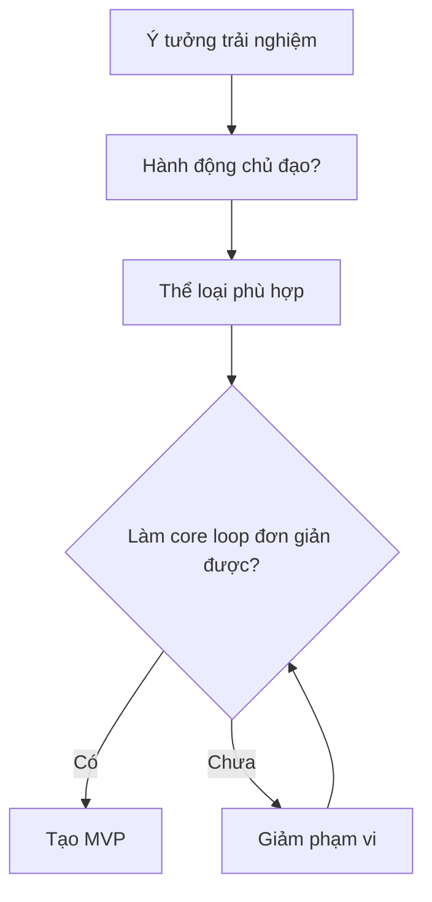

# Bài 04 — Game Genres

> **Nguồn và phạm vi:** Bản biên tập tiếng Việt dựa trên tệp hướng dẫn người dùng cung cấp, vốn được tự biên soạn từ đề mục công khai. Phần ví dụ, bảng và sơ đồ được bổ sung để học tập; **không phải bản dịch chính thức, transcript hay câu hỏi quiz chính thức của Unity**.

**Bài gốc để đối chiếu:** [Unity Learn — Planning a game](https://learn.unity.com/pathway/game-development/unit/planning-a-game?version=6.3)

## 1. Thể loại game (game genres)

Thể loại mô tả kiểu tương tác nổi bật và kỳ vọng của người chơi. Một game có thể thuộc nhiều thể loại: ví dụ action-platformer hoặc puzzle-adventure. Đừng nhầm **genre** (game chơi như thế nào) với **chủ đề** (game kể về điều gì) và **góc nhìn** (2D, 3D, góc nhìn thứ nhất).

## 2. Các thể loại thường gặp

| Thể loại | Cơ chế trung tâm | Điểm cần thử trong prototype |
|---|---|---|
| Platformer | Chạy, nhảy, vượt địa hình | Cảm giác di chuyển và camera |
| Puzzle | Giải bài toán theo quy tắc | Luật dễ hiểu, đáp án hợp lý |
| Action | Phản xạ, né, chiến đấu | Điều khiển, va chạm, phản hồi |
| Strategy | Phân bổ nguồn lực, quyết định | Sự rõ ràng về thông tin và đánh đổi |
| Simulation | Tương tác với hệ thống mô phỏng | Tính nhất quán của quy tắc |
| Racing | Đua tốc độ, xử lý phương tiện | Cảm giác điều khiển và track |
| Role-playing (RPG) | Nhân vật, chỉ số, tiến triển | Quyết định và vòng tiến triển |

## 3. Chọn thể loại theo năng lực dự án

Ví dụ: ý tưởng “khám phá hầm ngục” có thể là action, puzzle hoặc RPG tùy quyết định người chơi. Chọn một vòng lặp chính trước khi thêm hệ thống phụ.

## 4. Bài tập

1. Chọn ba game quen thuộc, ghi thể loại chính và một thể loại phụ nếu có.
2. Mô tả **cơ chế làm nên thể loại** thay vì chỉ nhìn phong cách đồ họa.
3. Chuyển cùng một chủ đề thành hai genre khác nhau (ví dụ không gian: né thiên thạch hoặc giải đố điều hướng tàu).
4. Xác định genre của dự án và tính năng tối thiểu để người khác nhận ra nó.

**Đầu ra:** bảng đối chiếu ba game và lý do lựa chọn genre.

## 5. Checklist hoàn thành

- [ ] Nêu được mục tiêu và ít nhất hai khái niệm cốt lõi của bài.
- [ ] Có sản phẩm thực hành hoặc câu trả lời minh chứng.
- [ ] Ghi lại kết quả mong đợi, kết quả thực tế và bằng chứng.
- [ ] Đối chiếu giao diện, package và hướng dẫn với phiên bản Unity đang sử dụng.

---
*Ghi chú: vị trí menu và khả năng hỗ trợ platform có thể thay đổi giữa các phiên bản Unity. Các dữ liệu, con số trong ví dụ là giả định phục vụ học tập, không phải kết quả đo thực tế.*
