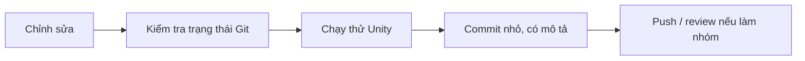

# Bài 06 — Set up version control for your game project

> **Nguồn và phạm vi:** Bản biên tập tiếng Việt dựa trên tệp hướng dẫn người dùng cung cấp, vốn được tự biên soạn từ đề mục công khai. Phần ví dụ, bảng và sơ đồ được bổ sung để học tập; **không phải bản dịch chính thức, transcript hay câu hỏi quiz chính thức của Unity**.

**Bài gốc để đối chiếu:** [Unity Learn — Planning a game](https://learn.unity.com/pathway/game-development/unit/planning-a-game?version=6.3)

## 1. Vì sao phải quản lý phiên bản?

Version control theo dõi thay đổi, cho phép quay về trạng thái ổn định và phối hợp khi nhiều người làm game. Đây là bài về **quản lý lịch sử mã nguồn và asset**; cơ chế lưu dữ liệu người chơi như PlayerPrefs là một chủ đề khác (có được nhắc đến trong tệp nguồn nhưng không thay thế version control).

## 2. Thành phần cần theo dõi trong dự án Unity

| Nên lưu vào Git | Thường loại trừ |
|---|---|
| `Assets/`, bao gồm các tệp `.meta` | `Library/` |
| `Packages/` | `Temp/` |
| `ProjectSettings/` | `Obj/`, `Logs/` |
| README, tài liệu dự án | File build và cache được sinh lại |

Bật **Visible Meta Files** và cấu hình **Asset Serialization: Force Text** khi phù hợp để các thay đổi asset dễ quản lý. Dùng `.gitignore` dành cho Unity và cân nhắc Git LFS cho các asset nhị phân lớn.

## 3. Quy trình Git cơ bản

```bash
git init
git add .
git commit -m "Initial Unity project"
git switch -c feature/player-movement
# Sau khi chỉnh sửa và kiểm tra:
git add Assets Packages ProjectSettings
git commit -m "Implement basic player movement"
```

Chạy các lệnh trong thư mục gốc dự án sau khi đã tạo `.gitignore` hợp lệ. Không `git add .` khi chưa kiểm tra xem cache hoặc thông tin bí mật có bị đưa vào không.



## 4. Bài tập và lỗi thường gặp

1. Khởi tạo repository cho một project Unity nhỏ.
2. Xác nhận Git không theo dõi `Library/` và vẫn có `.meta`.
3. Tạo nhánh, chỉnh một script, commit; dùng `git diff` để xem thay đổi.
4. Thử quay về commit trước **trên một nhánh thử**, không làm mất công việc chưa lưu.

**Chú ý:** Git không thay thế sao lưu đầy đủ; tránh mở cùng một scene ở nhiều nhánh rồi ghi đè asset không chủ ý. Với nhóm, quy ước người phụ trách scene/prefab và cách xử lý conflict.

## 5. Checklist hoàn thành

- [ ] Nêu được mục tiêu và ít nhất hai khái niệm cốt lõi của bài.
- [ ] Có sản phẩm thực hành hoặc câu trả lời minh chứng.
- [ ] Ghi lại kết quả mong đợi, kết quả thực tế và bằng chứng.
- [ ] Đối chiếu giao diện, package và hướng dẫn với phiên bản Unity đang sử dụng.

---
*Ghi chú: vị trí menu và khả năng hỗ trợ platform có thể thay đổi giữa các phiên bản Unity. Các dữ liệu, con số trong ví dụ là giả định phục vụ học tập, không phải kết quả đo thực tế.*
