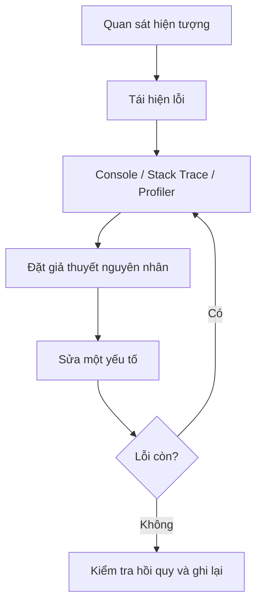

# Bài 07 — Troubleshooting strategies for game dev

> **Nguồn và phạm vi:** Bản biên tập tiếng Việt dựa trên tệp hướng dẫn người dùng cung cấp, vốn được tự biên soạn từ đề mục công khai. Phần ví dụ, bảng và sơ đồ được bổ sung để học tập; **không phải bản dịch chính thức, transcript hay câu hỏi quiz chính thức của Unity**.

**Bài gốc để đối chiếu:** [Unity Learn — Planning a game](https://learn.unity.com/pathway/game-development/unit/planning-a-game?version=6.3)

## 1. Khắc phục lỗi theo quy trình có bằng chứng

Đừng thay ngẫu nhiên nhiều tham số khi thấy game hoạt động sai. Hãy **tái hiện → thu thập bằng chứng → khoanh vùng → sửa một giả thuyết → kiểm chứng**.



## 2. Chọn công cụ đúng vấn đề

| Hiện tượng | Công cụ / nơi kiểm tra | Câu hỏi |
|---|---|---|
| C# không chạy | Console, Console stack trace | Có compiler error hay exception? |
| GameObject biến mất | Hierarchy, Inspector, Scene/Game view | Active? Camera nhìn thấy? Layer? |
| Va chạm không xảy ra | Collider, Rigidbody, layer collision matrix | Có đủ component và cấu hình phù hợp? |
| FPS thấp | Profiler CPU/GPU, Memory | Frame tốn ở khâu nào? |
| Chỉ lỗi trong bản build | Build log, thiết bị đích | Có tài nguyên/scene/thiết lập khác Editor? |

## 3. Ví dụ kiểm tra `NullReferenceException`

```csharp
using UnityEngine;

public class TargetFollower : MonoBehaviour
{
    [SerializeField] private Transform target;

    private void Update()
    {
        if (target == null)
        {
            Debug.LogWarning("Target chưa được gán", this);
            return;
        }

        transform.position = Vector3.MoveTowards(
            transform.position, target.position, 2f * Time.deltaTime);
    }
}
```

Cách kiểm tra: gắn script vào GameObject, để trống `target`, chạy thử và quan sát warning; sau đó gán đối tượng vào Inspector và xác nhận hành vi mong đợi. Đây là ví dụ minh họa tự xây dựng, không phải mã chính thức của Unity Learn.

## 4. Đo hiệu năng trước khi tối ưu

Đặt một tình huống kiểm thử cố định; chụp kết quả Profiler **trước** và **sau**, trên thiết bị mục tiêu nếu có. FPS trung bình không đủ để chứng minh nguyên nhân — cần xem CPU, GPU, cấp phát bộ nhớ và các spike.

**Mẫu bug report:** bước tái hiện · kết quả mong đợi · kết quả thực tế · phiên bản Unity · log/screenshot · thay đổi đã thử · kết quả retest.

## 5. Checklist hoàn thành

- [ ] Nêu được mục tiêu và ít nhất hai khái niệm cốt lõi của bài.
- [ ] Có sản phẩm thực hành hoặc câu trả lời minh chứng.
- [ ] Ghi lại kết quả mong đợi, kết quả thực tế và bằng chứng.
- [ ] Đối chiếu giao diện, package và hướng dẫn với phiên bản Unity đang sử dụng.

---
*Ghi chú: vị trí menu và khả năng hỗ trợ platform có thể thay đổi giữa các phiên bản Unity. Các dữ liệu, con số trong ví dụ là giả định phục vụ học tập, không phải kết quả đo thực tế.*
