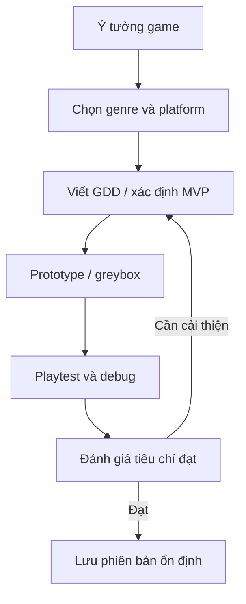

# Bài 08 — Unit 4 - Planning your game

> **Nguồn và phạm vi:** Bản biên tập tiếng Việt dựa trên tệp hướng dẫn người dùng cung cấp, vốn được tự biên soạn từ đề mục công khai. Phần ví dụ, bảng và sơ đồ được bổ sung để học tập; **không phải bản dịch chính thức, transcript hay câu hỏi quiz chính thức của Unity**.

**Bài gốc để đối chiếu:** [Unity Learn — Planning a game](https://learn.unity.com/pathway/game-development/unit/planning-a-game?version=6.3)

## 1. Tổng kết Unit 4

Unit 4 nối ý tưởng game với bản prototype khả thi: xác định thể loại, nền tảng, tài liệu thiết kế, quản lý lịch sử thay đổi và kiểm thử có phương pháp. Đây là **bộ câu hỏi ôn tập tự biên soạn**, không phải nội dung quiz chính thức trên Unity Learn.

## 2. Sơ đồ tổng hợp

## 3. Câu hỏi tự đánh giá

1. Khác biệt giữa **core loop**, mechanic và theme là gì? Cho một ví dụ.
2. GDD tối thiểu nên trả lời những câu hỏi nào?
3. Tại sao prototype thường dùng placeholder assets trước khi đầu tư mỹ thuật?
4. Một trò chơi có thể có nhiều genre không? Làm thế nào chọn genre chính?
5. Vì sao quyết định mobile hay PC có thể làm thay đổi thiết kế input và UI?
6. Các thư mục nào trong Unity nên được lưu vào Git, thư mục nào không?
7. Nếu gặp `NullReferenceException`, bạn kiểm tra điều gì đầu tiên?
8. Tại sao cần Profiler thay vì chỉ dựa vào FPS?
9. Giải thích cách kiểm tra một giả thuyết thiết kế bằng playtest.
10. Đề xuất ba tính năng MVP và một tiêu chí hoàn thành đo được cho game bạn muốn làm.

## 4. Gợi ý đối chiếu đáp án

- Câu 1–3: nêu định nghĩa, ví dụ hành động–phản hồi–kết quả, lý do giảm rủi ro.
- Câu 4–5: liên hệ cơ chế trọng tâm với kỳ vọng người chơi và giới hạn thiết bị.
- Câu 6: có `Assets` và `.meta`, `Packages`, `ProjectSettings`; loại trừ cache như `Library`.
- Câu 7–8: theo stack trace, tham chiếu Inspector; đo đúng điểm nghẽn và so sánh trước/sau.
- Câu 9–10: nêu giả thuyết, điều kiện thử, bằng chứng quan sát và quyết định tiếp theo.

## 5. Bài tập cuối unit

Tạo một **pitch**, một GDD ngắn, một sơ đồ core loop, một scene prototype, repository Git và báo cáo playtest. Chụp ít nhất một hình minh chứng và ghi một vấn đề đã sửa. Tự đánh giá theo bảng:

| Tiêu chí | Bằng chứng cần nộp |
|---|---|
| Ý tưởng rõ | Pitch và genre/platform |
| Phạm vi hợp lý | GDD và danh sách MVP |
| Chơi thử được | Scene/prototype |
| Có quy trình | Commit và bug report |
| Có học từ kiểm thử | Quan sát và một thay đổi được lý giải |

## 5. Checklist hoàn thành

- [ ] Nêu được mục tiêu và ít nhất hai khái niệm cốt lõi của bài.
- [ ] Có sản phẩm thực hành hoặc câu trả lời minh chứng.
- [ ] Ghi lại kết quả mong đợi, kết quả thực tế và bằng chứng.
- [ ] Đối chiếu giao diện, package và hướng dẫn với phiên bản Unity đang sử dụng.

---
*Ghi chú: vị trí menu và khả năng hỗ trợ platform có thể thay đổi giữa các phiên bản Unity. Các dữ liệu, con số trong ví dụ là giả định phục vụ học tập, không phải kết quả đo thực tế.*
