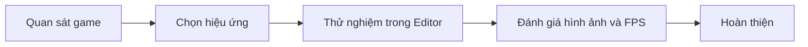

# Bài 01 — Introduction to Unit 6

> **Nguồn:** [Unity Learn — Visual Effects](https://learn.unity.com/pathway/game-development/unit/visual-effects?version=6.3). Tài liệu học tập tự biên soạn, không phải bản dịch hay nội dung chính thức của Unity.

## 1. Mục tiêu học tập

- Hiểu vai trò của chủ đề **Introduction to Unit 6** trong phát triển trò chơi.
- Thực hành một scene nhỏ có kết quả quan sát được.
- Kiểm tra lỗi bằng Inspector, Console và Play mode.

## 2. Kiến thức cơ sở

- **Scene** là không gian chứa GameObject.
- **Component** cung cấp dữ liệu và hành vi cho GameObject.
- **Particle System** cho phép tạo hiệu ứng như bụi, lửa, khói và phép thuật.
- **Emission**, **Shape**, **Lifetime** và **Renderer** ảnh hưởng đến cách hạt được phát, chuyển động và hiển thị.

## 3. Chuyên đề thực hành — Lộ trình học VFX

| Giai đoạn | Kết quả cần đạt |
|---|---|
| Khởi động | Hiểu vai trò VFX trong phản hồi trò chơi |
| Particle System | Tạo và tinh chỉnh hiệu ứng hạt CPU |
| VFX Graph | Làm quen quy trình hạt dựa trên GPU |
| Tích hợp | Gắn hiệu ứng vào sự kiện gameplay và kiểm tra hiệu năng |

**Sản phẩm đề xuất:** một scene thử nghiệm gồm lửa trại, hiệu ứng va chạm và một hiệu ứng phép thuật kích hoạt bằng phím.

## 4. Quy trình kiểm chứng

1. Xác định kết quả mong đợi trong Game view.
2. Tạo scene thử nghiệm, thay đổi từng tham số một.
3. Chạy Play mode, theo dõi Console và hiệu năng.
4. Chụp ảnh/video kết quả, giải thích một trường hợp lỗi và cách khắc phục.

## 5. Checklist hoàn thành

- [ ] Có scene hoặc project minh họa hoạt động.
- [ ] Giải thích được ít nhất ba khái niệm áp dụng.
- [ ] Có ảnh/video minh chứng.
- [ ] Có ghi chú lỗi và hướng kiểm tra.

*Lưu ý: Các thao tác và giao diện có thể khác giữa phiên bản Unity hoặc render pipeline.*
