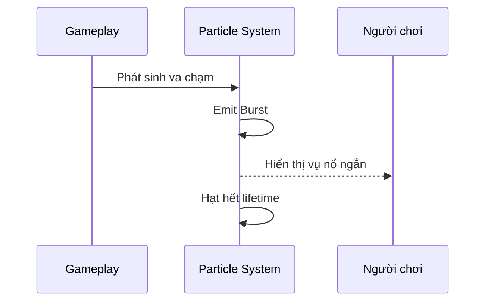

# Bài 05 — Create a burst particle

> **Nguồn:** [Unity Learn — Visual Effects](https://learn.unity.com/pathway/game-development/unit/visual-effects?version=6.3). Tài liệu học tập tự biên soạn, không phải bản dịch hay nội dung chính thức của Unity.

## 1. Mục tiêu học tập

- Hiểu vai trò của chủ đề **Create a burst particle** trong phát triển trò chơi.
- Thực hành một scene nhỏ có kết quả quan sát được.
- Kiểm tra lỗi bằng Inspector, Console và Play mode.

## 2. Kiến thức cơ sở

- **Scene** là không gian chứa GameObject.
- **Component** cung cấp dữ liệu và hành vi cho GameObject.
- **Particle System** cho phép tạo hiệu ứng như bụi, lửa, khói và phép thuật.
- **Emission**, **Shape**, **Lifetime** và **Renderer** ảnh hưởng đến cách hạt được phát, chuyển động và hiển thị.

## 3. Chuyên đề thực hành — Burst cho sự kiện tức thời

**Ví dụ: hiệu ứng khi vật thể bị phá hủy.**

1. Tạo Particle System tại vị trí va chạm.
2. Trong `Emission`, đặt `Rate over Time = 0` và cấu hình một `Burst` tại thời điểm bắt đầu.
3. Tắt `Looping` nếu muốn hiệu ứng chỉ chạy một lần; bật `Play On Awake` tùy cách kích hoạt.
4. Sử dụng `Size over Lifetime` và `Color over Lifetime` để tạo cảm giác bùng sáng rồi tan biến.
5. Đưa đối tượng vào Prefab để tái sử dụng cho nhiều sự kiện.

**Phân biệt:** Burst tạo số hạt theo một đợt, còn phát liên tục duy trì dòng hạt. Các giá trị phụ thuộc quy mô scene và mục tiêu thẩm mỹ.

## 4. Quy trình kiểm chứng

1. Xác định kết quả mong đợi trong Game view.
2. Tạo scene thử nghiệm, thay đổi từng tham số một.
3. Chạy Play mode, theo dõi Console và hiệu năng.
4. Chụp ảnh/video kết quả, giải thích một trường hợp lỗi và cách khắc phục.

## 5. Checklist hoàn thành

- [ ] Có scene hoặc project minh họa hoạt động.
- [ ] Giải thích được ít nhất ba khái niệm áp dụng.
- [ ] Có ảnh/video minh chứng.
- [ ] Có ghi chú lỗi và hướng kiểm tra.

*Lưu ý: Các thao tác và giao diện có thể khác giữa phiên bản Unity hoặc render pipeline.*
